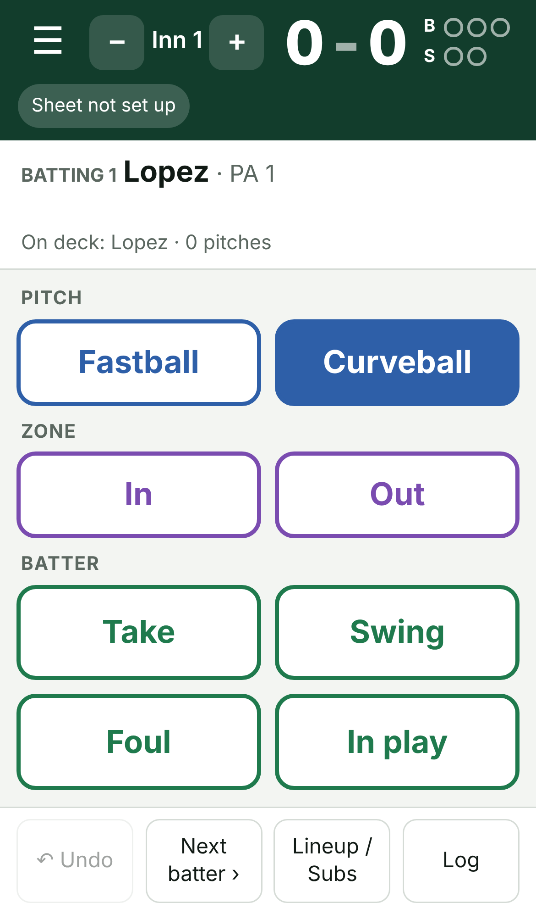

# PitchTracker

Record every pitch of a baseball game on an iPhone or iPad, even with no signal.
The data goes into a Google Sheet that other people can open, filter and build dashboards from.

 

## How it works

> **In-depth guide:** [docs/HOW-IT-WORKS.md](docs/HOW-IT-WORKS.md) explains the whole system from first principles, with links to every relevant line of code.

- **Three pads per pitch:** Pitch (Fastball / Curveball), Zone (In / Out) and Batter (Take / Swing / Foul / In play).
  The pitch is saved as soon as all three are chosen. Pads can be tapped in any order, and tapping a pad again unselects it.
- **The count updates automatically.** A take in the zone is a called strike and a take out of the zone is a ball.
  A swing is always a strike. A foul is a strike unless there are already two.
- **Next batter is automatic** on a walk (ball four), a strikeout (strike three) or a ball in play.
  Use **Next batter ›** by hand for anything else (hit by pitch, intentional walk…).
- **Lineup / Subs:** rename a lineup spot to make a substitution, change the pitcher, or pick the current batter to fix a mistake.
  A sub in the middle of a plate appearance keeps the count.
- **Undo** reverses the last action of any kind. An undone pitch stays in the sheet with `deleted = TRUE`.
- **Inning − / +** is set by hand and saved on each pitch.
- Outcomes (hit, out…) are **not** recorded. Join them later from the official play-by-play using `game_id` + `pa_number`.

## How your data is kept safe

1. Each pitch is written to the phone's storage *before* the screen updates (IndexedDB, strict durability).
2. The app asks iOS to treat its storage as persistent, and it must run from the Home Screen (it warns you otherwise).
3. Pitches upload as soon as there's signal. The app retries on reconnect, when you reopen it, and every 30 s.
   Every pitch has a unique id and the sheet *updates* rows by id, so resending never creates duplicates.
4. The badge at the top always shows the state: **✓ All synced** or **⚠ N not uploaded**.
5. Nothing is deleted from the phone after it uploads.
6. **☰ → Back up game (file)** saves a full backup through the share sheet (Files / iCloud Drive / AirDrop / email), with no signal needed.
   **Import backup** on the home screen restores it and uploads anything the sheet is missing.

## Setup

### 1. Host the app (GitHub Pages, free)

On GitHub: **Settings → Pages → Build and deployment → Deploy from a branch → `main` / `(root)` → Save**.
After a minute the app is live at `https://<your-user>.github.io/PitchTracker/`.

### 2. Connect the Google Sheet

1. Create a new Google Sheet, then go to **Extensions → Apps Script**.
2. Delete the sample code and paste in everything from [`apps-script/Code.gs`](apps-script/Code.gs). Save.
3. Choose the **`setup`** function in the toolbar and click **Run**. Approve the permissions: it's your own script, so click
   *Advanced → Go to project* if Google warns you.
   This creates the **Pitches** and **Summary** tabs. Open **Execution log** and copy the **TOKEN**.
4. **Deploy → New deployment** → gear icon → **Web app**. Set *Execute as*: **Me**, *Who has access*: **Anyone**. Click **Deploy** and copy the **Web app URL** (it ends in `/exec`).
5. Open the app's URL in **Safari** → **Settings**, paste the URL and token, **Save**, then **Test connection**.

"Anyone" means anyone with the URL can reach the script. Writes are refused without the token.
Share the *sheet* with viewers as usual. They never need the URL or the token.

If you change `Code.gs` later, use **Deploy → Manage deployments → Edit → New version** so the URL stays the same.

### 3. Install it on the iPhone / iPad

1. **After** connecting in step 2, the app's home screen in Safari shows *Install on this phone*. Tap **Copy setup link**.
2. Tap **Share → Add to Home Screen**.
3. Open the new icon. If it isn't already connected, tap **Paste & connect** (and **Paste** in the bubble iOS shows).

From then on, always open it from the Home Screen icon.

Why the copy step: on iPhone an app added to the Home Screen gets its own, empty storage, separate from Safari's, so
the connection has to be carried over. The app also tries to carry it in the page address, but iOS doesn't always keep it;
the clipboard always works.

**Android** (Chrome, Samsung Internet, Edge): connect the sheet in the browser first, then tap **Install app** on the
app's home screen (or browser menu **⋮ → Install app / Add to Home screen**). On Android the installed app shares the
browser's storage, so it's already connected; there is no copy-and-paste step. The phone's Back button returns from a
game to the games list.

### 4. Add other people

- **Viewers** don't need the app. In Google Sheets, use **Share → Anyone with the link → Viewer** and send them the sheet link.
- **Other recorders:** in the app, go to **Settings → Share setup link** and send that link (text, WhatsApp, email).
  On iPhone they open it in Safari, tap **Copy setup link**, **Add to Home Screen**, then **Paste & connect** in the new app. On Android they open it and tap **Install app**. Pitches go into the same sheet,
  and the `recorded_by` column shows who recorded each one (from **Settings → Your name**, or a device id).
  If the installed app ever opens without a connection, it shows a box to paste the setup link into.
- The setup link contains the token, so only send it to people you want writing to the sheet. To shut everyone out, run `setup` again
  after deleting the `TOKEN` script property (Project Settings → Script properties). That creates a new token; then share a new link.

### 5. Dashboard

- The **Summary** tab has starter pivots: pitches by pitcher and type, batter action by pitch type, and zone by pitch type.
- For a proper dashboard, use [Looker Studio](https://lookerstudio.google.com): **Create → Data source → Google Sheets → Pitches tab**.
  Add a filter `deleted = false`.

## Sheet columns

| column | meaning |
|---|---|
| `id` | unique pitch id |
| `game_id` | entered at game setup |
| `recorded_at` | when the pitch was entered |
| `inning` | from the − / + control |
| `pa_number` | plate appearance number in the game (1, 2, 3…) |
| `pitch_number` / `pitch_in_pa` | pitch number in the game / in the plate appearance |
| `lineup_slot`, `batter_number`, `batter` | the batter |
| `pitcher`, `pitcher_pitch_count` | the pitcher and their pitch count including this pitch |
| `balls_before`, `strikes_before` | count before the pitch |
| `pitch_type` | `FB` / `CB` |
| `zone` | `IN` / `OUT` |
| `action` | `TAKE` / `SWING` / `FOUL` / `IN_PLAY` |
| `result` | `ball`, `called_strike`, `swinging_strike`, `foul`, `in_play` |
| `pa_end` | `walk`, `strikeout`, `in_play` or empty |
| `deleted` | TRUE if undone in the app |
| `recorded_by` | the recorder's name from Settings, or `device-xxxxxx` |
| `synced_at` | when the sheet last received the row |

## Development

No build step and no dependencies: plain HTML, CSS and JavaScript modules.

```bash
npm test                      # game-logic unit tests (Node 18+)
python3 -m http.server 8000   # then open http://localhost:8000
```

```bash
node tests/e2e.cjs /tmp/shots   # browser test; needs Playwright and the server above on port 8765
```

| file | role |
|---|---|
| `js/game.js` | count, plate-appearance and lineup rules (pure, unit-tested) |
| `js/db.js` | local storage (IndexedDB). The only file to swap for SQLite if wrapped as a native app with Capacitor |
| `js/sync.js` | upload queue to the Google Sheet |
| `js/backup.js` | export/import of backup files and CSV |
| `js/connect.js` | setup links (`#connect=…`) |
| `js/app.js` | screens and UI |
| `sw.js` | offline caching. **Bump `VERSION` whenever any app file changes**, or installed copies keep the old files |
| `apps-script/Code.gs` | the Google Sheets receiver |
