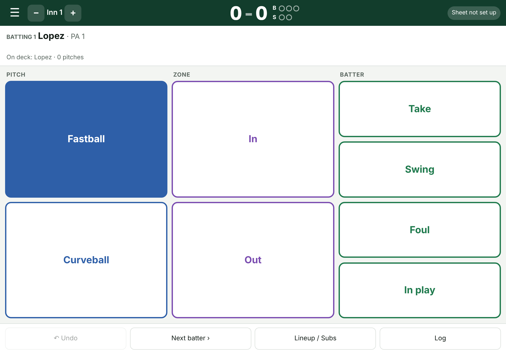

# PitchTracker

Record every pitch of a baseball game on an iPhone or iPad, even with no signal.
The data goes into a Google Sheet that other people can open, filter and build dashboards from.

 

## How it works

> **In-depth guide:** [docs/HOW-IT-WORKS.md](docs/HOW-IT-WORKS.md) explains the whole system from first principles, with links to every relevant line of code.

- **Three pads per pitch:** Pitch (Fastball / Curveball), Zone (In / Out) and Batter (Take / Swing / Foul / In play).
  The pitch is saved as soon as all three are chosen. Pads can be tapped in any order, and tapping a pad again unselects it.
- **The count updates automatically.** A take in the zone is a called strike and a take out of the zone is a ball.
  A swing is always a strike. A foul is a strike unless there are already two.
- **Both teams.** Enter the away and home lineups (or leave the opponent blank: they become *Batter 1–9*) and each team's pitcher.
  The away team bats in the top of each inning, the home team in the bottom; each keeps its own place in the order and its own pitch count.
- **Ball in play → outcome pads.** After *In play* the pads turn into a decision tree of big buttons:
  **Hit** (single / double / triple / home run), **Out** (ground / line / fly out, double play), **Fielder's choice**,
  **Sac** (bunt / fly) or **Error** (on a grounder / liner / fly), then **where the ball went** (P, C, 1B … RF, or Skip).
  **‹ Back** goes up a level. Each result is saved as a row in the **PlateAppearances** tab.
- **Outs and half-innings are automatic.** Strikeouts, outs, sacs and fielder's choices add one out, a double play two.
  At three outs the other team comes up. Use **Outs − / +** for anything else (caught stealing, pickoff, a runner thrown out on a hit)
  and **Inning − / +** (one half-inning per tap) to correct.
- **Next batter is automatic** on a walk, a strikeout or a ball in play. **Next batter ›** asks why:
  *Hit by pitch*, *Intentional walk*, *Catcher's interference*, *Out by rule* (adds an out) or *Other / correction* (records nothing).
- **Lineup / Subs:** rename a lineup spot (either team) to make a substitution, change either pitcher, or pick the current batter to fix a mistake.
  A sub in the middle of a plate appearance keeps the count.
- **Undo** reverses the last action of any kind. An undone pitch or result stays in the sheet with `deleted = TRUE`.

## How your data is kept safe

1. Each pitch is written to the phone's storage *before* the screen updates (IndexedDB, strict durability).
2. The app asks iOS to treat its storage as persistent, and it must run from the Home Screen (it warns you otherwise).
3. Pitches upload as soon as there's signal. The app retries on reconnect, when you reopen it, and every 30 s.
   Every pitch has a unique id and the sheet *updates* rows by id, so resending never creates duplicates.
4. The badge at the top always shows the state: **✓ All synced** or **⚠ N not uploaded**.
5. Nothing is deleted from the phone after it uploads.
6. **☰ → Back up game (file)** saves a full backup through the share sheet (Files / iCloud Drive / AirDrop / email), with no signal needed.
   **Import backup** on the home screen restores it and uploads anything the sheet is missing.

## Setup

### 1. Host the app (GitHub Pages, free)

On GitHub: **Settings → Pages → Build and deployment → Deploy from a branch → `main` / `(root)` → Save**.
After a minute the app is live at `https://<your-user>.github.io/PitchTracker/`.

### 2. Connect the Google Sheet

1. Create a new Google Sheet, then go to **Extensions → Apps Script**.
2. Delete the sample code and paste in everything from [`apps-script/Code.gs`](apps-script/Code.gs). Save.
3. Choose the **`setup`** function in the toolbar and click **Run**. Approve the permissions: it's your own script, so click
   *Advanced → Go to project* if Google warns you.
   This creates the **Pitches**, **PlateAppearances**, **Summary** and **Rosters** tabs. Open **Execution log** and copy the **TOKEN**.
4. **Deploy → New deployment** → gear icon → **Web app**. Set *Execute as*: **Me**, *Who has access*: **Anyone**. Click **Deploy** and copy the **Web app URL** (it ends in `/exec`).
5. Open the app's URL in **Safari** → **Settings**, paste the URL and token, **Save**, then **Test connection**.

"Anyone" means anyone with the URL can reach the script. Writes are refused without the token.
Share the *sheet* with viewers as usual. They never need the URL or the token.

If you change `Code.gs` later, use **Deploy → Manage deployments → Edit → New version** so the URL stays the same. Or set up
[automatic script updates](#automatic-script-updates-optional) once and skip this.

#### Automatic script updates (optional)

A GitHub Action ([`.github/workflows/deploy-apps-script.yml`](.github/workflows/deploy-apps-script.yml)) can deploy
`Code.gs` for you every time it changes on `main`, as a new version of your **existing** deployment, so the URL and
setup links stay the same. From then on the repo is the source of truth: edits made in the Apps Script editor get
overwritten on the next deploy.

One-time setup:

1. Turn on **Google Apps Script API** at <https://script.google.com/home/usersettings>.
2. On a computer with Node.js, run `npx @google/clasp@3.4.1 login` and allow access in the browser. This creates a
   file called `.clasprc.json` in your home folder.
3. Find two IDs in the Apps Script editor:
   - **Script ID**: ⚙ **Project Settings** → *IDs*.
   - **Deployment ID**: **Deploy → Manage deployments** → your web app (it's the middle of the `/exec` URL).
4. On GitHub: **Settings → Environments → New environment**, name it `apps-script`. Under *Deployment branches and
   tags* choose **Selected branches and tags** and add `main`. Then add three **environment secrets**:

   | Secret | Value |
   |---|---|
   | `CLASPRC_JSON` | The whole contents of `.clasprc.json` |
   | `APPS_SCRIPT_ID` | The script ID |
   | `APPS_SCRIPT_DEPLOYMENT_ID` | The deployment ID |

5. **Actions → Deploy Apps Script → Run workflow** to deploy the current `Code.gs` once and check it works.

The repo is public, but none of this is visible: secret values never show in the repo or the logs, and only workflows
running on `main` can read them (not other branches, not pull requests from forks). The script still refuses uploads
without the token, which never goes in the repo. Treat `CLASPRC_JSON` like a password: it can edit all your Apps
Script projects. To cut it off, remove clasp's access at <https://myaccount.google.com/permissions> and delete the
secret.

The Action only replaces `Code.gs`, and stops without changing anything if your script project has other files. At
the end it checks the live script reports the new `VERSION`. You don't need to run `setup` after a deploy: if the
columns changed, the first upload (or **Test connection**) moves the existing rows into the new layout by itself,
after keeping a copy of the old tab. If it starts failing with an authentication error, repeat step 2 and update
`CLASPRC_JSON`.

**Updating the script:** deploy the new `Code.gs` (automatically, see above, or paste it and use *Manage deployments →
Edit → New version*). Nothing else to do: when the columns change, the first upload after the deploy keeps a copy of
the old tab (*Pitches (before update …)*) and moves the existing rows into the new columns. Until the new script is
live, the app keeps everything on the phone and shows *the sheet script is out of date*; nothing is lost.

### 3. Install it on the iPhone / iPad

1. **After** connecting in step 2, the app's home screen in Safari shows *Install on this phone*. Tap **Copy setup link**.
2. Tap **Share → Add to Home Screen**.
3. Open the new icon. If it isn't already connected, tap **Paste & connect** (and **Paste** in the bubble iOS shows).

From then on, always open it from the Home Screen icon.

Why the copy step: on iPhone an app added to the Home Screen gets its own, empty storage, separate from Safari's, so
the connection has to be carried over. The app also tries to carry it in the page address, but iOS doesn't always keep it;
the clipboard always works.

**Android** (Chrome, Samsung Internet, Edge): connect the sheet in the browser first, then tap **Install app** on the
app's home screen (or browser menu **⋮ → Install app / Add to Home screen**). On Android the installed app shares the
browser's storage, so it's already connected; there is no copy-and-paste step. The phone's Back button returns from a
game to the games list.

### 4. Add other people

- **Viewers** don't need the app. In Google Sheets, use **Share → Anyone with the link → Viewer** and send them the sheet link.
- **Other recorders:** in the app, go to **Settings → Share setup link** and send that link (text, WhatsApp, email),
  or, in person, tap **Show QR code** and let them scan it with their phone's **Camera** app (it disappears after 60 seconds).
  Before connecting, their phone shows a **sheet code** (like `K7Q-X2M`); check it matches the one in your Settings.
  On iPhone they open it in Safari, tap **Copy setup link**, **Add to Home Screen**, then **Paste & connect** in the new app. On Android they open it and tap **Install app**. Pitches go into the same sheet,
  and the `recorded_by` column shows who recorded each one (from **Settings → Your name**, or a device id).
  If the installed app ever opens without a connection, it shows a box to paste the setup link into.
- The setup link and QR code contain the token, so only send it to people you want writing to the sheet. To shut everyone out, run `setup` again
  after deleting the `TOKEN` script property (Project Settings → Script properties). That creates a new token; then share a new link.

### 5. Team rosters (optional)

The **Rosters** tab has 5 blocks side by side, one per team. In each block, type the team name next to **Team** and list
the players below (**#** and **Name**), up to 40 per team. To add a sixth team, copy a whole block
to the right. Sheets set up before rosters existed get the tab the first time the app asks for rosters.

On **New game**, the app downloads the rosters (and keeps a copy for when there's no signal; **↻ Rosters** fetches them
again). Choose a team's roster and tap players into the batting order, pick the starting pitcher, then **Use lineup**.
Names are then spelled exactly as in the sheet, so the Summary counts each player in one place. Typing still works:
a roster name fixes its spelling and fills the number, and a roster number fills the name. During the game,
**Lineup / Subs** suggests the same roster's bench players.

A game keeps its own copy of the roster it started with, so editing the Rosters tab never changes games already recorded.
Rosters need script version 4 or later. Uploading pitches works with older scripts too.

### 6. Dashboard

- The **Summary** tab has starter pivots: pitches by pitcher and type, batter action by pitch type, zone by pitch type,
  ball-in-play results by pitch type, results by batter and results against each pitcher.
- For a proper dashboard, use [Looker Studio](https://lookerstudio.google.com): **Create → Data source → Google Sheets → Pitches tab**.
  Add a filter `deleted = false`. Add the **PlateAppearances** tab as a second source for results.

## Sheet columns

**Pitches** (one row per pitch):

| column | meaning |
|---|---|
| `id` | unique pitch id |
| `game_id` | entered at game setup |
| `recorded_at` | when the pitch was entered |
| `inning`, `half` | inning and `top` / `bottom` |
| `batting_team`, `pitching_team` | team names from setup |
| `outs_before` | outs when the pitch was thrown |
| `pa_number` | plate appearance number in the game (1, 2, 3…, both teams together) |
| `pitch_number` / `pitch_in_pa` | pitch number in the game / in the plate appearance |
| `lineup_slot`, `batter_number`, `batter` | the batter |
| `pitcher`, `pitcher_pitch_count` | the pitcher and their pitch count including this pitch |
| `balls_before`, `strikes_before` | count before the pitch |
| `pitch_type` | `FB` / `CB` |
| `zone` | `IN` / `OUT` |
| `action` | `TAKE` / `SWING` / `FOUL` / `IN_PLAY` |
| `result` | `ball`, `called_strike`, `swinging_strike`, `foul`, `in_play` |
| `pa_end` | `walk`, `strikeout`, `in_play` or empty |
| `pa_result` | on the last pitch of a plate appearance: its result code (`K`, `BB`, `2B`, `GO`…) |
| `deleted` | TRUE if undone in the app |
| `recorded_by` | the recorder's name from Settings, or `device-xxxxxx` |
| `synced_at` | when the sheet last received the row |

**PlateAppearances** (one row per finished plate appearance), with the same `id` … `pitcher` situation columns plus:

| column | meaning |
|---|---|
| `pitches` | pitches in the plate appearance |
| `balls`, `strikes` | the count on the last pitch |
| `result` | `1B` `2B` `3B` `HR` · `GO` `LO` `FO` `DP` · `FC` · `SAC_BUNT` `SAC_FLY` · `E_GROUND` `E_LINE` `E_FLY` · `K` `BB` · `HBP` `IBB` `CI` `OUT_RULE` |
| `result_label` | the same in words (`Double`, `Fly out`…) |
| `category` | `hit`, `out`, `fc`, `sac`, `error`, `strikeout`, `walk`, `hbp`, `interference` |
| `batted_ball` | `ground`, `line`, `fly`, `bunt` where the choice says so |
| `fielder` | `P` `C` `1B` `2B` `3B` `SS` `LF` `CF` `RF`, or empty if skipped |
| `outs_on_play` | outs the app counted for the play |
| `deleted`, `recorded_by`, `synced_at` | as above |

## Development

No build step and no dependencies: plain HTML, CSS and JavaScript modules.

```bash
npm test                      # game-logic, sheet-script and setup-link unit tests (Node 18+)
python3 -m http.server 8000   # then open http://localhost:8000
```

```bash
node tests/e2e.cjs /tmp/shots   # browser test; needs Playwright and the server above on port 8765
```

| file | role |
|---|---|
| `js/game.js` | count, outs, half-inning, outcome and lineup rules for both teams (pure, unit-tested) |
| `js/db.js` | local storage (IndexedDB). The only file to swap for SQLite if wrapped as a native app with Capacitor |
| `js/sync.js` | upload queue to the Google Sheet |
| `js/backup.js` | export/import of backup files and CSV |
| `js/connect.js` | setup links (`#connect=…`) |
| `js/roster.js` | cleaning up and matching roster players |
| `js/app.js` | screens and UI |
| `sw.js` | offline caching. **Bump `VERSION` whenever any app file changes**, or installed copies keep the old files |
| `apps-script/Code.gs` | the Google Sheets receiver |
