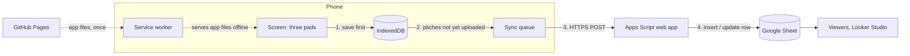
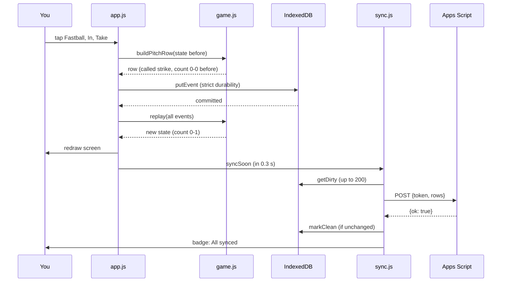

# How PitchTracker works

*A guide that starts from zero and ends at every line that matters. Written 16 November 2026.*

**Reading the code:** every file and function named in this guide links to it in this repository. Links with a line number open the file with that line highlighted. Line numbers are as of 16 November 2026 and can drift a few lines as the code changes. Section 15 has the full file list.

**How to read this:** sections 1–3 are for anyone; you need no programming background. Sections 4 onwards go deep into one part each and can be read in any order. If you only want to know "can I lose data?", read sections 1, 5.1 and 13.

---

## Contents

1. [The big picture](#1-the-big-picture)
2. [The basic ideas, from zero](#2-the-basic-ideas-from-zero)
3. [One pitch, step by step](#3-one-pitch-step-by-step)
4. [The game rules in code](#4-the-game-rules-in-code)
5. [Storage on the phone](#5-storage-on-the-phone)
6. [Sync: getting pitches to the sheet](#6-sync-getting-pitches-to-the-sheet)
7. [The Google side: Apps Script and the sheet](#7-the-google-side-apps-script-and-the-sheet)
8. [Setup links](#8-setup-links)
9. [Backups and CSV](#9-backups-and-csv)
10. [Working offline: the service worker](#10-working-offline-the-service-worker)
11. [The screens and the layout](#11-the-screens-and-the-layout)
12. [Security and privacy](#12-security-and-privacy)
13. [What happens when things go wrong](#13-what-happens-when-things-go-wrong)
14. [Limits and things not built yet](#14-limits-and-things-not-built-yet)
15. [Testing, changing and releasing](#15-testing-changing-and-releasing)
16. [Glossary](#16-glossary)

---

## 1. The big picture

PitchTracker is a website that behaves like an app. You open it once in Safari, add it to the Home Screen, and from then on it opens full-screen from its own icon, works with no signal, and keeps every pitch on the phone until it has safely reached a Google Sheet.

It is about 1,100 lines of plain JavaScript plus about 280 lines of HTML and CSS, and 114 lines of Google Apps Script. There is **no server of our own**: nothing is rented, nothing has to be kept switched on, and nothing costs money. There are no outside libraries; everything the app does is written in this repository.

### 1.1 The moving parts

| Part | What it is | What it does |
|---|---|---|
| **The phone** | An iPhone, iPad or Android phone running Safari or Chrome | Runs the app. All the logic happens here, not on a server |
| **The app files** | [`index.html`](../index.html), [`css/app.css`](../css/app.css), the files in [`js/`](../js), the icons | The program itself. Downloaded once, then kept on the phone |
| **GitHub Pages** | GitHub's free hosting for static files | Hands out the app files at `https://pmiquelm.github.io/PitchTracker/`. It never sees any pitch data |
| **IndexedDB** | A small database built into every browser | Stores games, lineups and every pitch on the phone ([`js/db.js`](../js/db.js)) |
| **The service worker** | A small script the browser keeps beside the app ([`sw.js`](../sw.js)) | Keeps a copy of the app files so the app opens with no signal |
| **Apps Script** | Google's way of attaching a small program to a Google Sheet ([`apps-script/Code.gs`](../apps-script/Code.gs)) | Receives pitches from phones and writes them into the sheet |
| **The Google Sheet** | A normal spreadsheet in your Google Drive | Holds one row per pitch. People view it, filter it, chart it |
| **Looker Studio** (optional) | Google's free dashboard tool | Turns the sheet into a dashboard |

### 1.2 The life of a pitch, in one paragraph

You tap **Fastball**, **In** and **Take**. The phone works out that this was a called strike, updates the count, and **writes the pitch into its own database before showing you anything**. A fraction of a second later, if there is signal, it sends that pitch to your Apps Script address on Google's servers. The script checks a password-like token, finds or adds the right row in the **Pitches** tab, and answers "ok". Only then does the phone mark the pitch as uploaded. If there is no signal, the pitch waits on the phone and goes up on its own the next time there is.



### 1.3 Who can do what

| Person | Needs | Can |
|---|---|---|
| **You (the owner)** | The Google account that owns the sheet | Everything: record, see all data, change the script, cut off access |
| **A recorder** | The setup link (section 8) | Add pitches to your sheet from their phone. Cannot read the sheet unless you also share it |
| **A viewer** | The sheet shared with them (view only) | Read the data and dashboards. Never touches the app |

---

## 2. The basic ideas, from zero

Everything later builds on twelve ideas. If you already know them, skip ahead.

### 2.1 Requests and responses

The web is a conversation of short messages. Your browser sends a **request** ("please give me the file `app.js`") and a computer somewhere sends back a **response** ("here it is"). Each request stands alone.

A request has:

- a **method**: `GET` means "give me something", `POST` means "here is some information I'm sending you";
- a **URL**: the address, like `https://pmiquelm.github.io/PitchTracker/js/app.js`;
- **headers**: small labelled notes, like `Content-Type: text/plain`;
- sometimes a **body**: the information being sent. For PitchTracker that is a batch of pitches.

A response has a **status code** (200 = OK, 302 = "look over there instead", 403 = not allowed, 404 = not found, 500 = the other side broke), headers, and a body.

PitchTracker makes exactly two kinds of request: `GET`s to GitHub Pages for the app's own files (only when installing or updating), and `POST`s to Google to upload pitches.

### 2.2 Static hosting: why there is no server

Most websites with a database have a server: a computer that runs code for every visitor and owns the data. PitchTracker deliberately doesn't. GitHub Pages is **static hosting**: it can only hand out files exactly as they are in the repository. It cannot run code, store anything or tell visitors apart.

That works here because all the thinking happens **on the phone**: the browser downloads the program and runs it locally. The only "server" is Google's Apps Script, and it does one tiny job: write rows into the sheet.

Consequences:

- **Free and nearly maintenance-free**: no machine to patch, no bill.
- **Fast at the field**: every tap is handled on the phone, so it doesn't matter how bad the signal is.
- **The code is public.** GitHub Pages on a free account requires a public repository, so anyone can read the app's code. That's fine: no secret lives in the code (section 12).

### 2.3 HTML, CSS and JavaScript

A web page is made of three languages:

- **HTML** describes *what is on the page*. [`index.html`](../index.html) is nearly empty: a `<div id="app">` box that JavaScript fills in, a box for pop-up messages, and links to the other files.
- **CSS** describes *how it looks*: colours, sizes, the grid of pads. All of it is in [`css/app.css`](../css/app.css).
- **JavaScript** is the *program*: what happens when you tap. It's split into **modules**, files that `import` from each other:

| Module | Job | Knows about |
|---|---|---|
| [`js/game.js`](../js/game.js) | The baseball rules: count, plate appearances, lineup | Nothing else: pure logic, no screen, no storage |
| [`js/db.js`](../js/db.js) | Reading and writing the phone's database | Only IndexedDB |
| [`js/sync.js`](../js/sync.js) | Uploading to Google | `db.js` |
| [`js/backup.js`](../js/backup.js) | Backup files and CSV | `db.js`, `game.js` |
| [`js/connect.js`](../js/connect.js) | Setup links | Nothing else |
| [`js/app.js`](../js/app.js) | The screens, buttons and startup | All of the above |

Keeping the rules (`game.js`) apart from the screen and storage is what lets them be tested on their own (section 15), and what would let the storage be swapped for something else later (section 5.7).

### 2.4 The browser as a small computer

A modern browser is a full computer inside the phone. It can run programs, store data, work offline and draw anything. A web app gets most of what a "real" app gets, with some rules the phone's maker imposes. On iPhone those rules are Apple's, and they matter (2.8).

### 2.5 Storing data in the browser: IndexedDB

A browser offers web pages a few places to keep data:

- **localStorage**: a tiny notepad of text values. Simple, but slow for lots of data, and it can't be written to reliably in one safe step.
- **IndexedDB**: a real database built into the browser. It stores whole objects (a pitch, a game), can look them up by fields, and supports **transactions**.

PitchTracker uses IndexedDB for everything.

A **transaction** is a bundle of reads and writes that happens *completely or not at all*. If the phone dies halfway through, the database comes back as it was before the transaction, never half-written. When a transaction **completes**, the data is saved.

**Durability** is how hard the browser tries to make "saved" mean "on the disk". By default some browsers say "done" once the data is in memory and write it to disk a moment later, which is faster but could lose the last second if the phone dies. PitchTracker asks for `durability: 'strict'` ([`js/db.js:7`](../js/db.js#L7)), meaning "don't tell me it's done until it's on disk". For a pitch, being safe matters more than a millisecond.

Each website gets its **own** IndexedDB, keyed by its address (its *origin*, 2.9). Data from `pmiquelm.github.io` is invisible to every other site.

### 2.6 Offline: the service worker and its cache

Normally, opening a website means downloading its files. With no signal, that fails.

A **service worker** is a small script a site can install into the browser. It sits *between the app and the network*. Every time the app asks for a file, the service worker can answer from its own **cache** (a stored copy) instead of going to the internet. PitchTracker's service worker ([`sw.js`](../sw.js)) stores a copy of every app file the first time you open the app, and from then on always answers from that copy. That's why the app opens in a stadium with no signal at all. Section 10 has the details.

### 2.7 PWAs: websites that install like apps

A **Progressive Web App (PWA)** is a website with three extra things:

1. a **manifest** ([`manifest.webmanifest`](../manifest.webmanifest)): a small file giving the app's name, icon, colours and "open full-screen". It can also fix the address the installed app always opens at (`start_url`). PitchTracker's deliberately leaves that out (8.4);
2. a **service worker** (2.6);
3. served over **HTTPS**.

With those, **Add to Home Screen** gives the site its own icon. It then opens without Safari's address bar, looking and feeling like an app. No App Store, no review, no yearly fee, and updates arrive by just changing the files on GitHub.

### 2.8 Apple's rules for web apps on iPhone

These rules shaped several design decisions:

- **The 7-day rule.** Safari deletes a website's stored data if you haven't visited it for 7 days. Apps added to the Home Screen are **exempt**: their data stays. That is why the app nags you to install it ([`installNoticeHTML`](../js/app.js#L185)).
- **Space pressure.** If the phone is almost full, iOS may clear data from websites that haven't been granted **persistent storage**. The app asks for it on every launch with `navigator.storage.persist()` ([`js/db.js:45`](../js/db.js#L45)). Settings shows whether it was granted.
- **Separate storage.** A Home Screen app has its **own** storage, separate from Safari's, and it starts **empty**. Something saved while the page is open in Safari isn't visible to the installed app, and vice versa. This is why setup links are built the way they are (section 8.4), and why the backup/import buttons exist.
- **No reliable background work.** iOS doesn't let web apps upload in the background after you close them. Uploads happen while the app is open (section 6.2).

**Android is simpler.** Chrome (and Samsung Internet, Edge) on Android installs a web app properly: it offers *Install app*, and the installed app **shares the browser's storage**, so whatever was set up in the browser (including the sheet connection) is already there. Persistent storage is normally granted to installed apps, and there is no 7-day rule for them. The app catches Chrome's install offer and shows its own **Install app** button ([`installNoticeHTML`](../js/app.js#L185)). Android also has a system **Back** button, which in an installed web app would normally close it; during a game the app turns Back into "return to the games list" instead (11.2).

### 2.9 Origins and CORS

An **origin** is the scheme + host + port of an address: `https://pmiquelm.github.io` is one origin, `https://script.google.com` is another. Browsers keep origins apart for safety: a page from one origin can't freely read responses from another. This rule is called the **same-origin policy**, and the system of exceptions is **CORS** (Cross-Origin Resource Sharing).

When the app (origin A) posts pitches to Google (origin B), the browser checks whether B allows it. For "complicated" requests (custom headers, JSON content type) the browser first sends a separate **preflight** request (`OPTIONS`) asking permission. Apps Script web apps don't answer preflights. So the app sends a "simple" request: a `POST` with no custom headers, whose body is JSON text but labelled `text/plain`. Simple requests skip the preflight, and Apps Script's response comes back readable ([`js/sync.js:40`](../js/sync.js#L40)).

### 2.10 JSON

**JSON** is the standard way to write data as text: `{"pitch_type": "FB", "zone": "IN", "balls_before": 1}`. Curly braces hold named fields, square brackets hold lists. The app sends pitches to Google as JSON and saves backups as JSON.

### 2.11 Unique IDs and "doing it twice is safe"

Every pitch gets a **UUID** when it's recorded: a random 128-bit number written like `3f1c9a2e-7b4d-4c1e-9f0a-2b6d8e1c5a47`. The chance of two ever being the same is effectively zero, so no central counter is needed. Each phone makes its own.

This makes uploads **idempotent**: doing the same thing twice has the same effect as doing it once. If a phone sends a pitch, the sheet saves it, but the "ok" answer is lost (signal drops at the wrong moment), the phone doesn't know it worked and sends it again. The script sees the same ID already in the sheet and **updates that row instead of adding a new one** (an *upsert*: update or insert). Retrying is therefore always safe, which is what lets the app retry aggressively.

### 2.12 An event log and "replay"

The app doesn't store "the count is 2–1, batter 4 is up". It stores **what happened**, in order: a list of **events**:

```
1. pitch      FB · OUT · TAKE
2. pitch      CB · IN  · FOUL
3. sub        slot 4 → Park #33
4. pitch      FB · IN  · SWING
5. inning     +1
...
```

To know the current state, it starts from the beginning of the game and **replays** every event through the rules. This idea is called *event sourcing*. It sounds wasteful, but a whole game is a few hundred events and replaying takes well under a millisecond. In return:

- **Undo is trivial and always correct**: mark the last event as undone, replay. No special "reverse a strikeout" code.
- **The state can never drift** from what was recorded: there is only one source of truth, the log.
- The log *is* the backup: export it and you can rebuild everything.

---

## 3. One pitch, step by step

This follows a real sequence through the code, from opening the app to the row appearing in the sheet.



### 3.1 Opening the app: `boot`

When the app opens, the browser loads `index.html`, which loads `js/app.js`. The last line of that file calls [`boot`](../js/app.js#L811), which:

1. **Registers the service worker** so app files get cached (section 10).
2. **Asks for persistent storage** ([`requestPersistence`](../js/db.js#L45)).
3. **Loads the settings** (sheet address, token, your name) into memory, and gives this phone a random **device ID** the first time.
4. **Checks the address for a setup link** (`#c=…`, or `#connect=…` in old links) and applies it if it's new ([line 828](../js/app.js#L828), section 8).
5. **In a browser tab only:** if the phone is connected but the address doesn't hold the setup link yet, puts it there and reloads once ([line 829](../js/app.js#L829), section 8.4). Inside the installed app this step does nothing.
6. **Starts the sync engine** ([`initSync`](../js/sync.js#L83)), which immediately tries to upload anything left over.
7. **Shows the home screen** ([`showHome`](../js/app.js#L114)): the list of games, sorted newest first.

### 3.2 Starting a game: `showSetup`

**New game** opens [`showSetup`](../js/app.js#L221): a game ID (pre-filled with today's date), an optional starting pitcher, and nine lineup rows of number + name. On **Start game**, the form is read, empty rows are skipped, and a **game record** is saved:

```json
{
  "key": "8d0f…",            // internal UUID, never shown
  "gameId": "2026-11-16-HOME", // what you typed; goes in every row
  "pitcher": "Garcia",
  "lineup": [{"number": "10", "name": "Lopez"}, …],
  "createdAt": 1794869000000
}
```

The game has two identifiers on purpose. `gameId` is yours: readable, and used to match the official stats later. `key` is the app's: guaranteed unique even if you type the same game ID twice, and used internally to group events.

### 3.3 The tracker screen: `showTracker` and `renderTracker`

[`showTracker`](../js/app.js#L269) loads the game and **all of its events** from IndexedDB, then runs `replay` (2.12) to compute the current state: count, batter, inning, pitch counts. [`renderTracker`](../js/app.js#L313) then draws the whole screen from that state: the count and dots, the batter bar, the three groups of pads, and the bottom buttons.

### 3.4 Tapping the pads: `handleTrackerClick`

Each tap goes to [`handleTrackerClick`](../js/app.js#L358). For a pad, it records your choice in a small variable `sel` (one choice per group; tapping a selected pad again clears it). When all three groups have a choice ([line 365](../js/app.js#L365)), it clears `sel` and calls `recordPitch`.

Taps are handled **one at a time, in order** ([line 352](../js/app.js#L352)): each tap waits for the previous one to finish. Without that, a very fast double tap could start two saves at once and they could interleave.

### 3.5 Saving the pitch: `recordPitch` and `addEvent`

[`recordPitch`](../js/app.js#L391) calls [`addEvent`](../js/app.js#L284), the single place where anything gets recorded. For a pitch it:

1. Creates the event: a new UUID, the game key, a sequence number (one more than the highest so far), the type `pitch`, your three choices, and a timestamp.
2. Builds the **sheet row** with [`buildPitchRow`](../js/game.js#L139) ([line 290](../js/app.js#L290)). The row is computed from the state *before* the pitch: who was batting, the count before, pitch number in the at-bat, and so on. Then it stamps `recorded_by` (your name or device ID).
3. Marks it `dirty: 1` ("not uploaded yet").
4. **Writes it to IndexedDB and waits until the write is on disk** ([line 294](../js/app.js#L294)). This is the most important line in the app. Nothing on screen changes until it has finished.
5. Adds it to the in-memory list and replays to get the new state.

Then `recordPitch` writes the "Last: …" line (e.g. *Last: Fastball · In · Take → Called strike*), refreshes the not-uploaded count, and asks sync to run in 0.3 seconds. The screen redraws with the new count, or the next batter if the at-bat ended.

### 3.6 The upload: `syncNow`

0.3 seconds later [`syncNow`](../js/sync.js#L52) runs. In short (section 6 has the details): read up to 200 not-uploaded pitches, send them to the Apps Script address with the token, wait for `{ok: true}`, then mark them uploaded, but only those that haven't changed in the meantime.

The 0.3-second delay groups pitches entered in quick succession into one upload, and keeps uploads from competing with your taps.

### 3.7 In the sheet: `doPost`

On Google's side, [`doPost`](../apps-script/Code.gs#L64) receives the batch, checks the token, and for each pitch either updates the row with that ID or appends a new row. Section 7 covers it.

---

## 4. The game rules in code

All baseball logic lives in [`js/game.js`](../js/game.js). It has no screen and no storage: you give it events, it gives you state. That's why it can be tested on its own with plain Node.js (section 15).

### 4.1 What a pitch is

A pitch is three choices:

| Field | Values | Meaning |
|---|---|---|
| `pitchType` | `FB`, `CB` | Fastball, Curveball |
| `zone` | `IN`, `OUT` | In or out of the strike zone, by your judgement |
| `action` | `TAKE`, `SWING`, `FOUL`, `IN_PLAY` | What the batter did. **Swing** means swing and miss |

### 4.2 From choices to a result: `pitchResult`

[`pitchResult`](../js/game.js#L32) turns zone + action into what the umpire would call:

| Action | Zone IN | Zone OUT |
|---|---|---|
| Take | `called_strike` | `ball` |
| Swing | `swinging_strike` | `swinging_strike` |
| Foul | `foul` | `foul` |
| In play | `in_play` | `in_play` |

So the app trusts your zone call for takes. On swings, fouls and balls in play the zone doesn't change the result, but it's still stored: that's what lets you measure chases (swings at pitches out of the zone) later.

### 4.3 The count: `evaluatePitch`

[`evaluatePitch`](../js/game.js#L43) applies a result to the current count and says whether the plate appearance ended:

- **Ball**: balls + 1. At 4 balls: plate appearance ends with **walk**.
- **Called or swinging strike**: strikes + 1. At 3 strikes: ends with **strikeout**.
- **Foul**: strikes + 1, **but only if there are fewer than 2 strikes**. A foul with two strikes leaves the count alone.
- **In play**: ends with **in_play**. The outcome (hit, out, error) isn't recorded; it comes from the official stats later.

It doesn't change anything itself; it just reports. That keeps it usable both for building the row (4.6) and for replay (4.4).

### 4.4 The state and the reducer

The state is one small object ([`initialState`](../js/game.js#L61)):

| Field | Meaning | Starts at |
|---|---|---|
| `lineup` | Current batting order, after any substitutions | The setup lineup |
| `pitcher` | Current pitcher's name | The setup pitcher |
| `inning` | Inning number | 1 |
| `slot` | Whose turn it is (0 = first in the order) | 0 |
| `balls`, `strikes` | The count | 0, 0 |
| `paNumber` | Plate appearance number in the game | 1 |
| `pitchInPa` | Pitches already thrown in this plate appearance | 0 |
| `pitchNumber` | Pitches already thrown in the game | 0 |
| `pitcherPitches` | Pitches already thrown by the current pitcher | 0 |
| `lastPaEnd` | How the previous event ended an at-bat, if it did | none |

[`reduce`](../js/game.js#L86) takes a state and one event and returns the next state. ("Reduce" is the programming word for folding a list into one value, one item at a time.) What each event type does:

| Event | Line | Effect |
|---|---|---|
| `pitch` | [90](../js/game.js#L90) | Counts the pitch (game and pitcher). If the at-bat ended, moves to the next batter; otherwise updates the count |
| `nextBatter` | [103](../js/game.js#L103) | The **Next batter ›** button: ends the at-bat without a pitch (HBP, intentional walk, etc.) |
| `setBatter` | [106](../js/game.js#L106) | A correction from the Lineup screen: jump to a slot with a fresh count. Counts as a new plate appearance only if pitches were already thrown |
| `sub` | [115](../js/game.js#L115) | Replaces the player in one lineup slot. **The count is kept**: a pinch hitter inherits it |
| `pitcher` | [118](../js/game.js#L118) | New pitcher; their pitch count starts at 0 |
| `inning` | [122](../js/game.js#L122) | Inning + 1 or − 1, never below 1 |

Moving to the next batter ([`nextBatter`](../js/game.js#L77)) wraps around: after the last slot comes the first.

[`replay`](../js/game.js#L134) is just: start from the initial state, skip undone events, sort by sequence number, and `reduce` through them all.

### 4.5 A worked example

Lopez bats first. Events and state after each:

| # | Event | Result | Count after | Batter after | PA |
|---|---|---|---|---|---|
| 1 | FB · OUT · TAKE | ball | 1–0 | Lopez | 1 |
| 2 | CB · IN · FOUL | foul | 1–1 | Lopez | 1 |
| 3 | FB · IN · SWING | swinging strike | 1–2 | Lopez | 1 |
| 4 | FB · IN · FOUL | foul (2 strikes, no change) | 1–2 | Lopez | 1 |
| 5 | CB · IN · TAKE | called strike → **strikeout** | 0–0 | Smith | 2 |
| 6–9 | 4 × FB · OUT · TAKE | 4 balls → **walk** | 0–0 | Jones | 3 |
| 10 | CB · OUT · IN_PLAY | **in play** | 0–0 | Kim | 4 |
| — | *Undo* | event 10 marked undone | 0–0 | Jones | 3 |

This is exactly the sequence the browser test runs (section 15).

### 4.6 The sheet row: `buildPitchRow`

[`buildPitchRow`](../js/game.js#L139) builds the row the sheet will get, from the state **just before** the pitch:

| Column | Example | Notes |
|---|---|---|
| `id` | `3f1c…` | The event's UUID; how the sheet recognises the row |
| `game_id` | `2026-11-16-HOME` | What you typed at setup |
| `recorded_at` | `2026-11-16T18:04:11Z` | When it was entered, in UTC |
| `inning` | 3 | From the − / + control |
| `pa_number` | 14 | 14th plate appearance of the game |
| `pitch_number` | 52 | 52nd pitch of the game |
| `pitch_in_pa` | 3 | 3rd pitch of this at-bat |
| `lineup_slot`, `batter_number`, `batter` | 4, 33, Park | |
| `pitcher`, `pitcher_pitch_count` | Reyes, 7 | Count *including* this pitch |
| `balls_before`, `strikes_before` | 1, 1 | The count before the pitch. Two columns, not "1-1", because Sheets would turn "1-1" into a date |
| `pitch_type`, `zone`, `action` | FB, IN, SWING | Your three taps |
| `result` | swinging_strike | From 4.2 |
| `pa_end` | strikeout / walk / in_play / empty | Whether this pitch ended the at-bat |
| `deleted` | FALSE | TRUE if undone in the app |
| `recorded_by` | Coach P | Name from Settings, or `device-1a2b3c` |
| `synced_at` | | Added by the sheet: when it last received the row |

The column list is defined in [`PITCH_COLUMNS`](../js/game.js#L25) and again in the script's [`HEADERS`](../apps-script/Code.gs#L17). The two must match.

Because the row is a **snapshot** made at the moment of the pitch, later events (a substitution, a pitcher change) never rewrite earlier rows. That's what you want: the row records who was actually batting at the time.

### 4.7 Joining with official stats later

Outcomes (single, groundout…) aren't recorded. To join them in, match rows on **`game_id` + `pa_number`**: plate appearance 14 in your sheet is the 14th batter in the official play-by-play for the tracked lineup. `inning`, `batter` and `pa_end` let you check the match is lined up. If a plate appearance was missed or added by mistake, those columns are how you'd spot it.

---

## 5. Storage on the phone

All of it is in [`js/db.js`](../js/db.js), the only file that touches IndexedDB.

### 5.1 The rule that matters most

> **Every pitch is written to the phone's disk before the screen changes, and nothing is ever deleted from the phone after it uploads.**

If the app is killed, the phone restarts or the battery dies one millisecond after a tap, one of two things is true: the pitch was saved, or the screen hadn't moved on yet (so you'd see it missing and tap again). There's no state where the screen showed a pitch the phone had lost.

### 5.2 The database layout

One database, `pitchtracker`, with three **stores** (an IndexedDB store is like a table), created in [`open`](../js/db.js#L11):

| Store | Holds | Looked up by |
|---|---|---|
| `games` | One record per game (3.2) | `key` |
| `events` | Every event of every game | `id`; plus **indexes** on `gameKey` (all events of a game) and `dirty` (everything not yet uploaded) |
| `kv` | Settings: sheet URL, token, your name, device ID, last applied setup link | a name (`settings`) |

An **index** is a pre-sorted lookup, like a book's index: "all events with `dirty = 1`" is answered instantly without reading every event.

### 5.3 An event record

```json
{
  "id": "3f1c9a2e-…",
  "gameKey": "8d0f…",
  "seq": 52,
  "type": "pitch",
  "data": {"pitchType": "FB", "zone": "IN", "action": "SWING"},
  "createdAt": 1794869051000,
  "deleted": 0,
  "dirty": 1,
  "rev": 1,
  "row": { …the sheet row from 4.6… },
  "syncedAt": 1794869052000
}
```

- `seq` orders events within a game.
- `deleted` is 1 if undone. Pitches are never removed, only marked (5.5).
- `dirty` is 1 while the sheet hasn't confirmed the latest version.
- `rev` (revision) goes up every time the event changes. It protects against a subtle race (6.4).
- `row` exists only for pitches.

`deleted` and `dirty` are numbers (0/1) rather than true/false because IndexedDB can't index true/false values.

### 5.4 How writes happen: `run`

Every operation goes through [`run`](../js/db.js#L32): open a transaction on one store, do the work, and resolve only when the transaction has **completed**, not when the request was merely sent. Write transactions use `durability: 'strict'` (2.5).

### 5.5 Undo and "tombstones"

[`undo`](../js/app.js#L415) treats pitches and other events differently:

- An undone **pitch** is not deleted. It's marked `deleted = 1`, `row.deleted = true`, `dirty = 1` and `rev + 1`, then saved ([line 420](../js/app.js#L420)). This marker is called a **tombstone**. It's needed because the pitch may already be in the sheet, and the sheet has to be told: the next sync sends the row again with `deleted = TRUE`. The sheet keeps the row but marks it, and the Summary tab and dashboards filter it out.
- An undone **substitution, pitcher change, inning change or next batter** never went to the sheet, so it is simply deleted.

Either way the app replays and the screen is correct again.

### 5.6 Persistent storage

[`requestPersistence`](../js/db.js#L45) asks the browser to mark the site's storage as persistent: "don't clear this under space pressure". Browsers decide for themselves whether to grant it. Installed apps usually get it. The result is shown in **Settings → Status**.

### 5.7 Why this file is separate

If the iOS rules ever prove too risky, the plan is to wrap the same app as a real native app with **Capacitor**, which stores data in a SQLite file iOS never clears. Only this file would change. Everything else talks to storage only through its functions (`putEvent`, `getEvents`, `getDirty`, …).

---

## 6. Sync: getting pitches to the sheet

All of it is in [`js/sync.js`](../js/sync.js).

### 6.1 What "pending" means

A pitch is **pending** while `dirty = 1`: the sheet hasn't confirmed the latest version of it. The count shown on the badge is simply `countDirty` ([`js/db.js:68`](../js/db.js#L68)): how many events have `dirty = 1`.

### 6.2 When sync runs

[`initSync`](../js/sync.js#L83) arranges for sync to run:

| Trigger | Why |
|---|---|
| 0.3 s after every pitch or undo ([`syncSoon`](../js/sync.js#L31)) | Normal case: upload almost immediately |
| When the phone reports it's back online | Signal returned |
| When the app comes back to the screen | You switched apps, or unlocked the phone |
| Every 30 s while anything is pending ([line 88](../js/sync.js#L88)) | Catches everything else, such as signal returning without the phone noticing |
| At startup | Uploads anything left from last time |
| **Sync now** in the menu, or tapping the badge | By hand |

Only one sync runs at a time. A trigger while one is running is ignored, and the running one picks up new pitches in its loop.

### 6.3 One sync, in detail: `syncNow`

[`syncNow`](../js/sync.js#L52):

1. Count pending events. If no sheet is set up, show *Sheet not set up* and stop. Pitches stay safe on the phone and go up once one is.
2. Take up to **200** pending events ([`getDirty`](../js/db.js#L69)).
3. Send them in one request ([`post`](../js/sync.js#L36)):
   ```
   POST https://script.google.com/macros/s/AKfy…/exec
   {"token": "…", "rows": [ {row 1}, {row 2}, … ]}
   ```
   with a **20-second timeout**: on a weak signal, a request can hang for minutes otherwise.
4. Google's servers answer with a redirect (302) to a `googleusercontent.com` address where the script's reply waits. The browser follows it automatically, and the reply is `{"ok": true, …}`.
5. On `ok`, [`markClean`](../js/db.js#L73) marks those events uploaded.
6. Repeat from step 2 until nothing is pending.

If anything fails (no connection, timeout, wrong token, Google error), sync stops, records the error for the badge, and leaves everything pending. Nothing is lost; the next trigger tries again.

### 6.4 The race that `rev` prevents

Imagine: sync sends pitch #52. While the request is in flight, you tap Undo, so #52 becomes a tombstone. Then the "ok" for the *old* version arrives. If the app now marked #52 as uploaded, the sheet would never learn about the undo.

So `markClean` only marks an event clean **if its `rev` is still the one that was sent**. The undo raised `rev`, so #52 stays pending and the tombstone goes up on the next round.

### 6.5 The badge

The badge comes in two sizes ([`badgeHTML`](../js/app.js#L61), text from [`syncSummary`](../js/app.js#L47)):

| Home screen (full) | Tracker (compact) | Meaning |
|---|---|---|
| **All synced** (green) | **✓ Synced** | Nothing pending |
| **Uploading N…** (blue) | **↻ N** | Upload in progress |
| **N not uploaded: reason** (yellow) | **⚠ N** | Pending, and the last try failed: *No connection* (device offline), *Couldn't reach the sheet script* (deployment access or address), *took too long*, *Wrong token*, … |
| **No sheet connected** (grey) | **No sheet** | No sheet connected yet. Pitches are kept |

On the tracker the badge is kept short so it never gets cut off; an early version showed the full text there, and on a phone it was truncated to "⚠ 5 not uploaded · …". **Tapping the badge** on any screen opens *Upload status* ([`showSyncDialog`](../js/app.js#L73)): the full message, the time of the last upload, **Upload now**, and, during a game, **Back up game (file)**.

Any change in sync status updates every badge on screen, and the open dialog, right away ([`onSyncStatus`](../js/sync.js#L21)).

### 6.6 Leaving a game with pending pitches

**☰ → Exit to games list** warns you if anything is pending ([line 522](../js/app.js#L522)). It's only a warning: pending pitches stay safe on the phone and upload whenever the app is next open with signal, whichever screen it's on.

---

## 7. The Google side: Apps Script and the sheet

The receiving end is [`apps-script/Code.gs`](../apps-script/Code.gs), which you paste into the sheet's **Extensions → Apps Script**.

### 7.1 What Apps Script is

Apps Script is JavaScript that runs **on Google's servers**, attached to a Google file. It can read and write that sheet directly. Deployed as a **web app**, it gets a public address (`https://script.google.com/macros/s/…/exec`); a request to that address runs `doGet` (for GET) or `doPost` (for POST).

### 7.2 The deployment settings, and why

| Setting | Value | Why |
|---|---|---|
| Execute as | **Me** | The script writes to *your* sheet with *your* permission. Recorders don't need Google accounts or access to the sheet |
| Who has access | **Anyone** | Phones call it without signing in to Google. The token (7.4) is what keeps strangers out |

Every **New deployment** creates a new address. To change the script but keep the address (so setup links keep working), use **Deploy → Manage deployments → Edit → Version: New version**. The GitHub Action in 15.2 does the same thing automatically.

### 7.3 `setup`: run once by hand

[`setup`](../apps-script/Code.gs#L24):

1. Creates the **Pitches** tab with the header row, bold and frozen.
2. Formats `id`, `game_id`, `batter_number` and `recorded_by` as **plain text** ([line 33](../apps-script/Code.gs#L33)). Otherwise Sheets "helpfully" turns a game ID like `2026-05-01` into a date, and jersey number `07` into `7`.
3. Builds the **Summary** tab with three `QUERY` formulas (7.6).
4. Generates the **token** (a random UUID) if there isn't one, stores it in the script's private **Script properties** ([line 55](../apps-script/Code.gs#L55)), and prints it to the execution log.

Running it again is safe: it keeps the existing token and rows, and rebuilds the header and Summary.

### 7.4 The token

The token is a shared secret between your sheet and the phones you've set up. Every upload carries it; the script compares it with the stored one and refuses with *Wrong token* if they differ ([line 70](../apps-script/Code.gs#L70)).

It lives in **Script properties**, not in the code, so the code can sit in a public repository. To revoke everyone's access: delete the `TOKEN` property (**Project Settings → Script properties**), run `setup` again to get a new token, and share a new setup link. Old links stop working immediately.

### 7.5 `doPost`: receiving pitches

[`doPost`](../apps-script/Code.gs#L64), step by step:

1. **Takes a lock** ([line 66](../apps-script/Code.gs#L66)) so two phones uploading at the same moment can't both append to the same "last row" and overwrite each other. The second waits (up to 30 s) for the first.
2. Reads the JSON body and **checks the token**.
3. Removes duplicates inside the batch (the last copy of an ID wins).
4. Reads the whole `id` column once and builds a lookup: ID → row number.
5. For each pitch: builds the row in `HEADERS` order (turning `recorded_at` into a real date, adding `synced_at` = now), then
   - **ID already present** → overwrite that row ([line 97](../apps-script/Code.gs#L97)). This is how resends and undos (tombstones) land;
   - **new ID** → add to a list of new rows ([line 99](../apps-script/Code.gs#L99)).
6. Writes all new rows in **one** operation at the bottom. One bulk write is much faster than many single ones.
7. Answers `{"ok": true, "received": N, "appended": M}`, or `{"ok": false, "error": "…"}`. The lock is always released.

`doGet` ([line 60](../apps-script/Code.gs#L60)) just answers `{"ok": true}`. It's what **Test connection** calls.

### 7.6 The Summary tab

Three formulas using Sheets' `QUERY` function, which runs a small SQL-like query over the Pitches tab. Columns are referred to by letter: K = pitcher, O = pitch_type, P = zone, Q = action, T = deleted.

| Table | Formula (core) | Shows |
|---|---|---|
| Pitches by pitcher and type | `select K, count(A) where T = false group by K pivot O` | One row per pitcher, a column per pitch type |
| Batter action by pitch type | `… group by O pivot Q` | Takes / swings / fouls / in play for FB vs CB |
| Zone by pitch type | `… group by O pivot P` | In vs out for FB vs CB |

`where T = false` leaves out undone pitches. If columns are ever reordered, these letters must be updated.

### 7.7 Dashboards

Looker Studio (lookerstudio.google.com) connects to the sheet directly: **Create → Data source → Google Sheets → Pitches**. Add a filter `deleted = false`. Useful fields to build from: `pitch_type`, `zone`, `action`, `result`, `balls_before`/`strikes_before` (for "what does he throw 0–2?"), `pitcher`, `game_id`. A *chase rate*, for instance, is swings where zone = OUT divided by pitches where zone = OUT.

---

## 8. Setup links

How someone else's phone gets connected to your sheet without typing anything. The code is in [`js/connect.js`](../js/connect.js), and the part in [`js/app.js` from line 615](../js/app.js#L615).

### 8.1 What a link looks like

```
https://pmiquelm.github.io/PitchTracker/#c=AKfycbx3Q9d…ab.3f1c9a2e-7b4d-4c1e-9f0a-2b6d8e1c5a47
```

After `#c=` come two things joined by a dot: the **deployment ID** of your Apps Script (the variable middle part of `https://script.google.com/macros/s/<ID>/exec`), then the **token**. The rest of the address is always the same, so the app rebuilds it ([`encodeConnect`](../js/connect.js#L41), [`decodeConnect`](../js/connect.js#L65)). A typical link is about 135 characters.

**Older links** (`#connect=…`, about 275 characters) packed the full address and token as JSON in **base64url**, an encoding that uses only letters, digits, `-` and `_`. They still work. That long form is also still used for Google Workspace script addresses (`…/a/macros/<your domain>/s/…`), which the short form can't express.

Either way it's an encoding, not encryption: anyone holding the link holds the token.

**Not a link shortener.** Public shorteners (bit.ly, TinyURL…) were ruled out. They store the full link, token included, on their own servers, and short links can be guessed or listed.

### 8.2 Why after a `#`

The part of an address after `#` is the **fragment**. Browsers **never send it to the server**; it stays on the phone. So GitHub Pages never sees your token, it isn't in GitHub's logs, and it isn't in the public code. Only the phone that opens the link reads it.

### 8.3 Opening a link

At startup, `boot` sees `c=` (or `connect=`) in the address and calls [`connectFromLink`](../js/app.js#L662):

1. [`decodeConnect`](../js/connect.js#L65) unpacks it and **validates** it strictly ([`isValidScriptUrl`](../js/connect.js#L35)). The address must be exactly `https://script.google.com/macros/s/<ID>/exec`, or the Workspace form: no other host, port, login, query string or fragment, and the ID and token may only contain letters, digits, `-` and `_`. Anything else is rejected. The unit tests try a list of tricks (`script.google.com.evil.example`, `user@…`, `?next=…`, `../`, …) and all are refused.
2. If this exact link was already applied on this phone, it's ignored ([line 668](../js/app.js#L668)). That matters because the link can stay in the address (8.4) and be seen at every launch.
3. **It asks before connecting**, every time the link would change the connection ([`confirmConnect`](../js/app.js#L639)). The question shows the **sheet code** (8.7) and says whether it would replace an existing connection. A valid-looking link can still point at *someone else's* script, which would quietly collect your pitches; this question is where that gets caught. Cancelling a link opened from the address is remembered, so it doesn't ask again at every launch.
4. It saves the address and token, shows *Connected to the sheet ✓*, and starts a sync.

The same checks apply in **Settings**: the app refuses to save an address that isn't an Apps Script web app address, or a token with unexpected characters.

### 8.4 The iPhone Home Screen problem

This is the trickiest part of the app, and it took three attempts.

**The problem.** An app added to the Home Screen gets its **own storage, and it starts empty** (2.8). Whatever you set up in Safari (the sheet address, the token, your name) stays behind in Safari's copy. The installed app has to be given the connection again, and the only things that can cross from Safari to the installed app are **the page address** at the moment you tap *Add to Home Screen*, and **the clipboard**.

**Attempt 1: nothing.** The first version did nothing special, and its manifest also fixed the start address (`start_url: "./"`), so the installed app always opened the bare address. The connection was lost on every install.

**Attempt 2: carry the link in the address.** The app keeps its setup link in Safari's address bar, and the manifest no longer sets `start_url`, so iOS should save the address as it is, link included:

- In a browser tab, a connected app writes its setup link into the address ([`keepLinkInAddress`](../js/app.js#L691)) at startup, after **Save** in Settings, and after connecting with a link, and reloads once so the page loads fresh from that address. It records the link as already applied, so the reload doesn't greet you with *Connected* again.
- Inside the installed app it does nothing, so there's no reload loop.
- If the installed app opens at that address, `boot` finds `#connect=…` and connects it, exactly as when opening a link someone sent you.

On a real iPhone this **didn't work** the first time it was tried. One reason is certain: the phone was still running the *previous* version from its offline cache (10.2), which didn't do any of this. Whether iOS keeps the `#…` part of the address at all is not known yet. **Settings → Status → Opened at** now shows the address the installed app was opened at (token hidden), which answers that the next time it's tried.

**Attempt 3: the clipboard hand-over, which doesn't depend on iOS.** It costs two taps:

1. In Safari, a connected app's home screen shows *Install on this phone* with a **Copy setup link** button ([`copySetupLink`](../js/app.js#L711)).
2. You tap *Share → Add to Home Screen*.
3. In the new app, the unconnected home screen shows a big **Paste & connect** button ([`pasteAndConnect`](../js/app.js#L723)). It reads the clipboard; iOS asks for permission with a small *Paste* bubble, and then the app connects.

If reading the clipboard is refused, the box underneath still lets you long-press, paste and tap **Connect** ([`pasteInto`](../js/app.js#L629)). Once connected, an installed app stays connected; this only has to happen once per phone.

None of this is needed on Android, where the installed app shares the browser's storage (2.8): there, the home screen just offers **Install app**.

Attempt 2 is kept. If iOS does keep the address, the installed app connects with no taps at all, and the paste button is simply never needed.

What the browser test (15.1) covers: saving a connection in a "Safari" context puts the link in the address; a separate "installed app" context with empty storage, opened at that address, connects by itself; an installed app opened at the bare address shows the paste box; **Copy setup link** puts the link on the clipboard; and **Paste & connect** connects from it. What only a real iPhone can show is how iOS treats the address.

### 8.5 Making and sharing a link

**Settings → Share with other recorders** shows the link masked (`…#c=••••••••`, with its length) rather than in full, so it can't be read over your shoulder. **Share setup link** builds it from the phone's current connection ([`buildSetupLink`](../js/connect.js#L75)) and opens the share sheet ([`shareSetupLink`](../js/app.js#L738)). On devices without a share sheet, it copies the link instead. **Show QR code** is in 8.7.

### 8.6 Telling recorders apart

Every row has `recorded_by`: the name from **Settings → Your name**, or `device-` plus the first characters of the phone's random device ID ([`recorderLabel`](../js/app.js#L625)). Changing your name affects new pitches only.

### 8.7 The QR code, and the sheet code

**Show QR code** in Settings turns the setup link into a QR code, so another recorder standing next to you can scan it with their camera and nobody has to send or type anything ([`showQrDialog`](../js/app.js#L774)).

A QR code of the setup link is as powerful as the link, so it's handled carefully:

- **Drawn on the phone.** No website or service ever sees the link. The drawing code ([`qrSvg`](../js/app.js#L760)) uses a QR library (next point) and draws the result as plain black-on-white squares, also in dark mode, since scanners need dark on light.
- **A vetted, pinned library, kept in this repository.** QR encoding is intricate (error correction, masking), so it isn't hand-written. [`js/vendor/qrcodegen.js`](../js/vendor/qrcodegen.js) is *Project Nayuki*'s QR Code generator, a small, widely used, MIT-licensed library. It was taken from the author's own repository at the tagged release v1.8.0 (the exact commit and checksum are in the file's header), not from a third-party npm repackage. It was compiled from TypeScript with nothing else changed, and checked to contain no network, page, storage or code-generation calls. It is never loaded from the internet. A unit test ([`tests/vendor.test.js`](../tests/vendor.test.js)) pins the file's checksum and re-checks it for those calls, so any change to it fails the tests.
- **Only on request, only briefly.** The code isn't on the page until you tap *Show QR code*. It disappears after **60 seconds**, when you close it, or the moment the app leaves the screen (switching apps, locking the phone). The squares are removed from the page instantly, not just hidden.
- **Warnings beside it.** It says what scanning grants, to scan with the phone's own **Camera** app (third-party scanner apps may keep a history or upload what they scan), and not to screenshot or post it.
- **Checked on both ends.** The receiving phone always asks before connecting (8.3) and shows the **sheet code**, and the QR screen shows the same code. If they don't match, the link didn't come from your sheet.

**The sheet code** ([`sheetCode`](../js/connect.js#L88)) is six characters like `K7Q-X2M`, made from a SHA-256 hash of the script address. It uses letters and digits that can't be confused when read aloud (no `0`/`O`, `1`/`I`). It identifies the sheet, not the token, so it isn't secret and stays the same when the token changes; it's also shown in Settings. Six characters from 32 symbols give about a billion possibilities. Faking a matching code would mean creating hundreds of millions of scripts, so in practice a matching code means the right sheet.

What was tested: the QR code was read back with an independent decoder ([jsQR](https://github.com/cozmo/jsQR)) from full-screen screenshots on an iPhone SE and an iPhone 14, in light and dark mode, and decoded to exactly the setup link, for both a normal and a Workspace address. The browser test checks it only appears on request, carries the same sheet code, and is removed on close and when the app is hidden.

---

## 9. Backups and CSV

Code: [`js/backup.js`](../js/backup.js).

### 9.1 Why backups exist

Sync covers almost everything. Backups cover the remaining case: **no signal for the whole game *and* the phone at risk** (low battery, borrowed phone, about to reinstall). A backup is a file you can put somewhere else with no internet at all: AirDrop to another phone, the Files app, or a queued email.

### 9.2 Making one

**☰ → Back up game (file)** ([`backupJSON`](../js/backup.js#L39)) writes the game record and **every** event (including undone ones) to a JSON file named like `pitchtracker-2026-11-16-HOME-2026-11-16-19-40.json`, and opens the share sheet ([`shareFile`](../js/backup.js#L18)). Safari only allows the share sheet straight after a tap, which is why backups are made from data already in memory, with no waiting first.

**☰ → Export CSV** ([`toCSV`](../js/backup.js#L49)) writes the sheet rows of the current game (undone pitches left out) as a CSV file that opens in Excel or Numbers.

### 9.3 Restoring one

**Import backup** on the home screen ([`importBackup`](../js/backup.js#L60)):

1. Checks it's really a PitchTracker backup.
2. Adds the game if this phone doesn't have it.
3. Adds every event this phone doesn't already have ([`addMissingEvents`](../js/db.js#L90)), and marks imported pitches as pending so they upload.
4. Events the phone already has are left alone.

Uploading imported pitches can't create duplicates: their IDs are the original ones, so the sheet updates rather than adds (2.11). You can import the same file twice, or on two phones, safely.

---

## 10. Working offline: the service worker

Code: [`sw.js`](../sw.js).

### 10.1 Its life cycle

1. **Install** ([line 24](../sw.js#L24)): the first time the app is opened (with signal), the service worker downloads every file in its `ASSETS` list into a cache named after the version, e.g. `pitchtracker-v3`. It asks for fresh copies (`cache: 'reload'`), bypassing any stale browser cache. If any file fails, installation fails as a whole and the old version stays. You never get half an app.
2. **Activate** ([line 32](../sw.js#L32)): deletes caches from older versions, and takes control of open pages.
3. **Fetch** ([line 40](../sw.js#L40)): for every request the app makes **to its own address**, answer from the cache; only if a file isn't cached, go to the network. Requests to Google (uploads) are never touched.

This is **cache-first**: once installed, the app never waits for the network to open, even with full signal.

### 10.2 Updates

Cache-first raises a question: how does a new version ever arrive? Every time the app opens with signal, the browser quietly checks whether `sw.js` itself has changed. If it has (and `VERSION` is how we change it), the new service worker installs alongside, downloading all the new files, and takes over.

At that moment the page on screen is still running the **old** code it was loaded with. The first versions of the app left it that way, so a new version only ran from the *next* launch. That caused real confusion: after an update was released, opening the app once still showed the old behaviour (8.4).

So now `boot` listens for the moment a new version takes over ([line 816](../js/app.js#L816)):

- **Not in a game:** the app reloads straight away into the new version, a second or two after opening.
- **In a game:** nothing happens until you go back to the games list; [`showHome`](../js/app.js#L114) then reloads. An update never interrupts recording.
- **On the very first visit** there is no old version to replace, so there's no reload.

**Settings → Status → App version** shows which version is cached on the phone (`v4`, `v5`…).

Rules for making changes:

- **Every change to any app file must bump `VERSION`** in `sw.js`. Otherwise `sw.js` is unchanged, no update is noticed, and installed phones keep the old files forever. This rule is written in [`CLAUDE.md`](../CLAUDE.md).
- A new file must also be added to `ASSETS`, or it won't be available offline.

Your data isn't in the service worker's cache. It's in IndexedDB (section 5), which updates never touch.

---

## 11. The screens and the layout

### 11.1 Screens

| Screen | Function | What's on it |
|---|---|---|
| Home | [`showHome`](../js/app.js#L114) | *Install on this phone* with **Copy setup link** (in Safari), *Connect to the team sheet* with **Paste & connect** (if not connected), New game, list of games, Settings, Import backup |
| New game | [`showSetup`](../js/app.js#L221) | Game ID, starting pitcher, 9 lineup rows |
| Tracker | [`renderTracker`](../js/app.js#L313) | Menu, count with ball/strike dots, compact sync badge; batter bar with the batter, PA number, inning − / +, a two-line *Last:* line and on deck; three pad groups; Undo / Next batter / Lineup / Log |
| Lineup / Subs | [`showLineupDialog`](../js/app.js#L437) | All slots editable (a changed name is a substitution), current-batter selector, pitcher |
| Log | [`showLogDialog`](../js/app.js#L479) | Every plate appearance, newest first, with each pitch and how it ended |
| Menu | [`showMenu`](../js/app.js#L499) | Pending count, Back up, Export CSV, Sync now, Exit |
| Settings | [`showSettings`](../js/app.js#L530) | Sheet address, token, your name, Test connection, Share setup link, Use a setup link, Status (including *App version* and *Opened at*) |

### 11.2 How screens are drawn

There's no framework (React and the like). Each screen function builds the screen as one piece of HTML text from the current state and puts it in the page, replacing what was there. Taps are caught by a single click handler per screen that reads a `data-act` label on the tapped button ("pad", "undo", "lineup"…). It's simple and fast enough: redrawing the tracker takes far less time than a tap.

Anything that came from a person (player names, game IDs) passes through [`esc`](../js/app.js#L24) before going into the HTML, which neutralises characters like `<` and `"`. Without it, a player named `` could run code (12.3).

Errors in the app's own code show up as a red *Error: …* message, so problems aren't silent. Errors from scripts that aren't the app's own (Safari's share sheet, browser extensions) arrive as a bare *Script error.* with no file name; those are ignored ([line 852](../js/app.js#L852)). Before that filter existed, pressing Safari's Share button showed a confusing *Error: Script error.*

**Android's Back button.** Opening a game adds a step to the browser's history ([line 275](../js/app.js#L275)). Pressing Back then lands back in the app instead of closing it: it closes an open dialog, or returns to the games list ([line 832](../js/app.js#L832)). Nothing is lost either way, because every pitch is already saved.

Dialogs (Lineup, Log, Menu, Upload status) use the browser's built-in `<dialog>` element ([`openDialog`](../js/app.js#L98)); tapping outside closes them.

### 11.3 Layout

All in [`css/app.css`](../css/app.css):

- **Fills the screen exactly.** On the tracker, the page is locked to the screen height (`100dvh`, [line 54](../css/app.css#L54)) and the pads grow or shrink to fit, so nothing ever scrolls during a game, from an iPhone SE to an iPad. The *Batter* group gets twice the height of the others on phones, because it has two rows of pads.
- **iPad.** In landscape the three groups sit side by side; in portrait the four batter pads go in one row.
- **Notch and home bar.** `env(safe-area-inset-*)` ([line 18](../css/app.css#L18)) keeps content clear of the notch and the swipe bar.
- **No accidental zoom.** Buttons use `touch-action: manipulation`, which turns off double-tap-to-zoom, and inputs use 17 px text, because iOS zooms into any input smaller than 16 px.
- **A header that always fits.** The top bar holds only the menu, the count and the compact badge. The inning control sits on the batter line instead. An earlier layout put the inning there too, and on a normal-width iPhone the count ran into the **+** button.
- **A steady *Last:* line.** It wraps onto a second line rather than being cut off, and always takes exactly two lines, so the pads don't move between pitches.
- **Colour per group** (blue pitch, purple zone, green batter) so you can find the right row without reading. A selected pad fills with its colour.
- **Dark mode** follows the phone's setting.

---

## 12. Security and privacy

### 12.1 What is public

- **The code.** The repository is public, so anyone can read every line. Nothing secret is in it.
- **The app's address.** Anyone can open the app. Without a setup link it can't write to your sheet; it just stores pitches on their own phone.

### 12.2 What is secret, and where it lives

| Secret | Where | Who has it |
|---|---|---|
| The Apps Script address | Your Apps Script deployment; Settings on each connected phone; inside setup links | You, and everyone you've sent a link |
| The token | Script properties; Settings on each connected phone; inside setup links | Same |
| Pitch data | The sheet; each phone's own games | You; recorders see only their own games; viewers you share the sheet with |

**What someone with the link can do:** add rows to your sheet, or overwrite a row *if they know its ID*. They **cannot read** the sheet through the script: it only answers "ok" or an error, never data. They can't touch other tabs, other files or your Google account.

**What someone without the link can do:** nothing. Without the token every upload is refused, and the address alone isn't enough.

**If a link or QR code leaks:** change the token (7.4). Every phone with the old one stops uploading (their pitches stay safe on those phones as pending), and you send a fresh link to the people who should have it.

### 12.3 Other defences

- **A content security policy** ([`index.html`](../index.html)). It tells the browser the page may only run its own script files (no inline or outside scripts), load its own styles and images, and talk only to itself and Google Apps Script (`script.google.com`, plus `script.googleusercontent.com`, where Google sends the replies). Even if some text ever slipped past escaping, the browser would refuse to run it, and nothing in the page could send the token anywhere else. The browser test checks that an outside script is blocked.
- **No referrer** (`<meta name="referrer" content="no-referrer">`): requests never tell other sites which page they came from.
- **Escaping** (11.2): names can't inject code into the page.
- **Setup links are validated strictly** (8.3): exact Apps Script addresses only, and every new connection is confirmed with the sheet code.
- **The token is hidden on screen** in Settings (shown as dots), and the setup link is shown masked (8.5).
- **The QR code** is drawn locally with a pinned, checked library, and shown only briefly (8.7).
- **HTTPS everywhere**: GitHub Pages and Google only serve HTTPS, so nothing travels readable on the stadium Wi-Fi.
- **The lock** in `doPost` (7.5) keeps two phones from overwriting each other's rows.
- **Upserts by ID** (2.11) keep retries from creating duplicate rows.

### 12.4 Personal data

The sheet holds player names and jersey numbers, plus the names recorders type. Nothing else about anyone: no locations, no contacts, no tracking. The app has no analytics and talks to nobody but GitHub (for its own files) and your Apps Script.

---

## 13. What happens when things go wrong

| Situation | What happens | Data safe? |
|---|---|---|
| No signal all game | Everything works; badge shows *⚠ N not uploaded*. Uploads when signal returns with the app open | Yes, on the phone. Make a backup if the phone is at risk |
| Signal drops during an upload | Timeout after 20 s; retried on the next trigger. If Google saved it but the answer was lost, the retry overwrites the same row | Yes, no duplicates |
| App killed or phone dies mid-tap | The pitch is either fully on disk or not saved at all (and the screen hadn't moved on) | Yes |
| Phone lost or broken | Uploaded pitches are in the sheet. Pending ones are gone unless a backup was made | Only what was uploaded or backed up |
| Android Back pressed during a game | Closes an open dialog, or returns to the games list; the game is saved | Yes |
| Very fast double tap | Taps are handled one at a time; a second tap just selects a pad for the next pitch | Yes |
| Wrong pad tapped | **Undo**. If already uploaded, the sheet row gets `deleted = TRUE` | Yes |
| Wrong batter shown (missed an at-bat) | **Lineup / Subs** → pick the right batter | Yes |
| Wrong token / script changed | Badge shows the error; pitches stay pending. Fix Settings, they upload | Yes |
| Script redeployed as a *new* deployment | The address changes; phones keep failing. Update the address in Settings (or send a new link) | Yes, pending on phones |
| Installed app opens without a connection | iOS didn't carry the address over (8.4). Pitches are kept as pending | Yes. **Paste & connect** after copying the link in Safari; they upload |
| App opened in Safari instead of from the icon | Works, but it's a separate copy with its own storage, and Safari may clear it after 7 days unused. The app warns you | Upload what's there, then use the icon |
| Website data cleared, or the app's icon deleted | The phone's copy of the data is gone | Uploaded data is in the sheet; pending pitches only if backed up |
| Two phones record the same game | Both upload; rows are told apart by `recorded_by`. Each phone has its own count and order, so they don't sync with each other | Yes, but you'd have double pitches |
| Google has an outage | Like no signal | Yes |
| A new app version is released mid-game | Nothing changes until you go back to the games list; then the app reloads into the new version (10.2) | Yes |
| *Error: Script error.* when pressing Share | Came from Safari's own scripts, not the app; now hidden (11.2) | Yes |

---

## 14. Limits and things not built yet

| Limit | Today | Possible fix |
|---|---|---|
| Hit by pitch | No pad; use **Next batter ›**. The pitch itself isn't in the sheet | Add an HBP pad that records a pitch and ends the at-bat |
| Foul tip caught for strike three | Record as **Swing** (it counts as a swinging strike) | Fine as is, or add a pad |
| One lineup per game | Tracks one team's batters | Add the opponent's lineup and switch each half-inning |
| Inning is set by hand | The app doesn't know about outs | Fine until outs are tracked |
| Inning ends mid-at-bat (caught stealing) | Use Lineup → current batter to give the next leadoff hitter a fresh count | |
| Only two pitch types | FB / CB | Add pads; the rest of the code is already generic |
| Zone is in/out only | No location detail | A 3×3 grid would fit the same model |
| No deleting games on the phone | Old games stay in the list | Add an archive or delete (only for fully uploaded games) |
| Two phones on one game don't share state | Each keeps its own | Would need a real backend (e.g. Supabase) |
| Apps Script limits | Google limits how many script runs an account gets per day and how many run at once. A game is a few hundred pitches in batches; nowhere near | Move to a database if it ever matters |
| iOS Home Screen address | Unknown whether iOS keeps the `#c=…` part of the address on install; *Opened at* in Settings will tell (8.4) | The clipboard hand-over works either way |

---

## 15. Testing, changing and releasing

### 15.1 The tests

- **Unit tests** ([`tests/game.test.js`](../tests/game.test.js), [`tests/connect.test.js`](../tests/connect.test.js)): run `npm test`. They check the count rules, walks, strikeouts, balls in play, lineup wrap-around, undo, substitutions, pitcher changes, the sheet row, and setup-link encoding and validation. Plain Node.js, nothing to install.
- **Browser test** ([`tests/e2e.cjs`](../tests/e2e.cjs)): drives the real app in a headless Chrome pretending to be an iPhone and an iPad, with Google replaced by a fake that records what it receives. It plays a whole sequence: settings, setup with a 9-man lineup, a strikeout, a walk, a ball in play and its undo, a substitution and pitcher change, the upload (checking 12 unique rows and one tombstone), going offline, recording, **reloading with no network** (the app must open from the service worker cache, with all data), coming back online, opening a setup link on a second phone, re-opening it, rejecting a bad link, pasting a good one on a third phone, and the Home Screen hand-over from 8.4: the setup link appearing in the address after connecting, an "installed app" with empty storage connecting itself from that address, and an installed app opened at the bare address showing the paste box without reloading in a loop, **Copy setup link** and **Paste & connect** through the clipboard, the version and *Opened at* lines in Settings, and the error filter (an outside *Script error.* is hidden, an error from the app's own file is shown). On an emulated Android phone (Pixel 7) it checks that there's no clipboard step, that Chrome's install offer becomes a working **Install app** button, that Back first closes a dialog and then returns from a game to the games list, and that the tracker's badge is compact and opens *Upload status* when tapped. Updates (10.2) were checked separately by serving a copy of the app and releasing a new `VERSION` while a page was open: on the home screen it reloads into the new version; during a game it waits until you exit to the games list. It also takes screenshots of each screen.

### 15.2 How a change goes live

1. Change the code on a branch; bump `VERSION` in `sw.js` if any app file changed.
2. Run both test suites.
3. Open a pull request on GitHub and merge it into `main`.
4. GitHub Pages republishes `main` within a minute or two.
5. Each phone picks up the new version the next time the app is opened with signal, and runs it from the launch after that (10.2).

If `apps-script/Code.gs` changes, it must also reach Google as a **new version of the existing deployment** (7.2). With [automatic script updates](../README.md#automatic-script-updates-optional) set up, merging to `main` does that: a GitHub Action fetches the live project, replaces `Code.gs` and redeploys. Otherwise paste it into the Apps Script editor and deploy by hand. Either way, run `setup` by hand if the headers changed.

### 15.3 Rules for changing the code

From [`CLAUDE.md`](../CLAUDE.md):

- Plain files, no build step, no libraries, unless there's a strong reason.
- Always save to IndexedDB **before** updating the screen; never delete local data after sync.
- Bump `VERSION` in `sw.js` on every change; add new files to `ASSETS`.
- `PITCH_COLUMNS` (`js/game.js`) and `HEADERS` (`Code.gs`) must match, and the Summary formulas' column letters must follow any move.

### 15.4 Every file

| File | Lines | What it is |
|---|---|---|
| [`index.html`](../index.html) | 25 | The page shell and its security policy (12.3) |
| [`manifest.webmanifest`](../manifest.webmanifest) | 29 | Name, icons, full-screen mode (2.7) |
| [`sw.js`](../sw.js) | 45 | Offline cache (10) |
| [`css/app.css`](../css/app.css) | 283 | All styling (11.3) |
| [`js/app.js`](../js/app.js) | 864 | Screens, taps, startup, settings, setup links (3, 11) |
| [`js/game.js`](../js/game.js) | 164 | Baseball rules (4) |
| [`js/db.js`](../js/db.js) | 109 | Phone storage (5) |
| [`js/sync.js`](../js/sync.js) | 90 | Uploads (6) |
| [`js/backup.js`](../js/backup.js) | 69 | Backup, import, CSV (9) |
| [`js/connect.js`](../js/connect.js) | 97 | Setup link encoding, validation, sheet code (8) |
| [`js/vendor/qrcodegen.js`](../js/vendor/qrcodegen.js) | 846 | QR code library, vendored and pinned (8.7) |
| [`apps-script/Code.gs`](../apps-script/Code.gs) | 114 | The Google side (7) |
| [`icons/`](../icons) | | App icons |
| [`tests/`](../tests) | | Unit and browser tests (15.1) |
| [`README.md`](../README.md) | | Setup instructions |
| [`CLAUDE.md`](../CLAUDE.md) | | Rules for changing the code |

---

## 16. Glossary

| Term | Meaning |
|---|---|
| **Apps Script** | JavaScript that runs on Google's servers, attached to a Google file (7.1) |
| **Base64url** | A way to write any data with only letters, digits, `-` and `_` (8.1) |
| **Cache-first** | Answer from the stored copy; only use the network when there isn't one (10.1) |
| **CORS / preflight** | The browser's rules for talking to another origin, and the permission check it sends first (2.9) |
| **Dirty / pending** | Changed on the phone, not yet confirmed by the sheet (6.1) |
| **Durability (strict)** | Don't call a write done until it's on disk (2.5) |
| **Event sourcing / replay** | Storing what happened and recomputing the state from it (2.12) |
| **Fragment** | The part of an address after `#`; never sent to the server (8.2) |
| **GitHub Pages** | GitHub's free static file hosting (2.2) |
| **Idempotent** | Doing it twice equals doing it once (2.11) |
| **IndexedDB** | The database built into every browser (2.5) |
| **Index (database)** | A pre-sorted lookup for fast searches (5.2) |
| **Manifest** | The file describing an installable web app (2.7) |
| **Origin** | Scheme + host + port; the browser's unit of separation (2.9) |
| **PA** | Plate appearance |
| **PWA** | A website that installs and works like an app (2.7) |
| **Reducer** | A function that turns (state, event) into the next state (4.4) |
| **rev** | An event's revision number; protects against the sync race (6.4) |
| **Service worker** | A script that sits between the app and the network (2.6, 10) |
| **Static hosting** | Hosting that only hands out files and runs no code (2.2) |
| **Tombstone** | A record kept, marked deleted, so the deletion can be passed on (5.5) |
| **Token** | The shared secret that lets phones write to your sheet (7.4) |
| **Transaction** | A bundle of database changes that happens completely or not at all (2.5) |
| **Upsert** | Update the row if it exists, insert it if it doesn't (2.11, 7.5) |
| **UUID** | A random ID so large that two never collide (2.11) |
