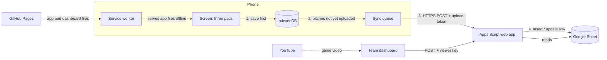
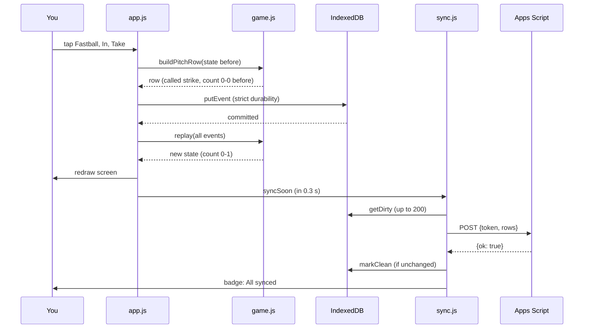
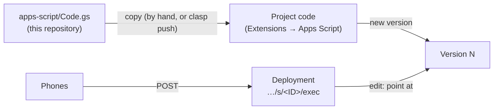

# How PitchTracker works

*A guide that starts from zero and ends at every line that matters. Written 16 November 2026, reorganized 26 November 2026.*

**Reading the code:** every file and function named in this guide links to it in this repository. Some links point at a line number; those can drift a few lines as the code changes. Section 16.4 has the full file list.

**How to read this:** sections 1–3 are for anyone; you need no programming background. Sections 4 onwards go deep into one part each and can be read in any order. If you only want to know "can I lose data?", read sections 1, 5.1 and 14. For who can record, read or deploy, and how to take that back, read section 13. If you're about to change the Google script, read section 17.

---

## Contents

1. [The big picture](#1-the-big-picture)
2. [The basic ideas, from zero](#2-the-basic-ideas-from-zero)
3. [One pitch, step by step](#3-one-pitch-step-by-step)
4. [The game rules in code](#4-the-game-rules-in-code)
5. [Storage on the phone](#5-storage-on-the-phone)
6. [Sync: getting pitches to the sheet](#6-sync-getting-pitches-to-the-sheet)
7. [The Google side: Apps Script and the sheet](#7-the-google-side-apps-script-and-the-sheet)
8. [Setup links](#8-setup-links)
9. [The team dashboard](#9-the-team-dashboard)
10. [Backups and CSV](#10-backups-and-csv)
11. [Working offline: the service worker](#11-working-offline-the-service-worker)
12. [The screens and the layout](#12-the-screens-and-the-layout)
13. [Keys, tokens and sign-ins](#13-keys-tokens-and-sign-ins)
14. [What happens when things go wrong](#14-what-happens-when-things-go-wrong)
15. [Limits and things not built yet](#15-limits-and-things-not-built-yet)
16. [Testing, changing and releasing](#16-testing-changing-and-releasing)
17. [Editing the Google script: how the build works](#17-editing-the-google-script-how-the-build-works)
18. [Glossary](#18-glossary)

---

## 1. The big picture

PitchTracker is a website that behaves like an app. You open it once in Safari, add it to the Home Screen, and from then on it opens full-screen from its own icon, works with no signal, and keeps every pitch on the phone until it has safely reached a Google Sheet. A second page, the **team dashboard**, shows everything in the sheet (games with their videos, hitters, pitchers, win probability, leaderboards) to anyone you send its link, without letting them change anything.

There is **no server of our own**: nothing is rented, nothing has to be kept switched on, and nothing costs money. Both pages are plain files; the only program that runs somewhere else is a Google Apps Script attached to the sheet. No outside libraries are loaded from anywhere; everything the pages run is in this repository (one small QR code library is copied in and pinned, 8.7). The dashboard embeds YouTube's player for the game videos.

### 1.1 The moving parts

| Part | What it is | What it does |
|---|---|---|
| **The phone** | An iPhone, iPad or Android phone running Safari or Chrome | Runs the app. All the recording logic happens here, not on a server |
| **The app files** | [`index.html`](../index.html), [`css/app.css`](../css/app.css), the files in [`js/`](../js), the icons | The recording app. Downloaded once, then kept on the phone |
| **The dashboard files** | [`dashboard/`](../dashboard) | The read-only team dashboard (section 9). Loaded fresh on every visit |
| **GitHub Pages** | GitHub's free hosting for static files | Hands out both pages at `https://pmiquelm.github.io/PitchTracker/` and `…/dashboard/`. It never sees any data or key |
| **IndexedDB** | A small database built into every browser | Stores games, lineups and every pitch on the phone ([`js/db.js`](../js/db.js)) |
| **The service worker** | A small script the browser keeps beside the app ([`sw.js`](../sw.js)) | Keeps a copy of the app files so the app opens with no signal |
| **Apps Script** | Google's way of attaching a small program to a Google Sheet ([`apps-script/Code.gs`](../apps-script/Code.gs)) | Receives pitches and plate appearances, hands out rosters and the dashboard's data, and runs the video timestamps window (section 7) |
| **The Google Sheet** | A normal spreadsheet in your Google Drive | **Pitches** (one row per pitch), **PlateAppearances**, the **Rosters** you type in and a **Summary**; and, from scoresheets transcribed outside the app, **PlayByPlay** with its **VideoTimes** and **Videos** |
| **YouTube** | Where the game videos are | Played inside the video timestamps window and the dashboard |
| **GitHub Actions** (optional) | GitHub's free automation | Deploys `Code.gs` whenever it changes on `main` (section 17) |
| **Other dashboards** (optional) | Looker Studio, the claude.ai dashboard | Read the sheet directly (9.10) |

### 1.2 The life of a pitch, in one paragraph

You tap **Fastball**, **In** and **Take**. The phone works out that this was a called strike, updates the count, and **writes the pitch into its own database before showing you anything**. A fraction of a second later, if there is signal, it sends that pitch to your Apps Script address on Google's servers. The script checks the **upload token** sent with it (13.3), finds or adds the right row in the **Pitches** tab, and answers "ok". Only then does the phone mark the pitch as uploaded. If there is no signal, the pitch waits on the phone and goes up on its own the next time there is. When the ball is put in play, big outcome pads (hit, out, fielder's choice, sac, error, then the detail and the fielder) replace the pitch pads; that result goes up the same way, into the **PlateAppearances** tab.



### 1.3 Who can do what

| Person | Needs | Can |
|---|---|---|
| **You (the owner)** | The Google account that owns the sheet | Everything: record, see all data, change the script, cut off access |
| **A recorder** | The setup link, which carries the upload token (section 8) | Add pitches to your sheet, download the rosters, and open or share the team dashboard. Can't read the sheet itself |
| **The team** | The dashboard link, which carries the viewer key (section 9) | See the dashboard. Can't change anything, and can't open the sheet |
| **A viewer of the sheet** | The sheet shared with them (view only) | Read the sheet. Never touches the app |

Every key, sign-in and secret involved, and how to take each back, is in section 13.

---

## 2. The basic ideas, from zero

Everything later builds on twelve ideas. If you already know them, skip ahead.

### 2.1 Requests and responses

The web is a conversation of short messages. Your browser sends a **request** ("please give me the file `app.js`") and a computer somewhere sends back a **response** ("here it is"). Each request stands alone.

A request has:

- a **method**: `GET` means "give me something", `POST` means "here is some information I'm sending you";
- a **URL**: the address, like `https://pmiquelm.github.io/PitchTracker/js/app.js`;
- **headers**: small labelled notes, like `Content-Type: text/plain`;
- sometimes a **body**: the information being sent. For PitchTracker that is a batch of pitches.

A response has a **status code** (200 = OK, 302 = "look over there instead", 403 = not allowed, 404 = not found, 500 = the other side broke), headers, and a body.

PitchTracker makes exactly two kinds of request: `GET`s to GitHub Pages for the app's own files (only when installing or updating), and `POST`s to Google: to upload pitches, to test the connection, and to download team rosters.

### 2.2 Static hosting: why there is no server

Most websites with a database have a server: a computer that runs code for every visitor and owns the data. PitchTracker deliberately doesn't. GitHub Pages is **static hosting**: it can only hand out files exactly as they are in the repository. It cannot run code, store anything or tell visitors apart.

That works here because all the thinking happens **on the phone**: the browser downloads the program and runs it locally. The only "server" is Google's Apps Script, and it does one tiny job: write rows into the sheet.

Consequences:

- **Free and nearly maintenance-free**: no machine to patch, no bill.
- **Fast at the field**: every tap is handled on the phone, so it doesn't matter how bad the signal is.
- **The code is public.** GitHub Pages on a free account requires a public repository, so anyone can read the app's code. That's fine: no secret lives in the code (section 13).

### 2.3 HTML, CSS and JavaScript

A web page is made of three languages:

- **HTML** describes *what is on the page*. [`index.html`](../index.html) is nearly empty: a `<div id="app">` box that JavaScript fills in, a box for pop-up messages, and links to the other files.
- **CSS** describes *how it looks*: colours, sizes, the grid of pads. All of it is in [`css/app.css`](../css/app.css).
- **JavaScript** is the *program*: what happens when you tap. It's split into **modules**, files that `import` from each other:

| Module | Job | Knows about |
|---|---|---|
| [`js/game.js`](../js/game.js) | The baseball rules: count, plate appearances, lineup | Nothing else: pure logic, no screen, no storage |
| [`js/db.js`](../js/db.js) | Reading and writing the phone's database | Only IndexedDB |
| [`js/sync.js`](../js/sync.js) | Uploading to Google, downloading rosters | `db.js`, `roster.js` |
| [`js/roster.js`](../js/roster.js) | Cleaning up downloaded rosters and matching typed names to them | Nothing else |
| [`js/backup.js`](../js/backup.js) | Backup files and CSV | `db.js`, `game.js` |
| [`js/connect.js`](../js/connect.js) | Setup links | Nothing else |
| [`js/app.js`](../js/app.js) | The screens, buttons and startup | All of the above |

Keeping the rules (`game.js`) apart from the screen and storage is what lets them be tested on their own (section 16), and what would let the storage be swapped for something else later (section 5.7).

### 2.4 The browser as a small computer

A modern browser is a full computer inside the phone. It can run programs, store data, work offline and draw anything. A web app gets most of what a "real" app gets, with some rules the phone's maker imposes. On iPhone those rules are Apple's, and they matter (2.8).

### 2.5 Storing data in the browser: IndexedDB

A browser offers web pages a few places to keep data:

- **localStorage**: a tiny notepad of text values. Simple, but slow for lots of data, and it can't be written to reliably in one safe step.
- **IndexedDB**: a real database built into the browser. It stores whole objects (a pitch, a game), can look them up by fields, and supports **transactions**.

PitchTracker uses IndexedDB for everything.

A **transaction** is a bundle of reads and writes that happens *completely or not at all*. If the phone dies halfway through, the database comes back as it was before the transaction, never half-written. When a transaction **completes**, the data is saved.

**Durability** is how hard the browser tries to make "saved" mean "on the disk". By default some browsers say "done" once the data is in memory and write it to disk a moment later, which is faster but could lose the last second if the phone dies. PitchTracker asks for `durability: 'strict'` ([`js/db.js:7`](../js/db.js#L7)), meaning "don't tell me it's done until it's on disk". For a pitch, being safe matters more than a millisecond.

Each website gets its **own** IndexedDB, keyed by its address (its *origin*, 2.9). Data from `pmiquelm.github.io` is invisible to every other site.

### 2.6 Offline: the service worker and its cache

Normally, opening a website means downloading its files. With no signal, that fails.

A **service worker** is a small script a site can install into the browser. It sits *between the app and the network*. Every time the app asks for a file, the service worker can answer from its own **cache** (a stored copy) instead of going to the internet. PitchTracker's service worker ([`sw.js`](../sw.js)) stores a copy of every app file the first time you open the app, and from then on always answers from that copy. That's why the app opens in a stadium with no signal at all. Section 11 has the details.

### 2.7 PWAs: websites that install like apps

A **Progressive Web App (PWA)** is a website with three extra things:

1. a **manifest** ([`manifest.webmanifest`](../manifest.webmanifest)): a small file giving the app's name, icon, colours and "open full-screen". It can also fix the address the installed app always opens at (`start_url`). PitchTracker's deliberately leaves that out (8.4);
2. a **service worker** (2.6);
3. served over **HTTPS**.

With those, **Add to Home Screen** gives the site its own icon. It then opens without Safari's address bar, looking and feeling like an app. No App Store, no review, no yearly fee, and updates arrive by just changing the files on GitHub.

### 2.8 Apple's rules for web apps on iPhone

These rules shaped several design decisions:

- **The 7-day rule.** Safari deletes a website's stored data if you haven't visited it for 7 days. Apps added to the Home Screen are **exempt**: their data stays. That is why the app nags you to install it ([`installNoticeHTML`](../js/app.js#L191)).
- **Space pressure.** If the phone is almost full, iOS may clear data from websites that haven't been granted **persistent storage**. The app asks for it on every launch with `navigator.storage.persist()` ([`js/db.js:45`](../js/db.js#L45)). Settings shows whether it was granted.
- **Separate storage.** A Home Screen app has its **own** storage, separate from Safari's, and it starts **empty**. Something saved while the page is open in Safari isn't visible to the installed app, and vice versa. This is why setup links are built the way they are (section 8.4), and why the backup/import buttons exist.
- **No reliable background work.** iOS doesn't let web apps upload in the background after you close them. Uploads happen while the app is open (section 6.2).

**Android is simpler.** Chrome (and Samsung Internet, Edge) on Android installs a web app properly: it offers *Install app*, and the installed app **shares the browser's storage**, so whatever was set up in the browser (including the sheet connection) is already there. Persistent storage is normally granted to installed apps, and there is no 7-day rule for them. The app catches Chrome's install offer and shows its own **Install app** button ([`installNoticeHTML`](../js/app.js#L191)). Android also has a system **Back** button, which in an installed web app would normally close it; during a game the app turns Back into "return to the games list" instead (12.2).

### 2.9 Origins and CORS

An **origin** is the scheme + host + port of an address: `https://pmiquelm.github.io` is one origin, `https://script.google.com` is another. Browsers keep origins apart for safety: a page from one origin can't freely read responses from another. This rule is called the **same-origin policy**, and the system of exceptions is **CORS** (Cross-Origin Resource Sharing).

When the app (origin A) posts pitches to Google (origin B), the browser checks whether B allows it. For "complicated" requests (custom headers, JSON content type) the browser first sends a separate **preflight** request (`OPTIONS`) asking permission. Apps Script web apps don't answer preflights. So the app sends a "simple" request: a `POST` with no custom headers, whose body is JSON text but labelled `text/plain`. Simple requests skip the preflight, and Apps Script's response comes back readable ([`js/sync.js:62`](../js/sync.js#L62)).

### 2.10 JSON

**JSON** is the standard way to write data as text: `{"pitch_type": "FB", "zone": "IN", "balls_before": 1}`. Curly braces hold named fields, square brackets hold lists. The app sends pitches to Google as JSON and saves backups as JSON.

### 2.11 Unique IDs and "doing it twice is safe"

Every pitch gets a **UUID** when it's recorded: a random 128-bit number written like `3f1c9a2e-7b4d-4c1e-9f0a-2b6d8e1c5a47`. The chance of two ever being the same is effectively zero, so no central counter is needed. Each phone makes its own.

This makes uploads **idempotent**: doing the same thing twice has the same effect as doing it once. If a phone sends a pitch, the sheet saves it, but the "ok" answer is lost (signal drops at the wrong moment), the phone doesn't know it worked and sends it again. The script sees the same ID already in the sheet and **updates that row instead of adding a new one** (an *upsert*: update or insert). Retrying is therefore always safe, which is what lets the app retry aggressively.

### 2.12 An event log and "replay"

The app doesn't store "the count is 2–1, batter 4 is up". It stores **what happened**, in order: a list of **events**:

```
1. pitch      FB · OUT · TAKE
2. pitch      CB · IN  · FOUL
3. sub        slot 4 → Park #33
4. pitch      FB · IN  · SWING
5. inning     +1
...
```

To know the current state, it starts from the beginning of the game and **replays** every event through the rules. This idea is called *event sourcing*. It sounds wasteful, but a whole game is a few hundred events and replaying takes well under a millisecond. In return:

- **Undo is trivial and always correct**: mark the last event as undone, replay. No special "reverse a strikeout" code.
- **The state can never drift** from what was recorded: there is only one source of truth, the log.
- The log *is* the backup: export it and you can rebuild everything.

---

## 3. One pitch, step by step

This follows a real sequence through the code, from opening the app to the row appearing in the sheet.



### 3.1 Opening the app: `boot`

When the app opens, the browser loads `index.html`, which loads `js/app.js`. The last line of that file calls [`boot`](../js/app.js#L1199), which:

1. **Registers the service worker** so app files get cached (section 11).
2. **Asks for persistent storage** ([`requestPersistence`](../js/db.js#L45)).
3. **Loads the settings** (sheet address, token, your name) into memory, and gives this phone a random **device ID** the first time.
4. **Checks the address for a setup link** (`#c=…`, or `#connect=…` in old links) and applies it if it's new ([line 1216](../js/app.js#L1216), section 8).
5. **In a browser tab only:** if the phone is connected but the address doesn't hold the setup link yet, puts it there and reloads once ([line 1217](../js/app.js#L1217), section 8.4). Inside the installed app this step does nothing.
6. **Starts the sync engine** ([`initSync`](../js/sync.js#L130)), which immediately tries to upload anything left over.
7. **Shows the home screen** ([`showHome`](../js/app.js#L120)): the list of games, sorted newest first.

### 3.2 Starting a game: `showSetup`

**New game** opens [`showSetup`](../js/app.js#L332): a game ID (pre-filled with today's date), a line saying which team rosters are available (3.2.1), then one box per team: **Away** (bats first, in the top of each inning) and **Home**. Each has a team name, an optional starting pitcher (that team's own pitcher) and nine lineup rows of number + name. If you leave a team's lineup completely blank (you often don't know the opponent's), it gets `Batter 1` … `Batter 9`, so its hitters are still tracked by batting-order spot. On **Start game**, the form is read, empty rows are skipped, and a **game record** is saved:

```json
{
  "key": "8d0f…",            // internal UUID, never shown
  "gameId": "2026-11-16-HOME", // what you typed; goes in every row
  "teams": [
    {"name": "Tigers", "pitcher": "Ortega", "lineup": [{"number": "10", "name": "Lopez"}, …]},
    {"name": "Home",   "pitcher": "Garcia", "lineup": [{"number": "", "name": "Batter 1"}, …]}
  ],
  "createdAt": 1794869000000
}
```

Games recorded before two-team tracking have `lineup` and `pitcher` instead of `teams`. They still open: [`gameTeams`](../js/game.js#L148) turns them into a single team.

The game has two identifiers on purpose. `gameId` is yours: readable, and what ties rows from both sheets to one game. `key` is the app's: guaranteed unique even if you type the same game ID twice, and used internally to group events.

#### 3.2.1 Team rosters

Typing nine names twice a game is slow, and a name spelled two ways ("J. Lopez", "Lopez") is counted as two players in the Summary. So the sheet has a **Rosters** tab you fill in once, and the app fills lineups from it.

**In the sheet.** The tab has five blocks side by side, one per team, each three columns wide (`#`, `Name`, a gap). The first row of a block says `Team` and then the team's name; the players go below, up to 40. Any block whose first cell says `Team` counts, so a sixth team is just a copied block. [`ensureRosters`](../apps-script/Code.gs#L138) creates the empty template (jersey numbers formatted as text, so `07` stays `07`) and never touches a tab that exists.

**Downloading.** When **New game** opens on a connected phone, the app asks the script for the rosters ([`fetchRosters`](../js/sync.js#L115)): a `POST` with the token and `"action": "rosters"`. The script reads every filled block ([`readRosters`](../apps-script/Code.gs#L165)) and answers with them. The phone cleans them up ([`normalizeRosters`](../js/roster.js#L10): no control characters, at most 20 rosters of 40 players, names cut at 60 characters) and **keeps a copy** in its `kv` store, so the next game can use them with no signal. The status line says how many rosters there are and when they were fetched, or **why they didn't load** (no connection, wrong token, *the sheet script is out of date*), so a failed download never looks like an empty tab. **↻ Rosters** fetches again.

**Picking the lineup.** Choose a roster for a team and the **starting-9 picker** opens ([`showRosterPicker`](../js/app.js#L256)): tap players in batting order, move them with ↑ / ↓, remove with ✕, pick the starting pitcher, then **Use lineup**, which writes the names and numbers into the form. The team takes the roster's name unless you typed one. Typing by hand still works and is helped along ([`wireRosterInputs`](../js/app.js#L234)): a roster name, in any capitalisation, is corrected to the sheet's spelling and fills the number; a roster number fills an empty name, unless two players share it ([`findByNumber`](../js/roster.js#L33) doesn't guess).

**A copy per game.** The chosen roster is saved inside the game record (`teams[i].roster`). During the game, **Lineup / Subs** suggests that roster's bench players for substitutions, even offline. Because it's a copy, editing or deleting the Rosters tab later never changes a game already started, and the pitch rows only ever contain the names that were in the lineup.

Rosters need script version 4 or later. With an older script, uploads still work; only the roster download says the script is out of date (7.5, *Versions*).

#### 3.2.2 Live BP sessions

**＋ Live BP** opens [`showBpSetup`](../js/app.js): a session ID (`<date>-BP`), the roster of the team, its name and the pitcher. The game record has `"mode": "bp"` and a single team with an empty lineup:

```json
{ "key": "…", "gameId": "2026-11-20-BP", "mode": "bp",
  "teams": [{ "name": "Eagles", "pitcher": "Ortega", "lineup": [], "roster": { … } }] }
```

In the rules ([`initialState`](../js/game.js), [`reduce`](../js/game.js)) a BP state has `bp: true`, the batter at the plate in `batter`, and `awaitingBatter`. Every way an at-bat ends (strikeout, walk, an outcome, **End AB** with a reason) adds one to `paNumber` and sets `awaitingBatter`, instead of moving to the next lineup slot. A new event, `batterUp {name, number}`, puts a batter at the plate; picked in the middle of an at-bat (**Batter**), it leaves that at-bat unfinished, like `setBatter` in a game. Outs and half-innings do nothing in BP. Undoing a `batterUp` brings **Who's up?** back.

The tracker draws a BP game with [`renderBpTracker`](../js/app.js): no outs dots or inning/outs steppers; the pads are replaced by **Who's up?** ([`whoUpHTML`](../js/app.js)) whenever a batter is owed; the footer is Undo / End AB / Batter / Pitcher / Log. Rows get `session_type = "bp"`, the team on both sides, and empty `inning`, `half`, `outs_before` and `lineup_slot` ([`situation`](../js/game.js)). Game rows get `session_type = "game"`.

### 3.3 The tracker screen: `showTracker` and `renderTracker`

[`showTracker`](../js/app.js#L468) loads the game and **all of its events** from IndexedDB, then runs `replay` (2.12) to compute the current state: count, batter, inning, pitch counts. [`renderTracker`](../js/app.js#L574) then draws the whole screen from that state: the count and dots, the batter bar, the three groups of pads, and the bottom buttons.

### 3.4 Tapping the pads: `handleTrackerClick`

Each tap goes to [`handleTrackerClick`](../js/app.js#L629). For a pad, it records your choice in a small variable `sel` (one choice per group; tapping a selected pad again clears it). When all three groups have a choice ([line 636](../js/app.js#L636)), it clears `sel` and calls `recordPitch`.

Taps are handled **one at a time, in order** ([line 627](../js/app.js#L627)): each tap waits for the previous one to finish. Without that, a very fast double tap could start two saves at once and they could interleave.

### 3.5 Saving the pitch: `recordPitch` and `addEvent`

[`recordPitch`](../js/app.js#L696) calls [`addEvent`](../js/app.js#L486), the single place where anything gets recorded. For a pitch it:

1. Creates the event: a new UUID, the game key, a sequence number (one more than the highest so far), the type `pitch`, your three choices, and a timestamp.
2. Builds the **sheet row** with [`buildPitchRow`](../js/game.js#L342) ([line 494](../js/app.js#L494)). The row is computed from the state *before* the pitch: who was batting, the count before, pitch number in the at-bat, and so on. Then it stamps `recorded_by` (your name or device ID).
3. Marks it `dirty: 1` ("not uploaded yet").
4. **Writes it to IndexedDB and waits until the write is on disk** ([line 509](../js/app.js#L509)). This is the most important line in the app. Nothing on screen changes until it has finished.
5. Adds it to the in-memory list and replays to get the new state.

Then `recordPitch` writes the "Last: …" line (e.g. *Last: Fastball · In · Take → Called strike*), refreshes the not-uploaded count, and asks sync to run in 0.3 seconds. The screen redraws with the new count, or the next batter if the at-bat ended.

### 3.6 The upload: `syncNow`

0.3 seconds later [`syncNow`](../js/sync.js#L75) runs. In short (section 6 has the details): read up to 200 not-uploaded pitches, send them to the Apps Script address with the token, wait for `{ok: true}`, then mark them uploaded, but only those that haven't changed in the meantime.

The 0.3-second delay groups pitches entered in quick succession into one upload, and keeps uploads from competing with your taps.

### 3.7 In the sheet: `doPost`

On Google's side, [`doPost`](../apps-script/Code.gs#L190) receives the batch, checks the token, and for each pitch either updates the row with that ID or appends a new row. Section 7 covers it.

---

## 4. The game rules in code

All baseball logic lives in [`js/game.js`](../js/game.js). It has no screen and no storage: you give it events, it gives you state. That's why it can be tested on its own with plain Node.js (section 16).

### 4.1 What a pitch is

A pitch is three choices:

| Field | Values | Meaning |
|---|---|---|
| `pitchType` | `FB`, `CB` | Fastball, Curveball |
| `zone` | `IN`, `OUT` | In or out of the strike zone, by your judgement |
| `action` | `TAKE`, `SWING`, `FOUL`, `IN_PLAY` | What the batter did. **Swing** means swing and miss |

### 4.2 From choices to a result: `pitchResult`

[`pitchResult`](../js/game.js#L116) turns zone + action into what the umpire would call:

| Action | Zone IN | Zone OUT |
|---|---|---|
| Take | `called_strike` | `ball` |
| Swing | `swinging_strike` | `swinging_strike` |
| Foul | `foul` | `foul` |
| In play | `in_play` | `in_play` |

So the app trusts your zone call for takes. On swings, fouls and balls in play the zone doesn't change the result, but it's still stored: that's what lets you measure chases (swings at pitches out of the zone) later.

### 4.3 The count: `evaluatePitch`

[`evaluatePitch`](../js/game.js#L127) applies a result to the current count and says whether the plate appearance ended:

- **Ball**: balls + 1. At 4 balls: plate appearance ends with **walk**.
- **Called or swinging strike**: strikes + 1. At 3 strikes: ends with **strikeout**.
- **Foul**: strikes + 1, **but only if there are fewer than 2 strikes**. A foul with two strikes leaves the count alone.
- **In play**: ends with **in_play**. The batter stays up until you choose the outcome in the decision tree (4.7).

It doesn't change anything itself; it just reports. That keeps it usable both for building the row (4.6) and for replay (4.4).

### 4.4 The state and the reducer

The state is one small object ([`initialState`](../js/game.js#L153)):

| Field | Meaning | Starts at |
|---|---|---|
| `teams` | Per team: `name`, `lineup` (after substitutions), `slot` (whose turn it is in *that team's* order), `pitcher` (that team's current pitcher) and `pitcherPitches` | From the setup |
| `inning`, `half` | Inning number and `top` (away bats) or `bottom` (home bats) | 1, top |
| `outs` | Outs in this half-inning | 0 |
| `balls`, `strikes` | The count | 0, 0 |
| `paNumber` | Plate appearance number in the game (both teams together) | 1 |
| `pitchInPa` | Pitches already thrown in this plate appearance | 0 |
| `pitchNumber` | Pitches already thrown in the game | 0 |
| `pending` | Set after a ball in play, until its outcome is chosen | none |
| `lastPaEnd`, `lastHalfEnd` | Whether the previous event ended an at-bat / a half-inning | none |

The **batting team** is team 0 in the top and team 1 in the bottom; the **fielding team** is the other one, and *its* pitcher is the one on the mound ([`battingIndex` / `fieldingIndex`](../js/game.js#L176)). Each team keeps its own place in its batting order across innings.

[`reduce`](../js/game.js#L241) takes a state and one event and returns the next state. ("Reduce" is the programming word for folding a list into one value, one item at a time.) What each event type does:

| Event | Line | Effect |
|---|---|---|
| `pitch` | [245](../js/game.js#L245) | Counts the pitch (game and the fielding team's pitcher). Strikeout or walk: next batter (a strikeout is also an out). Ball in play: sets `pending` and waits for `outcome`. Otherwise updates the count |
| `outcome` | [265](../js/game.js#L265) | The decision-tree result for the pending ball in play: next batter, plus the play's outs |
| `nextBatter` | [272](../js/game.js#L272) | The **Next batter ›** button, with a reason (hit by pitch, intentional walk, catcher's interference, out by rule, or other). *Out by rule* adds an out |
| `setBatter` | [278](../js/game.js#L278) | A correction from the Lineup screen: jump to a slot with a fresh count. Counts as a new plate appearance only if pitches were already thrown |
| `sub` | [284](../js/game.js#L284) | Replaces the player in one lineup slot of one team. **The count is kept**: a pinch hitter inherits it |
| `pitcher` | [291](../js/game.js#L291) | New pitcher for one team; their pitch count starts at 0 |
| `half` | [294](../js/game.js#L294) | The inning − / + buttons: one half-inning back or forward. Outs go to 0 |
| `outs` | [298](../js/game.js#L298) | The outs − / + buttons, for outs that aren't the batter's (caught stealing, pickoff, a runner doubled off…) |
| `inning` | [302](../js/game.js#L302) | Old games only: inning + 1 or − 1 |

**The third out** ([`addOuts`](../js/game.js#L233)) ends the half-inning by itself: outs go back to 0 and the other team bats (after the bottom, the inning goes up). If it happens in the middle of an at-bat (caught stealing for the third out), that batter's count is wiped and he leads off next inning with a new plate appearance number, which is the baseball rule.

Moving to the next batter ([`nextBatter`](../js/game.js#L197)) wraps around: after the last slot comes the first.

[`replay`](../js/game.js#L315) is just: start from the initial state, skip undone events, sort by sequence number, and `reduce` through them all.

### 4.5 A worked example

Lopez leads off for the away team. Events and state after each:

| # | Event | Result | Count after | Outs | Batter after | PA |
|---|---|---|---|---|---|---|
| 1 | FB · OUT · TAKE | ball | 1–0 | 0 | Lopez | 1 |
| 2 | CB · IN · FOUL | foul | 1–1 | 0 | Lopez | 1 |
| 3 | FB · IN · SWING | swinging strike | 1–2 | 0 | Lopez | 1 |
| 4 | FB · IN · FOUL | foul (2 strikes, no change) | 1–2 | 0 | Lopez | 1 |
| 5 | CB · IN · TAKE | called strike → **strikeout** | 0–0 | 1 | Smith | 2 |
| 6–9 | 4 × FB · OUT · TAKE | 4 balls → **walk** | 0–0 | 1 | Jones | 3 |
| 10 | CB · OUT · IN_PLAY | **in play**: decision tree opens | 0–0 | 1 | Jones | 3 |
| 11 | Hit → Single → CF | outcome | 0–0 | 1 | Kim | 4 |
| — | *Undo* | event 11 undone: the tree is back | 0–0 | 1 | Jones | 3 |
| — | *Undo* | event 10 undone | 0–0 | 1 | Jones | 3 |
| 12 | FB · IN · IN_PLAY, then Out → Fly out → Skip | **fly out** | 0–0 | 2 | Kim | 4 |

This is the sequence the browser test runs (section 16).

### 4.6 The sheet rows: `buildPitchRow` and `buildPaRow`

[`buildPitchRow`](../js/game.js#L342) builds the **Pitches** row, from the state **just before** the pitch:

| Column | Example | Notes |
|---|---|---|
| `id` | `3f1c…` | The event's UUID; how the sheet recognises the row |
| `game_id` | `2026-11-16-HOME` | What you typed at setup |
| `recorded_at` | `2026-11-16T18:04:11Z` | When it was entered, in UTC |
| `inning`, `half` | 3, bottom | `half` is empty for old one-team games |
| `batting_team`, `pitching_team` | Home, Tigers | |
| `outs_before` | 1 | Outs when the pitch was thrown |
| `pa_number` | 14 | 14th plate appearance of the game |
| `pitch_number` | 52 | 52nd pitch of the game |
| `pitch_in_pa` | 3 | 3rd pitch of this at-bat |
| `lineup_slot`, `batter_number`, `batter` | 4, 33, Park | |
| `pitcher`, `pitcher_pitch_count` | Reyes, 7 | Count *including* this pitch |
| `balls_before`, `strikes_before` | 1, 1 | The count before the pitch. Two columns, not "1-1", because Sheets would turn "1-1" into a date |
| `pitch_type`, `zone`, `action` | FB, IN, SWING | Your three taps |
| `result` | swinging_strike | From 4.2 |
| `pa_end` | strikeout / walk / in_play / empty | Whether this pitch ended the at-bat |
| `pa_result` | K / BB / 2B / GO … / empty | How the at-bat ended, on its last pitch. For a ball in play it's filled in when the outcome is chosen |
| `deleted` | FALSE | TRUE if undone in the app |
| `recorded_by` | Coach P | Name from Settings, or `device-1a2b3c` |
| `synced_at` | | Added by the sheet: when it last received the row |

[`buildPaRow`](../js/game.js#L377) builds the **PlateAppearances** row, one per finished at-bat: the same situation columns (`inning`, `half`, teams, `outs_before`, `pa_number`, batter, `pitcher`), then `pitches` (how many in the at-bat), `balls`/`strikes` (the count on the last pitch), `result` (a code such as `2B`), `result_label` (`Double`), `category` (`hit`, `out`, `fc`, `sac`, `error`, `strikeout`, `walk`, `hbp`, `interference`), `batted_ball` (`ground`, `line`, `fly`, `bunt` where the choice tells us), `fielder` (`P` … `RF`, or empty if skipped) and `outs_on_play`.

The column lists are defined in [`PITCH_COLUMNS`](../js/game.js#L99) and [`PA_COLUMNS`](../js/game.js#L109), and again in the script's [`HEADERS` and `PA_HEADERS`](../apps-script/Code.gs#L26). They must match; a unit test checks that they do.

Because rows are **snapshots** made at the moment of the event, later events (a substitution, a pitcher change) never rewrite earlier rows. That's what you want: the row records who was actually batting at the time. The one deliberate exception is `pa_result` on a ball-in-play pitch, which is filled in when its outcome is chosen (and cleared again if the outcome is undone).

### 4.7 Outcomes: the decision tree

After **In play**, the pitch is saved straight away (it's never at risk) and the pads are replaced by big outcome pads ([`treeHTML`](../js/app.js#L543)):

| Step 1 | Step 2 | Outs |
|---|---|---|
| **Hit** | Single · Double · Triple · Home run | 0 |
| **Out** | Ground out · Line out · Fly out · Double play | 1 (DP: 2) |
| **Fielder's choice** | (nothing more to ask) | 1 |
| **Sac** | Bunt · Fly | 1 |
| **Error** | Ground ball · Line drive · Fly ball | 0 |

Then **where the ball went**: LF, CF, RF, 3B, SS, 2B, P, C, 1B laid out roughly like the field, or **Skip**. **‹ Back** goes up one level. Only the last tap saves anything: an `outcome` event ([`recordOutcome`](../js/app.js#L708)) that carries the PlateAppearances row and updates the pitch's `pa_result`. While an outcome is owed, **Next batter** and the inning/outs buttons are disabled; **Undo** removes the ball-in-play pitch itself.

The outs per play are the usual case. Anything else (a fielder's choice where nobody is out, a triple play, a runner thrown out on a hit) is fixed with the outs − / + buttons, which never touch the batter.

**Next batter ›** asks why ([`showNextBatterDialog`](../js/app.js#L720)): *Hit by pitch*, *Intentional walk*, *Catcher's interference*, *Out by rule* (adds an out) each record a plate appearance with that result. *Other / correction* just moves on and records nothing, like the button used to.

---

## 5. Storage on the phone

All of it is in [`js/db.js`](../js/db.js), the only file that touches IndexedDB.

### 5.1 The rule that matters most

> **Every pitch is written to the phone's disk before the screen changes, and nothing is ever deleted from the phone after it uploads.**

If the app is killed, the phone restarts or the battery dies one millisecond after a tap, one of two things is true: the pitch was saved, or the screen hadn't moved on yet (so you'd see it missing and tap again). There's no state where the screen showed a pitch the phone had lost.

### 5.2 The database layout

One database, `pitchtracker`, with three **stores** (an IndexedDB store is like a table), created in [`open`](../js/db.js#L11):

| Store | Holds | Looked up by |
|---|---|---|
| `games` | One record per game (3.2) | `key` |
| `events` | Every event of every game | `id`; plus **indexes** on `gameKey` (all events of a game) and `dirty` (everything not yet uploaded) |
| `kv` | Settings (sheet URL, token, your name, device ID, last applied setup link) and the saved copy of the rosters (3.2.1) | a name (`settings`, `rosters`) |

An **index** is a pre-sorted lookup, like a book's index: "all events with `dirty = 1`" is answered instantly without reading every event.

### 5.3 An event record

```json
{
  "id": "3f1c9a2e-…",
  "gameKey": "8d0f…",
  "seq": 52,
  "type": "pitch",
  "data": {"pitchType": "FB", "zone": "IN", "action": "SWING"},
  "createdAt": 1794869051000,
  "deleted": 0,
  "dirty": 1,
  "rev": 1,
  "row": { …the sheet row from 4.6… },
  "syncedAt": 1794869052000
}
```

- `seq` orders events within a game.
- `deleted` is 1 if undone. Pitches are never removed, only marked (5.5).
- `dirty` is 1 while the sheet hasn't confirmed the latest version.
- `rev` (revision) goes up every time the event changes. It protects against a subtle race (6.4).
- `row` exists only for pitches.

`deleted` and `dirty` are numbers (0/1) rather than true/false because IndexedDB can't index true/false values.

### 5.4 How writes happen: `run`

Every operation goes through [`run`](../js/db.js#L32): open a transaction on one store, do the work, and resolve only when the transaction has **completed**, not when the request was merely sent. Write transactions use `durability: 'strict'` (2.5).

### 5.5 Undo and "tombstones"

[`undo`](../js/app.js#L759) treats pitches and other events differently:

- An undone **pitch, outcome or next batter with a reason** (anything that produced a sheet row) is not deleted. It's marked `deleted = 1`, `row.deleted = true`, `dirty = 1` and `rev + 1`, then saved ([line 772](../js/app.js#L772)). This marker is called a **tombstone**. It's needed because the pitch may already be in the sheet, and the sheet has to be told: the next sync sends the row again with `deleted = TRUE`. Undoing an outcome also clears `pa_result` on its pitch row, so the decision tree comes back for that batter. The sheet keeps the row but marks it, and the Summary tab and dashboards filter it out.
- An undone **substitution, pitcher change, inning or outs change, or plain next batter** never went to the sheet, so it is simply deleted.

Either way the app replays and the screen is correct again.

### 5.6 Persistent storage

[`requestPersistence`](../js/db.js#L45) asks the browser to mark the site's storage as persistent: "don't clear this under space pressure". Browsers decide for themselves whether to grant it. Installed apps usually get it. The result is shown in **Settings → Status**.

### 5.7 Why this file is separate

If the iOS rules ever prove too risky, the plan is to wrap the same app as a real native app with **Capacitor**, which stores data in a SQLite file iOS never clears. Only this file would change. Everything else talks to storage only through its functions (`putEvent`, `getEvents`, `getDirty`, …).

---

## 6. Sync: getting pitches to the sheet

All of it is in [`js/sync.js`](../js/sync.js).

### 6.1 What "pending" means

A pitch is **pending** while `dirty = 1`: the sheet hasn't confirmed the latest version of it. The count shown on the badge is simply `countDirty` ([`js/db.js:70`](../js/db.js#L70)): how many events have `dirty = 1`.

### 6.2 When sync runs

[`initSync`](../js/sync.js#L130) arranges for sync to run:

| Trigger | Why |
|---|---|
| 0.3 s after every pitch or undo ([`syncSoon`](../js/sync.js#L40)) | Normal case: upload almost immediately |
| When the phone reports it's back online | Signal returned |
| When the app comes back to the screen | You switched apps, or unlocked the phone |
| Every 30 s while anything is pending ([line 135](../js/sync.js#L135)) | Catches everything else, such as signal returning without the phone noticing |
| At startup | Uploads anything left from last time |
| **Sync now** in the menu, or tapping the badge | By hand |

Only one sync runs at a time. A trigger while one is running is ignored, and the running one picks up new pitches in its loop.

### 6.3 One sync, in detail: `syncNow`

[`syncNow`](../js/sync.js#L75):

1. Count pending events. If no sheet is set up, show *Sheet not set up* and stop. Pitches stay safe on the phone and go up once one is.
2. Take up to **200** pending events ([`getDirty`](../js/db.js#L71)).
3. Send them in one request ([`post`](../js/sync.js#L58)):
   ```
   POST https://script.google.com/macros/s/AKfy…/exec
   {"token": "…", "rows": [ {row 1}, {row 2}, … ]}
   ```
   with a **30-second timeout**: on a weak signal, a request can hang for minutes otherwise. It's deliberately longer than the 15 s the script waits for its lock (7.5), so a busy sheet answers *Sheet busy* instead of the request being cut off.
4. Google's servers answer with a redirect (302) to a `googleusercontent.com` address where the script's reply waits. The browser follows it automatically, and the reply is `{"ok": true, …}`.
5. On `ok`, [`markClean`](../js/db.js#L75) marks those events uploaded.
6. Repeat from step 2 until nothing is pending.

If anything fails (no connection, timeout, wrong token, Google error), sync stops, records the error for the badge, and leaves everything pending. Nothing is lost; the next trigger tries again.

### 6.4 The race that `rev` prevents

Imagine: sync sends pitch #52. While the request is in flight, you tap Undo, so #52 becomes a tombstone. Then the "ok" for the *old* version arrives. If the app now marked #52 as uploaded, the sheet would never learn about the undo.

So `markClean` only marks an event clean **if its `rev` is still the one that was sent**. The undo raised `rev`, so #52 stays pending and the tombstone goes up on the next round.

### 6.5 The badge

The badge comes in two sizes ([`badgeHTML`](../js/app.js#L67), text from [`syncSummary`](../js/app.js#L53)):

| Home screen (full) | Tracker (compact) | Meaning |
|---|---|---|
| **All synced** (green) | **✓ Synced** | Nothing pending |
| **Uploading N…** (blue) | **↻ N** | Upload in progress |
| **N not uploaded: reason** (yellow) | **⚠ N** | Pending, and the last try failed: *No connection* (device offline), *Couldn't reach the sheet script* (deployment access or address), *took too long*, *Wrong token*, … |
| **No sheet connected** (grey) | **No sheet** | No sheet connected yet. Pitches are kept |

On the tracker the badge is kept short so it never gets cut off; an early version showed the full text there, and on a phone it was truncated to "⚠ 5 not uploaded · …". **Tapping the badge** on any screen opens *Upload status* ([`showSyncDialog`](../js/app.js#L79)): the full message, the time of the last upload, **Upload now**, and, during a game, **Back up game (file)**.

Any change in sync status updates every badge on screen, and the open dialog, right away ([`onSyncStatus`](../js/sync.js#L30)).

### 6.6 Leaving a game with pending pitches

**☰ → Exit to games list** warns you if anything is pending ([line 903](../js/app.js#L903)). It's only a warning: pending pitches stay safe on the phone and upload whenever the app is next open with signal, whichever screen it's on.

---

## 7. The Google side: Apps Script and the sheet

The receiving end is [`apps-script/Code.gs`](../apps-script/Code.gs). It lives in this repository, but it only runs once a copy of it is in the sheet's **Extensions → Apps Script** project and deployed. Getting it there, by hand or automatically from GitHub, is the closest thing PitchTracker has to a build: section 17 covers it step by step.

### 7.1 What Apps Script is

Apps Script is JavaScript that runs **on Google's servers**, attached to a Google file. It can read and write that sheet directly. Deployed as a **web app**, it gets a public address (`https://script.google.com/macros/s/…/exec`); a request to that address runs `doGet` (for GET) or `doPost` (for POST).

### 7.2 The deployment settings, and why

| Setting | Value | Why |
|---|---|---|
| Execute as | **Me** | The script writes to *your* sheet with *your* permission. Recorders don't need Google accounts or access to the sheet |
| Who has access | **Anyone** | Phones and the dashboard call it without signing in to Google. The keys (7.4, 13.2) are what keep strangers out |

Every **New deployment** creates a new address. To change the script but keep the address (so setup links keep working), use **Deploy → Manage deployments → Edit → Version: New version**. The GitHub Action in section 17 does the same thing automatically.

### 7.3 `setup`: run once by hand, in a new sheet

[`setup`](../apps-script/Code.gs#L57) runs [`updateLayout`](../apps-script/Code.gs#L70) and creates the token:

1. Creates the **Pitches** and **PlateAppearances** tabs ([`prepareSheet`](../apps-script/Code.gs#L97)) with the header row, bold and frozen.
2. Formats the text columns (`id`, `game_id`, `batter_number`, `recorded_by`, the team names, `result`, `fielder`, `pa_result`, `session_type`: [`TEXT_COLUMNS`](../apps-script/Code.gs#L44)) as **plain text** ([line 120](../apps-script/Code.gs#L120)). Otherwise Sheets "helpfully" turns a game ID like `2026-05-01` into a date, jersey number `07` into `7`, and `1B` into who knows what.
3. Creates the empty **Rosters** template if there's no Rosters tab (3.2.1).
4. Builds the **Summary** tab with six `QUERY` formulas (7.6).
5. Generates the **token** (a random UUID) if there isn't one, stores it in the script's private **Script properties** ([line 63](../apps-script/Code.gs#L63)), and prints it to the execution log.

Running it again is safe: it keeps the existing token and rows, and rebuilds the header and Summary. It is only needed once, for a new sheet: after that, column changes are applied by the script itself (7.5, step 3).

### 7.4 The keys

The script answers anyone (7.2), so it checks a key in every request itself. There are two, both random values in the script's private **Script properties**, never in the code:

- the **upload token** (`TOKEN`), made by `setup`, which lets a phone write rows and read the rosters;
- the **viewer key** (`VIEW_KEY`), made the first time a phone asks for a dashboard link, which only reads the dashboard's data.

What each request needs, where the keys travel and how to change them: section 13.

### 7.5 `doPost`: receiving pitches and plate appearances

[`doPost`](../apps-script/Code.gs#L190), step by step:

1. **Takes a lock** ([line 195](../apps-script/Code.gs#L195)) so two phones uploading at the same moment can't both append to the same "last row" and overwrite each other. The second waits up to 15 s for the first, then answers *Sheet busy* and the phone tries again later.
2. Reads the JSON body and **checks the token**.
3. **Checks both sheets have the current columns** ([line 209](../apps-script/Code.gs#L209)). If they don't (the first request after deploying a `Code.gs` with new columns, or a deleted tab), it runs [`updateLayout`](../apps-script/Code.gs#L70) right there, under the lock, before writing anything. If the layout still doesn't match (for example a column it doesn't know, which it won't delete), it refuses with the reason rather than writing values under the wrong headings, and the phones keep the data.
4. Then, for the pitches (`rows`) into **Pitches** and the plate appearances (`pas`) into **PlateAppearances**, [`upsert`](../apps-script/Code.gs#L239):
   1. removes duplicates inside the batch (the last copy of an ID wins);
   2. reads the whole `id` column once and builds a lookup: ID → row number;
   3. builds each row in header order (turning `recorded_at` into a real date, adding `synced_at` = now), then **ID already present** → overwrite that row ([line 263](../apps-script/Code.gs#L263)), which is how resends, undos (tombstones) and late outcomes land; **new ID** → add to a list of new rows;
   4. writes all new rows in **one** operation at the bottom.
5. Answers `{"ok": true, "version": 9, "received": N, "appended": M, "pas": P}`, or `{"ok": false, "error": "…"}`. The lock is always released, and any error inside is caught and sent back as `{"ok": false}`: an uncaught one would make Google answer with an HTML error page, which the phone could only report as *couldn't reach the sheet script*.

A request with `"action": "rosters"` (3.2.1) takes a different path right after the token check ([line 200](../apps-script/Code.gs#L200)): it reads the Rosters tab and answers `{"ok": true, "version": 9, "rosters": […]}` without touching any rows.

`doGet` ([line 186](../apps-script/Code.gs#L186)) just answers `{"ok": true, "app": "PitchTracker", "version": 9}`; the deploy workflow uses it to confirm the new version is live. **Test connection** sends an empty upload instead (`rows: []`), so it also checks the token and the script version, and brings the columns up to date if a deploy changed them.

Two other requests read rather than write: `"action": "viewerKey"` (with the upload token) answers the dashboard's viewer key, and `"action": "dashboard"` (with the viewer key, no lock, no token) answers the dashboard's data (9.3). The full list, with the key each needs, is in 13.2.

**Versions.** Several numbers are involved, and they mean different things:

| Number | Where | Meaning |
|---|---|---|
| `VERSION` | [`Code.gs`](../apps-script/Code.gs), now 9 | Which script this is. Goes up on **every** change to the file, and is sent in every reply. The deploy workflow uses it to confirm the new script is live (17.4) |
| `SCRIPT_VERSION` | [`js/sync.js`](../js/sync.js), now 6 | The oldest script the app will upload to. Goes up only when the app *needs* something new from the script |
| `ROSTER_SCRIPT_VERSION` | [`js/sync.js`](../js/sync.js), now 4 | The oldest script the app will ask for rosters |
| `DASHBOARD_SCRIPT_VERSION` | [`js/sync.js`](../js/sync.js), now 8 | The oldest script the app will ask for the viewer key |

The app refuses to sync with a script that reports less than `SCRIPT_VERSION`, and says why (*the sheet script is out of date*). That stops an old script, which doesn't know about plate appearances or `session_type` (version 6: live BP rows would be counted as games), from answering "ok" and having the app mark them uploaded. Nothing is lost while it waits: everything stays pending on the phone. A script from before rosters doesn't know the `rosters` action, reads the request as an empty upload and answers *No rows*; the app turns that into the same *out of date* message ([line 123](../js/sync.js#L123)).

**Updating an existing sheet.** Deploy the new `Code.gs` (automatically from GitHub, or paste it and **Deploy → Manage deployments → Edit → New version**; section 17). On the first upload, [`prepareSheet`](../apps-script/Code.gs#L97) sees that Pitches has the old columns, saves a copy of it as *Pitches (before update …)*, and moves every existing row into the new layout by column name. New columns are left blank for old rows.

### 7.6 The Summary tab

Ten formulas ([line 80](../apps-script/Code.gs#L80)) using Sheets' `QUERY` function, which runs a small SQL-like query over a tab. Columns are referred to by letter. In Pitches: O = pitcher, S = pitch_type, T = zone, U = action, X = pa_result, Y = deleted, AA = session_type. In PlateAppearances: F = batting_team, L = batter, M = pitcher, R = result_label, S = category, W = deleted, Y = session_type. The first six are for games (`and AA <> 'bp'` / `and Y <> 'bp'`); the last four only for live BP, wrapped in `IFERROR` so they say *No live BP recorded yet* instead of an error until the first session.

| Table | Formula (core) | Shows |
|---|---|---|
| Pitches by pitcher and type | `select O, count(A) where Y = false group by O pivot S` | One row per pitcher, a column per pitch type |
| Batter action by pitch type | `… group by S pivot U` | Takes / swings / fouls / in play for FB vs CB |
| Zone by pitch type | `… group by S pivot T` | In vs out for FB vs CB |
| Ball-in-play results by pitch type | `… and U = 'IN_PLAY' group by S pivot X` | What happens when FB vs CB is put in play |
| Results by batter | `select F, L, count(A) where W = false group by F, L pivot R` | Each hitter's singles, walks, strikeouts… |
| Results against each pitcher | `select M, count(A) where W = false group by M pivot S` | Hits, outs, walks… allowed by each pitcher |
| Live BP: pitches by pitcher and type | `… and AA = 'bp' group by O pivot S` | Each BP pitcher's mix |
| Live BP: batter action by pitch type | `… and AA = 'bp' group by S pivot U` | Takes / swings / fouls / in play in BP |
| Live BP: results by batter | `select L, count(A) where W = false and Y = 'bp' group by L pivot R` | Each hitter's BP results |
| Live BP: batter vs pitcher | `… and Y = 'bp' group by M pivot L` | Plate appearances for each pitcher–batter pair |

`session_type` is filled for every row: when the layout is updated, old rows get `game`, and an upload without it (from an app older than the column) is a game too (`DEFAULTS` in Code.gs).

`where … = false` leaves out undone rows. If columns are ever reordered, these letters must be updated (17.2). The Summary tab is rebuilt from scratch every time the layout is updated, so anything typed into it by hand is lost; build your own tables in a tab of your own.

### 7.7 Video timestamps

A second, separate use of the same script: a window **inside the sheet**, used on a computer, that links each row of the **PlayByPlay** tab (made from the scoresheets, outside this app) to its moment in the game's YouTube video.

- **The menu.** [`onOpen`](../apps-script/Code.gs) is a *simple trigger*: Google runs it every time the sheet is opened, and it adds **PitchTracker → Video timestamps**. That runs `showVideoTool`, which hands Google a web page (`VIDEO_TOOL_HTML`, kept inside `Code.gs` because the deploy ships only that file, 17.4). Google shows it in a floating window over the sheet (a *modeless dialog*, `HtmlService`), in its own sandboxed frame. The app's Content-Security-Policy doesn't apply here: this page is served by Google, not GitHub Pages.
- **The video.** The page embeds YouTube's official player ([IFrame Player API](https://developers.google.com/youtube/iframe_api_reference)). The page asks it the current second (`getCurrentTime`) and tells it to play, pause or jump, which is all the keys do. Clicking inside the video gives it the keyboard, so the page takes the keyboard back whenever the player changes state or the window loses focus to it.
- **Talking to the script.** The page calls four functions through `google.script.run`, which runs them as the person at the computer (an editor of the sheet; no token involved): `videoToolGames`, `videoToolEvents` (one game's PlayByPlay rows in at-bat order: by `event_seq`, then each run of plays between pitches moved after the plate appearance it happened during, since a time marks when an at-bat starts; [`atBatOrder`](../apps-script/Code.gs), and the same in the dashboard's lists), `saveVideoLink` (the game's link, into the **Videos** tab) and `setVideoTime`. Each takes the script lock, like `doPost`. PlayByPlay's columns are found by header name.
- **Where a time lives.** PlayByPlay is regenerated from the Scoresheets tab and sometimes rebuilt from scratch, so nothing is written into its rows. `setVideoTime` writes one row in **VideoTimes**: `game_id`, `event_seq`, and the play's `event_code` and `batter` *as they were when stamped*, then the seconds, the link (`…watch?v=<id>&t=<seconds>s`) and the label (`41:12`). The video id is checked to be exactly 11 letters, digits, `-` or `_` ([`youtubeId`](../apps-script/Code.gs)), and the seconds are a whole number.
- **PlayByPlay's `video` column** is one `ARRAYFORMULA` in its header cell ([`pbpVideoFormula`](../apps-script/Code.gs)), after the generated columns. For every row it looks up `game_id|event_seq` in VideoTimes. If the stored code and batter still match the row, it shows `HYPERLINK(link, label)`, with the label worked out from the seconds (a typed `26:19` would turn into a time of day in Sheets and show as `1.0965`); if they don't (a corrected game file inserted or removed a play, so that number is now a different play), it shows `⚠ check`, never a link to the wrong moment. Regenerating the rows therefore keeps every time without a refill step. The formula is rewritten from the current header positions each time the window opens or a time is saved.
- **Permission.** Showing a window needs a permission the upload part didn't (`script.container.ui`, *display content in the spreadsheet*). Google asks the sheet's owner to approve the script again after the first deploy that has it. Until then it may refuse to run the script at all, uploads included; the phones keep their rows pending and retry (14), and the deploy's version check can fail. Approving once (open the sheet, click the menu) fixes both.

---

## 8. Setup links

How someone else's phone gets connected to your sheet without typing anything. (Dashboard links work the same way, with their own name and a read-only key: 9.2.) The code is in [`js/connect.js`](../js/connect.js), and the part in [`js/app.js` from line 1004](../js/app.js#L1004).

### 8.1 What a link looks like

```
https://pmiquelm.github.io/PitchTracker/#c=AKfycbx3Q9d…ab.3f1c9a2e-7b4d-4c1e-9f0a-2b6d8e1c5a47
```

After `#c=` come two things joined by a dot: the **deployment ID** of your Apps Script (the variable middle part of `https://script.google.com/macros/s/<ID>/exec`), then the **token**. The rest of the address is always the same, so the app rebuilds it ([`encodeConnect`](../js/connect.js#L41), [`decodeConnect`](../js/connect.js#L65)). A typical link is about 135 characters.

**Older links** (`#connect=…`, about 275 characters) packed the full address and token as JSON in **base64url**, an encoding that uses only letters, digits, `-` and `_`. They still work. That long form is also still used for Google Workspace script addresses (`…/a/macros/<your domain>/s/…`), which the short form can't express.

Either way it's an encoding, not encryption: anyone holding the link holds the token.

**Not a link shortener.** Public shorteners (bit.ly, TinyURL…) were ruled out. They store the full link, token included, on their own servers, and short links can be guessed or listed.

### 8.2 Why after a `#`

The part of an address after `#` is the **fragment**. Browsers **never send it to the server**; it stays on the phone. So GitHub Pages never sees your token, it isn't in GitHub's logs, and it isn't in the public code. Only the phone that opens the link reads it.

### 8.3 Opening a link

At startup, `boot` sees `c=` (or `connect=`) in the address and calls [`connectFromLink`](../js/app.js#L1050):

1. [`decodeConnect`](../js/connect.js#L65) unpacks it and **validates** it strictly ([`isValidScriptUrl`](../js/connect.js#L35)). The address must be exactly `https://script.google.com/macros/s/<ID>/exec`, or the Workspace form: no other host, port, login, query string or fragment, and the ID and token may only contain letters, digits, `-` and `_`. Anything else is rejected. The unit tests try a list of tricks (`script.google.com.evil.example`, `user@…`, `?next=…`, `../`, …) and all are refused.
2. If this exact link was already applied on this phone, it's ignored ([line 1056](../js/app.js#L1056)). That matters because the link can stay in the address (8.4) and be seen at every launch.
3. **It asks before connecting**, every time the link would change the connection ([`confirmConnect`](../js/app.js#L1027)). The question shows the **sheet code** (8.7) and says whether it would replace an existing connection. A valid-looking link can still point at *someone else's* script, which would quietly collect your pitches; this question is where that gets caught. Cancelling a link opened from the address is remembered, so it doesn't ask again at every launch.
4. It saves the address and token, shows *Connected to the sheet ✓*, and starts a sync.

The same checks apply in **Settings**: the app refuses to save an address that isn't an Apps Script web app address, or a token with unexpected characters.

### 8.4 The iPhone Home Screen problem

This is the trickiest part of the app, and it took three attempts.

**The problem.** An app added to the Home Screen gets its **own storage, and it starts empty** (2.8). Whatever you set up in Safari (the sheet address, the token, your name) stays behind in Safari's copy. The installed app has to be given the connection again, and the only things that can cross from Safari to the installed app are **the page address** at the moment you tap *Add to Home Screen*, and **the clipboard**.

**Attempt 1: nothing.** The first version did nothing special, and its manifest also fixed the start address (`start_url: "./"`), so the installed app always opened the bare address. The connection was lost on every install.

**Attempt 2: carry the link in the address.** The app keeps its setup link in Safari's address bar, and the manifest no longer sets `start_url`, so iOS should save the address as it is, link included:

- In a browser tab, a connected app writes its setup link into the address ([`keepLinkInAddress`](../js/app.js#L1079)) at startup, after **Save** in Settings, and after connecting with a link, and reloads once so the page loads fresh from that address. It records the link as already applied, so the reload doesn't greet you with *Connected* again.
- Inside the installed app it does nothing, so there's no reload loop.
- If the installed app opens at that address, `boot` finds `#connect=…` and connects it, exactly as when opening a link someone sent you.

On a real iPhone this **didn't work** the first time it was tried. One reason is certain: the phone was still running the *previous* version from its offline cache (11.2), which didn't do any of this. Whether iOS keeps the `#…` part of the address at all is not known yet. **Settings → Status → Opened at** now shows the address the installed app was opened at (token hidden), which answers that the next time it's tried.

**Attempt 3: the clipboard hand-over, which doesn't depend on iOS.** It costs two taps:

1. In Safari, a connected app's home screen shows *Install on this phone* with a **Copy setup link** button ([`copySetupLink`](../js/app.js#L1099)).
2. You tap *Share → Add to Home Screen*.
3. In the new app, the unconnected home screen shows a big **Paste & connect** button ([`pasteAndConnect`](../js/app.js#L1111)). It reads the clipboard; iOS asks for permission with a small *Paste* bubble, and then the app connects.

If reading the clipboard is refused, the box underneath still lets you long-press, paste and tap **Connect** ([`pasteInto`](../js/app.js#L1017)). Once connected, an installed app stays connected; this only has to happen once per phone.

None of this is needed on Android, where the installed app shares the browser's storage (2.8): there, the home screen just offers **Install app**.

Attempt 2 is kept. If iOS does keep the address, the installed app connects with no taps at all, and the paste button is simply never needed.

What the browser test (16.1) covers: saving a connection in a "Safari" context puts the link in the address; a separate "installed app" context with empty storage, opened at that address, connects by itself; an installed app opened at the bare address shows the paste box; **Copy setup link** puts the link on the clipboard; and **Paste & connect** connects from it. What only a real iPhone can show is how iOS treats the address.

### 8.5 Making and sharing a link

**Settings → Share with other recorders** shows the link masked (`…#c=••••••••`, with its length) rather than in full, so it can't be read over your shoulder. **Share setup link** builds it from the phone's current connection ([`buildSetupLink`](../js/connect.js#L75)) and opens the share sheet ([`shareSetupLink`](../js/app.js#L1126)). On devices without a share sheet, it copies the link instead. **Show QR code** is in 8.7.

### 8.6 Telling recorders apart

Every row has `recorded_by`: the name from **Settings → Your name**, or `device-` plus the first characters of the phone's random device ID ([`recorderLabel`](../js/app.js#L1013)). Changing your name affects new pitches only.

### 8.7 The QR code, and the sheet code

**Show QR code** in Settings turns the setup link into a QR code, so another recorder standing next to you can scan it with their camera and nobody has to send or type anything ([`showQrDialog`](../js/app.js#L1162)).

A QR code of the setup link is as powerful as the link, so it's handled carefully:

- **Drawn on the phone.** No website or service ever sees the link. The drawing code ([`qrSvg`](../js/app.js#L1148)) uses a QR library (next point) and draws the result as plain black-on-white squares, also in dark mode, since scanners need dark on light.
- **A vetted, pinned library, kept in this repository.** QR encoding is intricate (error correction, masking), so it isn't hand-written. [`js/vendor/qrcodegen.js`](../js/vendor/qrcodegen.js) is *Project Nayuki*'s QR Code generator, a small, widely used, MIT-licensed library. It was taken from the author's own repository at the tagged release v1.8.0 (the exact commit and checksum are in the file's header), not from a third-party npm repackage. It was compiled from TypeScript with nothing else changed, and checked to contain no network, page, storage or code-generation calls. It is never loaded from the internet. A unit test ([`tests/vendor.test.js`](../tests/vendor.test.js)) pins the file's checksum and re-checks it for those calls, so any change to it fails the tests.
- **Only on request, only briefly.** The code isn't on the page until you tap *Show QR code*. It disappears after **60 seconds**, when you close it, or the moment the app leaves the screen (switching apps, locking the phone). The squares are removed from the page instantly, not just hidden.
- **Warnings beside it.** It says what scanning grants, to scan with the phone's own **Camera** app (third-party scanner apps may keep a history or upload what they scan), and not to screenshot or post it.
- **Checked on both ends.** The receiving phone always asks before connecting (8.3) and shows the **sheet code**, and the QR screen shows the same code. If they don't match, the link didn't come from your sheet.

**The sheet code** ([`sheetCode`](../js/connect.js#L88)) is six characters like `K7Q-X2M`, made from a SHA-256 hash of the script address. It uses letters and digits that can't be confused when read aloud (no `0`/`O`, `1`/`I`). It identifies the sheet, not the token, so it isn't secret and stays the same when the token changes; it's also shown in Settings. Six characters from 32 symbols give about a billion possibilities. Faking a matching code would mean creating hundreds of millions of scripts, so in practice a matching code means the right sheet.

What was tested: the QR code was read back with an independent decoder ([jsQR](https://github.com/cozmo/jsQR)) from full-screen screenshots on an iPhone SE and an iPhone 14, in light and dark mode, and decoded to exactly the setup link, for both a normal and a Workspace address. The browser test checks it only appears on request, carries the same sheet code, and is removed on close and when the app is hidden.

---

## 9. The team dashboard

A second page next to the app, for people who should see the data but not record it or open the sheet. It lives in
[`dashboard/`](../dashboard) and is served by GitHub Pages like the app: `https://pmiquelm.github.io/PitchTracker/dashboard/`.

### 9.1 What it is made of

| File | What it does |
|---|---|
| [`dashboard/index.html`](../dashboard/index.html) | The page shell and its own security policy (9.9) |
| [`dashboard/dash.js`](../dashboard/dash.js) | Opening a link, reading the sheet, drawing every tab, the charts and the video |
| [`dashboard/model.js`](../dashboard/model.js) | Turns the sheet's tabs into plays, games and every number (9.4, 9.5). No page, no network: unit-tested |
| [`dashboard/winprob.js`](../dashboard/winprob.js) | The run and win model (9.6). Unit-tested |
| [`dashboard/leaders.js`](../dashboard/leaders.js) | The leaderboards (9.7). Unit-tested |
| [`dashboard/dash.css`](../dashboard/dash.css) | Its look, light and dark |

It reuses two of the app's files, [`js/connect.js`](../js/connect.js) (links and the sheet code) and
[`js/game.js`](../js/game.js) (pitch type names, game dates and numbers). Both have no page or storage code, which is
what lets both pages share them (a rule in [`CLAUDE.md`](../CLAUDE.md)). The app's service worker doesn't cache the
dashboard: it is always loaded fresh.

### 9.2 Opening a dashboard link

A dashboard link looks like a setup link with a different name after the `#`:

```
https://pmiquelm.github.io/PitchTracker/dashboard/#v=AKfycbx3Q9d…ab.0f3a…9c
```

After `#v=` come the script's deployment ID and the **viewer key** (13.4), joined by a dot. Workspace addresses use the
long form `#view=…`, as setup links do (8.1). [`buildViewerLink`](../js/connect.js) and
[`decodeViewerLink`](../js/connect.js) make and read them, with the same strict validation as setup links (8.3). A setup
link is never read as a dashboard link, nor the reverse: opening an app setup link in the dashboard just says so and
takes it out of the address bar.

When the page opens with a link, [`boot`](../dashboard/dash.js):

1. validates it;
2. the first time, asks **Open the team dashboard?** and shows the **sheet code** (8.7), as the app does before
   connecting, because a link from someone else could show made-up data;
3. keeps the address and key in the browser's `localStorage` and takes the `#…` out of the address bar. From then on
   the plain address opens it.

If the script answers `bad_key` (the link was replaced, 13.4), the page forgets the key and says the link no longer
works.

### 9.3 Reading the sheet

One request, `{"action": "dashboard", "key": …}`, sent like an upload (a "simple" POST, 2.9). The script answers it in
[`dashboard_`](../apps-script/Code.gs) **before** taking the lock or looking at the upload token: it only reads. It
sends, each as `{cols, rows}`, with columns found by their header name so moved columns don't matter:

- **Pitches** and **PlateAppearances**: only the columns the dashboard uses, without deleted rows, and without IDs or
  recorder names;
- **PlayByPlay**, every column but the `video` formula;
- **VideoTimes**, and the game links from **Videos**.

Nothing is kept on the device. The page reads again when it comes back to the screen after 5 minutes, or on ↻.

### 9.4 Plays, and the at-bat order

[`buildModel`](../dashboard/model.js) makes one list of **plays**:

- **A game in PlayByPlay** (transcribed from a scoresheet) takes its plays from there: names, results, runs, and the
  plays between pitches (steals, wild pitches, pickoffs). Each plate appearance gets the app's pitches by matching the
  *n*-th plate appearance of each half-inning in the app (same game ID), as the claude.ai dashboard does.
- **A game only the app recorded, and live BP**, take their plate appearances from PlateAppearances and their pitches
  from Pitches. Pitches of an unfinished plate appearance count for pitch numbers only.
- **Video times** come from VideoTimes, and count only if the play's code and batter still match (7.7).

**At-bat order.** The scoresheet numbers plays as they happen, so a steal during Bob's at-bat comes *before* Bob's plate
appearance. Video times mark when an at-bat starts, so lists show each plate appearance first, then the plays that
happened during it ([`atBatOrder`](../dashboard/model.js), the same rule as the stamping window, 7.7). A play after the
last plate appearance of a half-inning (a pickoff for the third out) stays at its end. Scores and win probability still
follow the order of play.

**Games** are listed oldest first in the menu, by the date at the start of the game ID, doubleheaders by game number
(`gameDate` and `gameNumber` in [`js/game.js`](../js/game.js)).

### 9.5 The numbers

[`line`](../dashboard/model.js) works out everything for any list of plays (a player's, a team's, one game's), with the
claude.ai dashboard's definitions:

| Kind | Numbers |
|---|---|
| Results | PA, AB, H, 2B, 3B, HR, BB, HBP, K, RBI; AVG; OBP = (H + BB + HBP) / (AB + BB + HBP + SF); SLG |
| Pitches | swing, zone swing, first-pitch swing, whiff (misses per swing), 2-strike whiff, chase (swings at pitches out of the zone, over pitches out of the zone), zone %, strike % (not a ball), CSW (called + swinging strikes), first-pitch strikes; each also per pitch type |
| Freezes | a called third strike; freeze rate = freezes over 2-strike pitches in the zone |
| Plate appearances | **quality at-bat**: a hit, walk, hit by pitch, sacrifice or catcher's interference, 6 pitches or more, or two 2-strike fouls; **1-1 strikes**; **putaways** (strikeouts of batters who reached two strikes); **quick outs** (retired in 3 pitches or fewer); **leadoff batters retired**; **3-ball counts**. These count only plate appearances with pitches recorded |

**Hitters** and **Pitchers** show the whole team or one player. A player's numbers carry the team's beside them. Below
are game-by-game charts ([`byGame`](../dashboard/model.js); a player's chart draws the team's line in grey behind), a
chart comparing the team on any number (with fastball and curveball dots where they apply), a sortable table of
everyone with a team total, pitch types, swing rate and pitch mix by count ([`countGrid`](../dashboard/model.js)),
batter vs pitcher ([`matchups`](../dashboard/model.js)) and every plate appearance. "The team" defaults to the team in
the most games, which is yours: opponents change from game to game. Unit tests:
[`tests/dashboard.test.js`](../tests/dashboard.test.js).

### 9.6 Win probability

For games in PlayByPlay, [`winprob.js`](../dashboard/winprob.js) is the claude.ai dashboard's run model, ported line for
line. Both were run side by side on the same games and gave the same numbers to their rounding.

- **Rates.** How often each outcome (out, walk or HBP, single or error, double, triple, home run) and base-running play
  (double play, wild pitch / passed ball / balk, steal, caught stealing or pickoff) happened in this league's games,
  each blended with a typical rate worth 50 chances, so a small sample doesn't swing the model.
- **Run expectancy.** The model plays a half-inning out one event at a time, giving the runs expected from each base and
  out state.
- **Win probability.** From those, the home team's chance of winning from any inning, half, bases, outs and score, with
  the league's rules: 7 innings, the run rule (20 after 3, 15 after 4, 10 after 5 and 6), extra innings starting with
  runners on 1st and 2nd.
- **Each play** gets RE24 (the change in run expectancy plus runs scored), the chance of winning before and after, WPA
  (win probability added, for the batting team, in percentage points) and leverage (1 = an average plate appearance).
  A play with an error is also valued as if it had been made: the batter and pitcher get that, and the fielder is
  charged with the rest.

The Games tab shows a summary sentence, the chart (following your team if it played; point at it for the play, tap to
jump the video), the biggest plays, who moved the game (hitting, running, pitching and fielding), team totals, and the
model's tables under *How the win probability is worked out*. Unit tests: [`tests/winprob.test.js`](../tests/winprob.test.js).

### 9.7 Leaderboards

[`leaders.js`](../dashboard/leaders.js) has the claude.ai dashboard's boards, titles and minimum samples, good and bad,
for a team's hitters and pitchers. Streaks run across games in date order and are *active* when the latest chance kept
them going; ties share a rank. Names are the scoresheet's where a game has one (the claude.ai dashboard uses the app's).

### 9.8 The video

The page embeds YouTube's IFrame player from `youtube-nocookie.com`. Tapping a play's ▶ seeks to its time; **▶** on a
hitter's or pitcher's plate appearance opens that game at that moment.

**Follow the video** checks the player's time every 0.7 s and marks the last play whose time has passed. On a wide
screen it scrolls the list of plays beside the video; on a phone, where the whole page scrolls under the header and the
video, it scrolls the page so the play sits just below the video.

If YouTube can't load, or the video's owner doesn't allow embedding, the page says so with a link to the video.

### 9.9 The page

- **Its own security policy** ([`dashboard/index.html`](../dashboard/index.html)): its own files, `script.google.com`
  (and `script.googleusercontent.com`) for data, and YouTube's script, frame and thumbnails. Nothing else. It sends the
  site's origin as the referrer, and only that, because YouTube refuses to play embeds with no referrer. The app's
  policy is unchanged (13.9).
- **Header**: the name, the **Games / Live BP / Both** menu and ↻ always share the first row; the tabs go below on a
  phone. The video sticks just under the header, whatever its height.
- **Wide tables** keep the name column pinned. At rest it shows full names; scrolling sideways clips them away to a short
  form (initials, two letters a word where initials clash, or a play's code), freeing room for the numbers
  ([`freezeNames`](../dashboard/dash.js)), as in the claude.ai dashboard.
- **Charts** are drawn as plain SVG once the page is on screen, and again when its width changes. No chart library.

### 9.10 Other dashboards

- **Looker Studio** (lookerstudio.google.com) connects to the sheet directly: **Create → Data source → Google Sheets →
  Pitches**, a filter `deleted = false`, a control on `session_type`, and **PlateAppearances** as a second source.
- **The claude.ai dashboard** is a private page on claude.ai that reads the sheet through the Google Sheets connector,
  with each reader's own Google access (13.8). The team dashboard's numbers follow its definitions.

---

## 10. Backups and CSV

Code: [`js/backup.js`](../js/backup.js).

### 10.1 Why backups exist

Sync covers almost everything. Backups cover the remaining case: **no signal for the whole game *and* the phone at risk** (low battery, borrowed phone, about to reinstall). A backup is a file you can put somewhere else with no internet at all: AirDrop to another phone, the Files app, or a queued email.

### 10.2 Making one

**☰ → Back up game (file)** ([`backupJSON`](../js/backup.js#L39)) writes the game record and **every** event (including undone ones) to a JSON file named like `pitchtracker-2026-11-16-HOME-2026-11-16-19-40.json`, and opens the share sheet ([`shareFile`](../js/backup.js#L18)). Safari only allows the share sheet straight after a tap, which is why backups are made from data already in memory, with no waiting first.

**☰ → Export pitches (CSV)** ([`toCSV`](../js/backup.js#L53)) writes the Pitches rows of the current game (undone pitches left out) as a CSV file that opens in Excel or Numbers. **Export plate appearances (CSV)** does the same for the PlateAppearances rows.

### 10.3 Restoring one

**Import backup** on the home screen ([`importBackup`](../js/backup.js#L71)):

1. Checks it's really a PitchTracker backup.
2. Adds the game if this phone doesn't have it.
3. Adds every event this phone doesn't already have ([`addMissingEvents`](../js/db.js#L92)), and marks imported pitches as pending so they upload.
4. Events the phone already has are left alone.

Uploading imported pitches can't create duplicates: their IDs are the original ones, so the sheet updates rather than adds (2.11). You can import the same file twice, or on two phones, safely.

---

## 11. Working offline: the service worker

Code: [`sw.js`](../sw.js).

### 11.1 Its life cycle

1. **Install** ([line 25](../sw.js#L25)): the first time the app is opened (with signal), the service worker downloads every file in its `ASSETS` list into a cache named after the version, e.g. `pitchtracker-v3`. It asks for fresh copies (`cache: 'reload'`), bypassing any stale browser cache. If any file fails, installation fails as a whole and the old version stays. You never get half an app.
2. **Activate** ([line 33](../sw.js#L33)): deletes caches from older versions, and takes control of open pages.
3. **Fetch** ([line 41](../sw.js#L41)): for every request the app makes **to its own address**, answer from the cache; only if a file isn't cached, go to the network. Requests to Google (uploads) are never touched.

This is **cache-first**: once installed, the app never waits for the network to open, even with full signal.

### 11.2 Updates

Cache-first raises a question: how does a new version ever arrive? Every time the app opens with signal, the browser quietly checks whether `sw.js` itself has changed. If it has (and `VERSION` is how we change it), the new service worker installs alongside, downloading all the new files, and takes over.

At that moment the page on screen is still running the **old** code it was loaded with. The first versions of the app left it that way, so a new version only ran from the *next* launch. That caused real confusion: after an update was released, opening the app once still showed the old behaviour (8.4).

So now `boot` listens for the moment a new version takes over ([line 1204](../js/app.js#L1204)):

- **Not in a game:** the app reloads straight away into the new version, a second or two after opening.
- **In a game:** nothing happens until you go back to the games list; [`showHome`](../js/app.js#L120) then reloads. An update never interrupts recording.
- **On the very first visit** there is no old version to replace, so there's no reload.

**Settings → Status → App version** shows which version is cached on the phone (`v4`, `v5`…).

Rules for making changes:

- **Every change to any app file must bump `VERSION`** in `sw.js`. Otherwise `sw.js` is unchanged, no update is noticed, and installed phones keep the old files forever. This rule is written in [`CLAUDE.md`](../CLAUDE.md).
- A new file must also be added to `ASSETS`, or it won't be available offline.

Your data isn't in the service worker's cache. It's in IndexedDB (section 5), which updates never touch.

---

## 12. The screens and the layout

### 12.1 Screens

| Screen | Function | What's on it |
|---|---|---|
| Home | [`showHome`](../js/app.js#L120) | *Install on this phone* with **Copy setup link** (in Safari), *Connect to the team sheet* with **Paste & connect** (if not connected), New game, list of games, Settings, Import backup |
| New game | [`showSetup`](../js/app.js#L332) | Game ID; roster status and **↻ Rosters**; for the away and home teams: roster choice and **Pick starting 9**, name, starting pitcher, 9 lineup rows (3.2.1) |
| New live BP | [`showBpSetup`](../js/app.js) | Session ID; roster status and **↻ Rosters**; the team's roster, name and pitcher (3.2.2) |
| Live BP tracker | [`renderBpTracker`](../js/app.js) | Count with ball/strike dots; *Live BP · team*, the batter, PA number, *Last:* line, pitcher and pitch counts; pads, the outcome tree, or **Who's up?**; Undo / End AB / Batter / Pitcher / Log |
| Tracker | [`renderTracker`](../js/app.js#L574) | Menu, count with ball/strike/out dots, compact sync badge; batter bar with half-inning and batting team, the batter, PA number, inning − / +, a two-line *Last:* line, on deck and pitcher, outs − / +; three pad groups, or the outcome decision tree after a ball in play; Undo / Next batter (asks why) / Lineup / Log |
| Lineup / Subs | [`showLineupDialog`](../js/app.js#L787) | Both teams, batting team first: all slots editable (a changed name is a substitution), current-batter selector, each team's pitcher; the game's roster suggested as you type |
| Log | [`showLogDialog`](../js/app.js#L850) | Every plate appearance, newest first, with half-inning, team, each pitch and its result |
| Menu | [`showMenu`](../js/app.js#L877) | Pending count, Back up, Export pitches / plate appearances (CSV), Sync now, Exit |
| Settings | [`showSettings`](../js/app.js#L911) | Sheet address, token, your name, Test connection, Share setup link and QR code, Team dashboard (share link, QR code, open, replace the link), Use a setup link, Status (including *App version* and *Opened at*) |

### 12.2 How screens are drawn

There's no framework (React and the like). Each screen function builds the screen as one piece of HTML text from the current state and puts it in the page, replacing what was there. Taps are caught by a single click handler per screen that reads a `data-act` label on the tapped button ("pad", "undo", "lineup"…). It's simple and fast enough: redrawing the tracker takes far less time than a tap.

Anything that came from a person (player names, game IDs) passes through [`esc`](../js/app.js#L29) before going into the HTML, which neutralises characters like `<` and `"`. Without it, a player named `` could run code (13.9).

Errors in the app's own code show up as a red *Error: …* message, so problems aren't silent. Errors from scripts that aren't the app's own (Safari's share sheet, browser extensions) arrive as a bare *Script error.* with no file name; those are ignored ([line 1240](../js/app.js#L1240)). Before that filter existed, pressing Safari's Share button showed a confusing *Error: Script error.*

**Android's Back button.** Opening a game adds a step to the browser's history ([line 474](../js/app.js#L474)). Pressing Back then lands back in the app instead of closing it: it closes an open dialog, or returns to the games list ([line 1220](../js/app.js#L1220)). Nothing is lost either way, because every pitch is already saved.

Dialogs (Lineup, Log, Menu, Upload status) use the browser's built-in `<dialog>` element ([`openDialog`](../js/app.js#L104)); tapping outside closes them.

### 12.3 Layout

All in [`css/app.css`](../css/app.css):

- **Fills the screen exactly.** On the tracker, the page is locked to the screen height (`100dvh`, [line 57](../css/app.css#L57)) and the pads grow or shrink to fit, so nothing ever scrolls during a game, from an iPhone SE to an iPad. The *Batter* group gets twice the height of the others on phones, because it has two rows of pads.
- **iPad.** In landscape the three groups sit side by side; in portrait the four batter pads go in one row.
- **Notch and home bar.** `env(safe-area-inset-*)` ([line 20](../css/app.css#L20)) keeps content clear of the notch and the swipe bar.
- **No accidental zoom.** Buttons use `touch-action: manipulation`, which turns off double-tap-to-zoom, and inputs use 17 px text, because iOS zooms into any input smaller than 16 px.
- **A header that always fits.** The top bar holds only the menu, the count and the compact badge. The inning control sits on the batter line instead. An earlier layout put the inning there too, and on a normal-width iPhone the count ran into the **+** button.
- **A steady *Last:* line.** It wraps onto a second line rather than being cut off, and always takes exactly two lines, so the pads don't move between pitches.
- **Colour per group** (blue pitch, purple zone, green batter) so you can find the right row without reading. A selected pad fills with its colour.
- **Dark mode** follows the phone's setting.

---

## 13. Keys, tokens and sign-ins

Every way in, what it lets someone do, where it's kept, and how to take it back.

### 13.1 The whole picture

| Key or sign-in | Who has it | What it allows | Kept in | How to take it back |
|---|---|---|---|---|
| **Your Google account** (the sheet's owner) | You | Everything: the sheet, the script, its keys, deploying | Google | — |
| **Editor access to the sheet** | People you share it with as Editor | The same as the owner, in practice: an editor can open **Extensions → Apps Script**, read the script's keys and deploy it | Google Drive sharing | Remove them in **Share** |
| **Viewer access to the sheet** | People you share it with as Viewer | Read every tab | Google Drive sharing | Remove them in **Share** |
| **Upload token** (`TOKEN`), the *writer* key | Every connected phone; every setup link and QR code | Upload pitches and plate appearances, download rosters, get the viewer key (13.3) | Script properties; each phone's settings | New token (13.3) |
| **Viewer key** (`VIEW_KEY`), the *reader* key | Every dashboard link; each browser that opened one | Read the dashboard's data (9.3). Nothing else | Script properties; each viewer's browser | **Replace the link…** (13.4) |
| **The script's address** (deployment ID) | Every phone and link | Nothing on its own: send requests that the keys above then accept or refuse | Every phone and link; a GitHub secret | Only by a new deployment, which disconnects everyone |
| **The sheet code** (`K7Q-X2M`) | Anyone | Nothing: it identifies the sheet, it isn't a key (8.7) | Worked out from the address | — |
| **Write access to the GitHub repository** | You and any collaborators | Change the app and the dashboard; merging to `main` publishes them and deploys the script (13.7) | GitHub | Remove collaborators |
| **`CLASPRC_JSON`** (clasp's Google sign-in) | The GitHub environment `apps-script` | Edit and deploy **all** your Apps Script projects | A GitHub environment secret, readable only on `main` | Revoke clasp's access (13.7) |
| **Google sign-in at the computer** | Sheet editors using **Video timestamps** | Run the window's functions as themselves (13.6) | Google | Their editor access |
| **Google Sheets connector on claude.ai** | Readers of the claude.ai dashboard | Read the sheet with their own Google access (13.8) | claude.ai | Their sheet access, or the connector |

### 13.2 The script: one address, four requests

The script is deployed as a web app with **Execute as: Me** and **Who has access: Anyone** (7.2). *Execute as me* means
whatever the script does, it does with your authority over your sheet, so recorders and viewers need no Google account
and no access to the sheet. *Anyone* means Google lets every request through without a sign-in: **the script itself is
the gatekeeper**, and decides from the key in each request.

| Request | Key it needs | What it does | Code |
|---|---|---|---|
| `GET /exec` | None | Answers `{"ok": true, "app": "PitchTracker", "version": N}`. Nothing else | [`doGet`](../apps-script/Code.gs) |
| `POST {token, rows, pas}` | Upload token | Writes rows into Pitches and PlateAppearances (7.5). Answers only counts, never data | [`doPost`](../apps-script/Code.gs) |
| `POST {token, action: "rosters"}` | Upload token | Reads the Rosters tab | `doPost` |
| `POST {token, action: "viewerKey", renew}` | Upload token | Answers the viewer key, making it the first time; `renew: true` replaces it | `doPost`, `viewerKey_` |
| `POST {action: "dashboard", key}` | Viewer key | Reads what the dashboard shows (9.3). Can't write | [`dashboard_`](../apps-script/Code.gs) |

A request with the wrong key, or none, gets `{"ok": false, …}` and touches nothing. The two keys never stand in for each
other: the viewer key can't upload or read rosters, and the upload token can't read the dashboard's data directly (it
can only fetch the viewer key, which a recorder is trusted with). Both keys are compared exactly, and both are long
random values (a UUID, and two UUIDs), far beyond guessing, so there's no need to count wrong tries.

When you run `setup` or a deploy adds something new, Google asks **you** to approve what the script may do: read and
write the spreadsheet it's attached to, keep its settings, show a window in the sheet. That approval is between you and
your script; no one else ever sees it.

### 13.3 The upload token: who can write

- **Made by** [`setup`](../apps-script/Code.gs) (7.3): a random UUID in the script's **Script properties**, printed once to
  the execution log. Script properties are private to the script project (and so to the sheet's editors), never in the
  code, so the code can sit in a public repository.
- **Carried** in setup links and their QR codes (`#c=<deployment>.<token>`, 8.1), after the `#`, which browsers never send
  to a server (8.2). Each connected phone keeps it in its own settings ([`js/db.js`](../js/db.js)) and sends it with
  every upload. Settings shows it as dots and the setup link masked (8.5).
- **Allows** adding and overwriting rows (by ID) in Pitches and PlateAppearances, downloading the Rosters tab, and getting
  the viewer key, so any recorder can share the team dashboard. It **doesn't** allow reading pitches or any other tab
  through the script.
- **To change it** (a link leaked, or a recorder left): in the Apps Script editor, **Project Settings → Script
  properties**, delete `TOKEN`; run `setup` again (it keeps your rows and makes a new token); send the new setup link to
  the recorders who should have it. Phones with the old token keep their pitches pending, with *Wrong token*, until
  they connect with the new link. The viewer key is a separate value and keeps working.

### 13.4 The viewer key: who can read

- **Made** the first time a connected phone asks for it (**Settings → Team dashboard**), by `viewerKey_`: two random UUIDs
  in Script properties as `VIEW_KEY`. A recorder's phone doesn't keep it: it fetches it each time you share or open the
  dashboard, proving itself with the upload token.
- **Carried** in dashboard links and their QR codes (`#v=<deployment>.<key>`, 9.2), after the `#`. A viewer's browser keeps
  it in `localStorage` after the first visit.
- **Allows** exactly one request: the dashboard's data (9.3). That is every non-deleted pitch and plate appearance (without
  IDs or recorder names), the whole PlayByPlay and the video links. Not the Rosters tab, not the upload token, no
  writing, no other tab.
- **To change it**: **Settings → Team dashboard → Replace the link…** asks the script to make a new key (`renew`). Every
  dashboard link shared so far stops working on every device (the page then says so and forgets it); share the new link
  with the team. Deleting `VIEW_KEY` in Script properties does the same: the next request makes a new one. Recorders
  are unaffected.

### 13.5 The sheet code and the script's address

The **address** (`https://script.google.com/macros/s/<deployment ID>/exec`) is in every link and phone. It isn't a key:
without the token or viewer key, a request to it only learns the script's version. It is still kept out of the public
repository (the deploy workflow reads it from a secret, and hides it from its logs), so nobody can find it without a
link.

The **sheet code** ([`sheetCode`](../js/connect.js)) is six characters worked out from the address. It isn't secret. The
app and the dashboard show it before trusting a new link, so a link that points at someone else's script is caught by
comparing codes (8.7, 9.2).

### 13.6 Video timestamps: the sheet's own sign-in

The **Video timestamps** window (7.7) doesn't use either key. It opens inside the sheet, so only someone signed in to
Google **with edit access to the sheet** can open it. Its functions run through `google.script.run`, as that person,
with their access. That is why it can write to VideoTimes and Videos without any token.

### 13.7 Deploying: GitHub and clasp

Two routes put new code live, and both are guarded by who can merge to `main`:

- **The app and the dashboard**: GitHub Pages publishes `main` as it is (16.2). Anyone with **write access to the
  repository** can merge, so treat collaborators as people you'd trust with the app and its users. The published files
  contain no secrets.
- **The script**: the workflow (17.4) signs in to Google as you with **clasp**. Its sign-in, `CLASPRC_JSON`, is a Google
  OAuth token that can edit and deploy **every** Apps Script project in your account, so it is a password in all but
  name. It lives, with the script and deployment IDs, as **environment secrets** in the GitHub environment
  `apps-script`, which only workflows on `main` may use: not other branches, not pull requests from forks. Secret values
  never appear in the repository or the logs, and the workflow deletes its copy when it ends.
  - To cut it off: remove *clasp* at <https://myaccount.google.com/permissions>, and delete the secret. To renew it after
    an expiry: `npx @google/clasp@3.4.1 login` and paste the new `.clasprc.json` into the secret (README, step 7).
  - The upload token and viewer key are never involved in deploying: they stay in Script properties.

### 13.8 The claude.ai dashboard

The claude.ai dashboard (9.10) doesn't use the script at all. It is a private page on claude.ai, shared with specific
people, that reads the sheet through the **Google Sheets connector**: each reader's query runs with **their own** Google
access, so the sheet must be shared with them. Taking away their sheet access, or their access to the page, cuts them
off.

### 13.9 Other defences

- **Content security policies.** The app's page ([`index.html`](../index.html)) may only run its own script files (no
  inline or outside scripts), load its own styles and images, and talk only to itself and Google Apps Script. The
  dashboard has its own, which also allows YouTube's player (9.9). Even if some text slipped past escaping, the browser
  would refuse to run it, and nothing could send a key anywhere else. The browser test checks an outside script is
  blocked.
- **Referrers.** The app sends none. The dashboard sends only the site's origin, never the `#…` (YouTube needs it).
- **Escaping** (12.2): names can't inject code into either page.
- **Strict link validation** (8.3, 9.2): exact Apps Script addresses only; every new connection confirmed with the sheet
  code.
- **The QR codes** are drawn on the phone with a pinned, checked library, and shown only briefly (8.7).
- **HTTPS everywhere**: GitHub Pages and Google only serve HTTPS.
- **The lock** in `doPost` (7.5) keeps two phones from overwriting each other's rows; **upserts by ID** (2.11) keep retries
  from creating duplicates.

### 13.10 If something leaks

| Leaked | Someone could | Do this |
|---|---|---|
| A setup link or its QR code | Add rows to your sheet, read the rosters, open the dashboard | Change the upload token (13.3); also replace the dashboard link if you don't want them reading (13.4) |
| A dashboard link | Read what the dashboard shows | **Replace the link…** (13.4) |
| `CLASPRC_JSON` | Change any of your Apps Script projects | Revoke clasp (13.7) at once, then log in again |
| Editor access given by mistake | Anything the owner can | Remove it in **Share**, then change both keys |

### 13.11 What is public, and personal data

- **Public:** the code (the repository), and the app's and dashboard's addresses. Without a link, the app just stores
  pitches on that person's own phone, and the dashboard asks for a link.
- **Personal data:** the sheet holds player names and jersey numbers (in the rows and the Rosters tab) and the names
  recorders type. Every connected phone keeps a copy of the rosters; the dashboard shows names to anyone with its link.
  Nothing else about anyone: no locations, no contacts, no tracking. Neither page has analytics; they talk only to GitHub
  (their own files), your Apps Script, and, for the dashboard, YouTube.

---

## 14. What happens when things go wrong

| Situation | What happens | Data safe? |
|---|---|---|
| No signal all game | Everything works; badge shows *⚠ N not uploaded*. Uploads when signal returns with the app open | Yes, on the phone. Make a backup if the phone is at risk |
| Signal drops during an upload | Timeout after 30 s; retried on the next trigger. If Google saved it but the answer was lost, the retry overwrites the same row | Yes, no duplicates |
| App killed or phone dies mid-tap | The pitch is either fully on disk or not saved at all (and the screen hadn't moved on) | Yes |
| Phone lost or broken | Uploaded pitches are in the sheet. Pending ones are gone unless a backup was made | Only what was uploaded or backed up |
| Android Back pressed during a game | Closes an open dialog, or returns to the games list; the game is saved | Yes |
| Very fast double tap | Taps are handled one at a time; a second tap just selects a pad for the next pitch | Yes |
| Wrong pad tapped | **Undo**. If already uploaded, the sheet row gets `deleted = TRUE` | Yes |
| Wrong batter shown (missed an at-bat) | **Lineup / Subs** → pick the right batter | Yes |
| Wrong token / script changed | Badge shows the error; pitches stay pending. Fix Settings, they upload | Yes |
| Script redeployed as a *new* deployment | The address changes; phones keep failing. Update the address in Settings (or send a new link) | Yes, pending on phones |
| Installed app opens without a connection | iOS didn't carry the address over (8.4). Pitches are kept as pending | Yes. **Paste & connect** after copying the link in Safari; they upload |
| App opened in Safari instead of from the icon | Works, but it's a separate copy with its own storage, and Safari may clear it after 7 days unused. The app warns you | Upload what's there, then use the icon |
| Website data cleared, or the app's icon deleted | The phone's copy of the data is gone | Uploaded data is in the sheet; pending pitches only if backed up |
| Two phones record the same game | Both upload; rows are told apart by `recorded_by`. Each phone has its own count and order, so they don't sync with each other | Yes, but you'd have double pitches |
| Google has an outage | Like no signal | Yes |
| A new app version is released mid-game | Nothing changes until you go back to the games list; then the app reloads into the new version (11.2) | Yes |
| *The sheet script is out of date* | The app needs a newer `Code.gs` than the one deployed (7.5) | Yes, pending on phones. Deploy the new script (17) |
| A script deploy fails | The workflow stops with a reason (17.7); the old script keeps serving | Yes |
| *Rosters not loaded* on New game | No signal, wrong token, or an old script; the saved copy is used if there is one | Yes. Type the lineup by hand |
| Rosters tab edited mid-season | New games use the new names; games already started keep their copy (3.2.1) | Yes |
| A dashboard link says it *no longer works* | The link was replaced (13.4) | Yes. Ask for the new link |
| The dashboard says the sheet's script is older than it | `Code.gs` before version 8 is deployed | Yes. Deploy the new script (17) |
| A video won't play in the dashboard | YouTube can't load, or the owner blocks embedding | Yes. The page links to the video on YouTube |
| A plate appearance has no ▶, or *Follow the video* skips it | It has no video time, or its time is marked ⚠ (7.7) | Yes. Stamp it in **Video timestamps** |
| *Error: Script error.* when pressing Share | Came from Safari's own scripts, not the app; now hidden (12.2) | Yes |

---

## 15. Limits and things not built yet

| Limit | Today | Possible fix |
|---|---|---|
| Hit by pitch | **Next batter › → Hit by pitch** records the plate appearance, but the pitch itself isn't in the Pitches sheet or the pitch count | Add an HBP pad that records a pitch and ends the at-bat |
| Foul tip caught for strike three | Record as **Swing** (it counts as a swinging strike) | Fine as is, or add a pad |
| Outs per play are the usual case | A double play is 2, a fielder's choice 1, an error 0 | Fix the unusual ones with outs − / + |
| Dropped third strike, batter safe | Counted as a strikeout and an out | Tap outs − |
| Runners and runs | Not tracked: no base state or score | Add a runners diamond and RBI/runs later |
| Only two pitch types | FB / CB | Add pads; the rest of the code is already generic |
| Zone is in/out only | No location detail | A 3×3 grid would fit the same model |
| No deleting games on the phone | Old games stay in the list | Add an archive or delete (only for fully uploaded games) |
| Two phones on one game don't share state | Each keeps its own | Would need a real backend (e.g. Supabase) |
| Apps Script limits | Google limits how many script runs an account gets per day and how many run at once. A game is a few hundred pitches in batches; nowhere near | Move to a database if it ever matters |
| iOS Home Screen address | Unknown whether iOS keeps the `#c=…` part of the address on install; *Opened at* in Settings will tell (8.4) | The clipboard hand-over works either way |

---

## 16. Testing, changing and releasing

### 16.1 The tests

- **Unit tests**, run with `npm test` (plain Node.js, nothing to install):
  - [`tests/game.test.js`](../tests/game.test.js), [`tests/gameid.test.js`](../tests/gameid.test.js): the count rules, walks, strikeouts, balls in play and their outcomes, outs and the switch of half-inning, both teams' lineups and pitch counts, old one-team games, undo, substitutions, pitcher changes, both sheet rows, game IDs and their dates, and that the column lists match the script;
  - [`tests/apps-script.test.js`](../tests/apps-script.test.js): the real `Code.gs` against a fake spreadsheet (17.3);
  - [`tests/sync.test.js`](../tests/sync.test.js), [`tests/roster.test.js`](../tests/roster.test.js): sync error messages and the empty Test connection upload; roster clean-up and matching;
  - [`tests/connect.test.js`](../tests/connect.test.js): setup and dashboard links, their validation, that neither is taken for the other, and the sheet code;
  - [`tests/dashboard.test.js`](../tests/dashboard.test.js), [`tests/winprob.test.js`](../tests/winprob.test.js): the dashboard's plays, at-bat order, every rate, game-by-game, the run and win model, and the leaderboards;
  - [`tests/vendor.test.js`](../tests/vendor.test.js): the QR library's checksum.
- **Browser test** ([`tests/e2e.cjs`](../tests/e2e.cjs)): drives the real app in a headless Chrome pretending to be an iPhone and an iPad, with Google replaced by a fake that records what it receives. It plays a whole sequence: settings, setup with a 9-man lineup, a strikeout, a walk, a ball in play through the decision tree (with **Back**), undoing the outcome and then the pitch, a fly out, a substitution and pitcher change, the upload (checking 12 unique rows and one tombstone), going offline, recording, **reloading with no network** (the app must open from the service worker cache, with all data), coming back online, **Next batter → Out by rule** as the third out switching to the home team, the outs and inning buttons, opening a setup link on a second phone, re-opening it, rejecting a bad link, pasting a good one on a third phone, and the Home Screen hand-over from 8.4: the setup link appearing in the address after connecting, an "installed app" with empty storage connecting itself from that address, and an installed app opened at the bare address showing the paste box without reloading in a loop, **Copy setup link** and **Paste & connect** through the clipboard, the version and *Opened at* lines in Settings, and the error filter (an outside *Script error.* is hidden, an error from the app's own file is shown). For rosters it checks that a script from before rosters gets *out of date* rather than an empty list, that rosters download and the starting-9 picker fills the form, that typed names and numbers are matched, and that **Lineup / Subs** offers the bench. On an emulated Android phone (Pixel 7) it checks that there's no clipboard step, that Chrome's install offer becomes a working **Install app** button, that Back first closes a dialog and then returns from a game to the games list, and that the tracker's badge is compact and opens *Upload status* when tapped. Updates (11.2) were checked separately by serving a copy of the app and releasing a new `VERSION` while a page was open: on the home screen it reloads into the new version; during a game it waits until you exit to the games list. It also takes screenshots of each screen.

The dashboard was checked in the same headless Chrome, on an emulated iPhone in dark mode and on a desktop, against a fake script with sample games: the link and sheet-code question, every tab, the header and the sticky video, *Follow the video* with a stand-in YouTube player, the names shrinking in wide tables, and a replaced link. Those checks aren't part of `tests/e2e.cjs` yet.

To run the browser test, serve the folder on port 8765 (`python3 -m http.server 8765`) and run `node tests/e2e.cjs <folder for screenshots>`. It needs Playwright and Chromium installed.

### 16.2 How a change to the app goes live

There is no build: the files in the repository are exactly the files phones download. "Releasing" is merging.

1. Change the code on a branch; bump `VERSION` in `sw.js` if any app file changed, and add any new file to `ASSETS`.
2. Run both test suites.
3. Open a pull request on GitHub and merge it into `main`.
4. GitHub Pages republishes `main` within a minute or two.
5. Each phone picks up the new version the next time the app is opened with signal (11.2).

A change to `apps-script/Code.gs` takes a second route, to Google rather than to GitHub Pages. Section 17 covers it.

### 16.3 Rules for changing the code

From [`CLAUDE.md`](../CLAUDE.md):

- Plain files, no build step, no libraries, unless there's a strong reason.
- Always save to IndexedDB **before** updating the screen; never delete local data after sync.
- Bump `VERSION` in `sw.js` on every change to an app file; add new files to `ASSETS`.
- `PITCH_COLUMNS`/`PA_COLUMNS` (`js/game.js`) and `HEADERS`/`PA_HEADERS` (`Code.gs`) must match, and the Summary formulas' column letters must follow any move (17.2).
- Bump `VERSION` in `Code.gs` on every change to that file (17.2).
- `index.html` has a strict content security policy (13.9): loading anything from a new address needs a deliberate change to it.
- Never edit `js/vendor/qrcodegen.js` by hand (8.7).
- Keep setup-link validation strict, and always confirm a new connection with the sheet code (8.3).
- `dashboard/` has its own security policy and isn't in the service worker; it imports `js/connect.js` and `js/game.js`, so keep those free of page and storage code; `winprob.js` follows the claude.ai dashboard's model, so change both together; the dashboard reads with the viewer key, never the token (9).

### 16.4 Every file

| File | Lines | What it is |
|---|---|---|
| [`index.html`](../index.html) | 25 | The app's page shell and its security policy (13.9) |
| [`manifest.webmanifest`](../manifest.webmanifest) | 29 | Name, icons, full-screen mode (2.7) |
| [`sw.js`](../sw.js) | 47 | The app's offline cache (11) |
| [`css/app.css`](../css/app.css) | 384 | The app's styling (12.3) |
| [`js/app.js`](../js/app.js) | 1,689 | Screens, taps, startup, settings, rosters picker, setup and dashboard links (3, 8, 12) |
| [`js/game.js`](../js/game.js) | 519 | Baseball rules, the sheet rows, game dates (4); also used by the dashboard |
| [`js/db.js`](../js/db.js) | 117 | Phone storage (5) |
| [`js/sync.js`](../js/sync.js) | 153 | Uploads, Test connection, rosters, the viewer key (6) |
| [`js/roster.js`](../js/roster.js) | 38 | Roster clean-up and matching |
| [`js/backup.js`](../js/backup.js) | 80 | Backup, import, CSV (10) |
| [`js/connect.js`](../js/connect.js) | 134 | Setup and dashboard links, validation, sheet code (8, 9.2); also used by the dashboard |
| [`js/vendor/qrcodegen.js`](../js/vendor/qrcodegen.js) | 846 | QR code library, vendored and pinned (8.7) |
| [`dashboard/index.html`](../dashboard/index.html) | 23 | The dashboard's page shell and security policy (9.9) |
| [`dashboard/dash.js`](../dashboard/dash.js) | 1,210 | The dashboard page: links, reading, every tab, charts, video (9) |
| [`dashboard/model.js`](../dashboard/model.js) | 494 | Plays, games and every number (9.4, 9.5) |
| [`dashboard/winprob.js`](../dashboard/winprob.js) | 415 | Run expectancy and win probability (9.6) |
| [`dashboard/leaders.js`](../dashboard/leaders.js) | 214 | Leaderboards (9.7) |
| [`dashboard/dash.css`](../dashboard/dash.css) | 336 | The dashboard's styling |
| [`apps-script/Code.gs`](../apps-script/Code.gs) | 1,005 | The Google side: uploads, rosters, keys, the dashboard's data, video timestamps (7, 17) |
| [`.github/workflows/deploy-apps-script.yml`](../.github/workflows/deploy-apps-script.yml) | 99 | Deploys `Code.gs` to Google on every change on `main` (17.4) |
| [`icons/`](../icons) | | App icons |
| [`tests/`](../tests) | | Unit and browser tests (16.1) |
| [`README.md`](../README.md) | | What it is, setup, and access at a glance |
| [`CLAUDE.md`](../CLAUDE.md) | | Rules for changing the code |

---

## 17. Editing the Google script: how the build works

The app itself has no build (16.2). The Google script is the one part that has to be *built and shipped* somewhere else: the copy in this repository does nothing until it has been copied into your Apps Script project and deployed. This section is everything you need to change [`apps-script/Code.gs`](../apps-script/Code.gs) safely.

### 17.1 The pieces on Google's side

Four Google terms, each with a real job here:

| Term | What it is | PitchTracker's |
|---|---|---|
| **Project** | The script attached to the sheet: what you see under **Extensions → Apps Script**. Holds the code files and a manifest (`appsscript.json`) | Exactly two files: `Code.gs` and `appsscript.json`. Its **script ID** is under ⚙ *Project Settings* |
| **Version** | A frozen, numbered snapshot of the project's code. Saving in the editor does **not** make one | A new one per deploy |
| **Deployment** | A public address (`…/macros/s/<deployment ID>/exec`) pointing at one version | **One**, made once by hand. Its address is in every phone's settings and every setup and dashboard link |
| **Script properties** | Private key–value settings stored with the project, outside the code | `TOKEN`, the upload token, and `VIEW_KEY`, the viewer key (13.3, 13.4) |

The key point: **the phones talk to the deployment, and the deployment runs a version, not the latest code.** Editing or even saving the code changes nothing for the phones. Only pointing the *existing* deployment at a *new* version does. Creating a *new deployment* instead gives a new address, which would disconnect every phone (14).



### 17.2 Making a change: the checklist

1. **Edit [`apps-script/Code.gs`](../apps-script/Code.gs) in the repository**, never in the Apps Script editor. With automatic deploys on, the repository is the source of truth: an edit made only in the editor is overwritten by the next deploy.
2. **Bump `VERSION`** at the top of the file ([line 22](../apps-script/Code.gs#L22)), on every change, however small. It's how the deploy proves the new code is live (17.4). Forgetting it makes the deploy fail even though the code went up.
3. **If you add, remove or move a column:**
   - change `HEADERS` / `PA_HEADERS` in `Code.gs` **and** `PITCH_COLUMNS` / `PA_COLUMNS` in [`js/game.js`](../js/game.js#L99) the same way (the script's lists are the app's plus `synced_at` at the end). A unit test fails if they differ;
   - fix the column letters in the Summary `QUERY` formulas ([line 78](../apps-script/Code.gs#L78)) and in the comment above them (7.6);
   - add the column to `TEXT_COLUMNS` if it holds codes or numbers that must stay text;
   - you **don't** need to migrate existing sheets: the first upload after the deploy does it (17.5). Just never write code that relies on column positions in an old sheet.
4. **If the app needs the new script** (it sends something an older script would ignore or get wrong), raise `SCRIPT_VERSION` in [`js/sync.js`](../js/sync.js#L14) to the new `VERSION`, and bump `VERSION` in `sw.js` because `sync.js` changed. For a feature an old script simply can't serve, but which shouldn't block uploads, use a separate minimum, as rosters do (`ROSTER_SCRIPT_VERSION`, 7.5).
5. **Run `npm test`.** [`tests/apps-script.test.js`](../tests/apps-script.test.js) runs the real `Code.gs` (17.3).
6. **Open a pull request and merge it into `main`.** The merge ships both halves: GitHub Pages serves the app files, and the workflow deploys the script (17.4).

**Keep the script backward compatible.** Phones update at different times (11.2), so for a while old apps talk to the new script. They send rows without the new fields; [`upsert`](../apps-script/Code.gs#L239) leaves those cells blank (or fills the default from `DEFAULTS`, like `session_type` = `game`), which is fine. The reverse, a new app talking to an old script, is what `SCRIPT_VERSION` blocks, safely: pitches just wait on the phone (7.5, *Versions*).

### 17.3 Testing the script without Google

`Code.gs` uses Google's objects (`SpreadsheetApp`, `PropertiesService`, `LockService`, `ContentService`…), which don't exist outside Google. [`tests/apps-script.test.js`](../tests/apps-script.test.js) supplies small imitations of them: a `FakeSheet` that keeps cells in memory and throws like the real one when a range goes past the sheet's edge, a script lock, script properties with a token. It then loads the real `Code.gs` text into an isolated Node.js context (`node:vm`) and calls `setup`, `doPost` and `doGet` as Google would. The tests cover:

- a fresh `setup`, then upserts into both sheets;
- a sheet with old columns: moved to the new layout by name, with a copy kept;
- a wrong token refused;
- the first upload after a deploy that changed the columns updating the layout by itself, and an empty upload (Test connection) doing the same;
- a sheet with a column the script doesn't know: upload refused with the reason, nothing changed;
- the Rosters template, reading filled blocks, needing the token, and never rewriting a tab someone typed into;
- the video timestamps: stamping, the `video` formula, a play that changed being flagged, the at-bat order;
- the keys: the viewer key needing the token, being made once and replaced on `renew`; the dashboard reading only with the viewer key, never with the token, and the viewer key never uploading or reading rosters; the dashboard's data found by header name, without deleted rows or the video formula.

A separate test in [`tests/game.test.js`](../tests/game.test.js#L201) reads `HEADERS` and `PA_HEADERS` out of `Code.gs` and compares them with the app's column lists. What the fakes can't show is Google's own behaviour (permissions, quotas, how Sheets formats a value), so after a deploy that changes the layout, look at the sheet once.

The deploy workflow also runs `node --check` on the file before sending it anywhere, so a syntax error never reaches Google.

### 17.4 The automatic deploy, step by step

[`.github/workflows/deploy-apps-script.yml`](../.github/workflows/deploy-apps-script.yml) is a GitHub Actions workflow. It runs on GitHub's machines when a push to `main` changes `apps-script/Code.gs`, or when started by hand (**Actions → Deploy Apps Script → Run workflow**). Two deploys never run at once (`concurrency`), and a running one is never cancelled halfway.

It uses **clasp**, Google's command-line tool for Apps Script, pinned to an exact version (`@google/clasp@3.4.1`) so a new release can't change what it does. Steps:

| Step | What it does | Why |
|---|---|---|
| Check out | Gets the repository at the merged commit. The checkout action is pinned by its commit hash, not a tag | A tag can be moved to other code; a hash can't |
| Check secrets are set | Stops with a clear message if `APPS_SCRIPT_ID`, `APPS_SCRIPT_DEPLOYMENT_ID` or `CLASPRC_JSON` is missing | Better than a confusing clasp error |
| Syntax check | Copies `Code.gs` to `Code.js` and runs `node --check` | Catches a typo before anything is sent |
| Sign in | Writes `CLASPRC_JSON` to `~/.clasprc.json`, readable only by the job (`umask 077`) | This is clasp's saved Google login |
| Fetch the live project | `clasp pull` downloads the project, then checks it holds exactly `Code.gs` and `appsscript.json` | If someone added or renamed a file in the editor, replacing `Code.gs` would leave two copies of every function. It stops and lets a person look |
| Push and redeploy | Copies the repository's `Code.gs` over the live one, `clasp push --force`, then `clasp redeploy <deployment ID>` | `push` replaces the project's code; `redeploy` without a version number makes a new version and points the **existing** deployment at it, labelled `main <commit>`. Same address, so no phone notices |
| Check the live script | Reads `VERSION` from `Code.gs`, then `GET`s the `/exec` address up to six times, 10 s apart, until it answers with that version | Proves the new code is actually serving, not just uploaded |
| Remove credentials | Deletes `~/.clasprc.json`, even if an earlier step failed | Nothing left behind on the machine |

Output that would repeat the deployment ID is hidden, so it doesn't appear in the public logs.

**Where the secrets live.** The three values are **environment secrets** in a GitHub environment called `apps-script` that only the `main` branch may use. A workflow edited on another branch, or a pull request from a fork, can't read them. `CLASPRC_JSON` is the sensitive one: it can edit all of the owner's Apps Script projects, so treat it like a password (13.7). The upload token and viewer key are never involved: they stay in Script properties. One-time setup is in the [README](../README.md#7-automatic-script-updates-optional).

### 17.5 What happens after the deploy

Nothing needs running by hand. On the next request that writes (a pitch upload, or **Test connection**), `doPost` notices the sheet's headers don't match the new ones ([line 209](../apps-script/Code.gs#L209)) and, under the lock, runs [`updateLayout`](../apps-script/Code.gs#L70):

1. [`prepareSheet`](../apps-script/Code.gs#L97) keeps a copy of each data tab whose columns changed, named like *Pitches (before update 2026-11-18 09-30)*, then moves every row into the new layout **by column name**. New columns are blank for old rows. If the old tab has a column the new script doesn't know, it refuses rather than drop data, and the phones keep their rows and show the reason.
2. The Rosters tab is created if missing; an existing one is left alone.
3. The Summary tab is rebuilt with the new formulas.

Meanwhile, on the phones: an app that requires the new script shows *the sheet script is out of date* until the deploy is live, keeping everything pending, then uploads on its next try (every 30 s, 6.2).

### 17.6 Deploying by hand

Without the workflow (or to fix things when it's stuck):

1. Open the sheet → **Extensions → Apps Script**.
2. Select everything in `Code.gs`, paste the repository's version over it, and save.
3. **Deploy → Manage deployments**, select the web app, ✏️ **Edit**, *Version*: **New version**, **Deploy**.
4. Check: open the `/exec` address in a browser. It should show `{"ok":true,"app":"PitchTracker","version":N}` with the new `VERSION`. Then **Test connection** in the app.

Never use **Deploy → New deployment** for an update: that creates a second address, and every phone and setup link still points at the first.

### 17.7 When the deploy fails

| Message in the workflow | Cause | Fix |
|---|---|---|
| *Secret for … is missing* | The `apps-script` environment or one of its secrets isn't set, or the run isn't on `main` | Set it up as in the README |
| *The live project has unexpected files* | Someone added or renamed a file in the Apps Script editor | Move that code into `Code.gs` in the repository, delete the extra file in the editor, run the workflow again |
| An authentication or `invalid_grant` error from clasp | The saved Google login expired or was revoked, or the Apps Script API is turned off | Turn the API on at script.google.com/home/usersettings, run `npx @google/clasp@3.4.1 login` again and replace `CLASPRC_JSON` |
| *The live script reports version 'X', expected Y* | `VERSION` wasn't bumped, or the deployment ID points at a different deployment than the phones use | Bump `VERSION` and merge again; or check `APPS_SCRIPT_DEPLOYMENT_ID` matches the `/exec` address in the app's Settings |
| A syntax error from `node --check` | A typo in `Code.gs` | Fix it; nothing was sent to Google |

A failed deploy is safe: either nothing changed in Google, or the new code is live but couldn't be confirmed. The phones keep every pitch pending until a script they accept answers.

---

## 18. Glossary

| Term | Meaning |
|---|---|
| **Apps Script** | JavaScript that runs on Google's servers, attached to a Google file (7.1) |
| **clasp** | Google's command-line tool for uploading and deploying Apps Script projects (17.4) |
| **Deployment / version** | A fixed public address for the script, and the frozen snapshot of code it runs (17.1) |
| **Base64url** | A way to write any data with only letters, digits, `-` and `_` (8.1) |
| **Cache-first** | Answer from the stored copy; only use the network when there isn't one (11.1) |
| **CORS / preflight** | The browser's rules for talking to another origin, and the permission check it sends first (2.9) |
| **Dirty / pending** | Changed on the phone, not yet confirmed by the sheet (6.1) |
| **Durability (strict)** | Don't call a write done until it's on disk (2.5) |
| **Event sourcing / replay** | Storing what happened and recomputing the state from it (2.12) |
| **Fragment** | The part of an address after `#`; never sent to the server (8.2) |
| **GitHub Actions** | GitHub's automation; runs the script deploy (17.4) |
| **GitHub Pages** | GitHub's free static file hosting (2.2) |
| **Idempotent** | Doing it twice equals doing it once (2.11) |
| **IndexedDB** | The database built into every browser (2.5) |
| **Index (database)** | A pre-sorted lookup for fast searches (5.2) |
| **Manifest** | The file describing an installable web app (2.7) |
| **Origin** | Scheme + host + port; the browser's unit of separation (2.9) |
| **PA** | Plate appearance |
| **PWA** | A website that installs and works like an app (2.7) |
| **Roster** | A team's player list in the sheet's Rosters tab, used to fill lineups (3.2.1) |
| **Reducer** | A function that turns (state, event) into the next state (4.4) |
| **rev** | An event's revision number; protects against the sync race (6.4) |
| **Service worker** | A script that sits between the app and the network (2.6, 10) |
| **Static hosting** | Hosting that only hands out files and runs no code (2.2) |
| **Tombstone** | A record kept, marked deleted, so the deletion can be passed on (5.5) |
| **Upload token** | The secret that lets phones write to your sheet; carried in setup links (13.3) |
| **Viewer key** | The secret that lets the team dashboard read; carried in dashboard links (13.4) |
| **Sheet code** | Six characters that identify the sheet, shown before trusting a link; not a secret (8.7) |
| **At-bat order** | Each plate appearance, then the plays that happened during it (9.4) |
| **QAB** | Quality at-bat (9.5) |
| **RE24, WPA, leverage** | Change in run expectancy; win probability added; how tense a moment is (9.6) |
| **Script properties** | The script's private settings, where the keys live (17.1) |
| **Transaction** | A bundle of database changes that happens completely or not at all (2.5) |
| **Upsert** | Update the row if it exists, insert it if it doesn't (2.11, 7.5) |
| **UUID** | A random ID so large that two never collide (2.11) |
